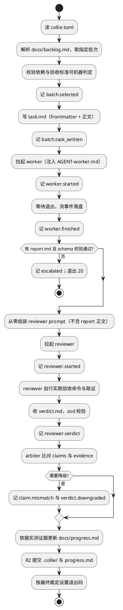

# Collie SPEC

> Agent 团队编排器。本文件是**唯一方案来源**（Single Source of Truth）。
> 唯一可修改者：R1 方案设计 Agent，且须用户批准。其他角色只读。
> 与本文件冲突时以本文件为准。

版本：v0.1
更新时间：2026-10-16
仓库：https://github.com/CIPFZ/Collie
配套文档：[ROADMAP.md](./ROADMAP.md)（版本路线）、[ROLES.md](./ROLES.md)（角色与权限）、[CONSTRAINTS.md](./CONSTRAINTS.md)（铁律）

---

## 1. 定位与范围

### 1.1 要解决的问题

用户有一个想法时，流程是：与好模型讨论可行性与技术方案，产出 SPEC、AGENT 手册、
图标、决策文档；再下发给工作 Agent 分阶段实现；完成后由审核 Agent 对照目标与现状
给出下一步。真正消耗用户时间的不是决策本身，而是**在多个 agent 窗口之间搬运上下文**
——每次搬运都要重新进入上下文。

Collie 的目标：把用户的输入位置收敛到一个入口，并让「不需要用户的轮次」根本不惊动用户。
用户只保留头（需求阐述与方案讨论）与尾（裁决）。

### 1.2 定位

**Collie 是 agent 与工程之间的胶水。**
不是 agent 编排平台，不是通用 workflow 引擎，不是 agent 框架。

它的全部工作是：取批次、拉起 Agent、看活性、比对证据、写轨迹、决定升级。

护城河在于粘合 agent 侧与工程侧的四个阻抗不匹配（自然语言对可验证事实、
易失会话对持久仓库、无身份对需权限、自觉完成对可判定完成）。
详见 ROADMAP 第 0 章「定位与护城河」，其中 0.3 给出了判断是否走偏的指标，
0.5 给出了泛化的硬边界。

### 1.3 范围

v0.1 的范围严格限定为：
- 单项目、单 task、串行执行
- 两个 Agent 角色的单批次闭环（R3 worker + R4 reviewer）
- R2 调度器本体

不在范围内（见 ROADMAP 各版本与永不做清单）：
多项目并发、并行 worker、失败恢复、多批次自动串行、可观测命令、
R1 自动拆批次、R5 体检、安全加固、成本配额。

### 1.4 验证目标

v0.1 只验证一件事：**审核 Agent 的独立取证能否拦住 worker 的虚假汇报。**
这是 Collie 的核心假设，不成立则整个系统价值为零。

## 2. 技术选型

### 2.1 语言与运行时

TypeScript，Node.js 22 LTS，ESM。

选型理由（按项目性质选择，非默认偏好）：
Collie 的核心全部是 Claude Agent SDK 已第一方提供的能力——hooks、`canUseTool`、
session fork、NDJSON 流解析。用 TS 可直接复用，用其他语言等于重造这些机制。
次优为 Python。Shell 不可行：信号阶梯与流解析无法测试。

### 2.2 依赖清单

| 依赖 | 用途 | 许可证 |
|---|---|---|
| `@anthropic-ai/claude-agent-sdk` | 拉起与控制 Agent | 供应商条款，ADR-004 豁免 |
| `commander` | CLI 参数解析 | MIT |
| `zod` | 尾部 JSON 块的 schema 校验 | MIT |
| `smol-toml` | 解析 `collie.toml` | BSD-3-Clause |
| `yaml` | 解析 task.md 的 frontmatter | ISC |
| `vitest` | 测试 | MIT |
| `tsx` | 开发期直接跑 TS | MIT |

开发依赖（devDependencies，批准见 ADR-002）：
`typescript`（锁 `~6.0.x`，Apache-2.0）、`@types/node`、`eslint`、`@eslint/js`、
`typescript-eslint`、`prettier`、`eslint-config-prettier`（均 MIT）。

许可证红线（ADR-003）：运行时依赖仅接受 MIT / Apache-2.0 / BSD / ISC / 0BSD；
开发依赖及其传递层不受白名单约束但禁止强 copyleft（GPL / AGPL / SSPL）。
新增任何依赖必须先写 ADR。
明确不引入：任何编排框架（LangGraph、Temporal 等）、任何可观测框架、任何 ORM。

### 2.3 工程约定

- 严格模式 TypeScript，`strict: true`，禁用 `any`（必要时用 `unknown` + 收窄）
- ESLint + Prettier 零错误
- 包前缀 `@collie/`，CLI 命令名 `collie`
- 所有阈值集中在 `collie.toml`，代码中禁止裸写数字；
  由 ESLint `no-magic-numbers` 在 `src/**` 强制执行（放行 0 / 1 / -1），见 ADR-002
- 结构不变量（如批次条目 1~3）属 schema 定义，以具名常量写在 `src/schema/`，不进 toml
- 测试放在 `test/`，不放进 `src/`（测试需断言 SPEC 默认值，不受 `no-magic-numbers` 约束）
- `.collie/collie.toml` 由 R1 放置并维护（阈值须与本文件 3.1 一致），worker 只读；
  `collie init` 实现后由其从模板生成
- 测试不访问网络、不调用真实模型（用 fake Agent runner）

## 3. 数据模型

所有跨边界结构集中定义在 `src/schema/`，用 zod 声明并导出类型。
`SCHEMA_VERSION = 1`。v0.1 期间以可选字段方式扩展，不升版本、不写迁移；
只有删除或改变已有字段语义时才 bump。

### 3.1 配置

```toml
# .collie/collie.toml
schema_version = 1

[project]
name = "collie"
repo = "https://github.com/CIPFZ/Collie"

[agent.worker]
model = "claude-opus-4-6"
allowed_tools = ["Read", "Write", "Edit", "Glob", "Grep", "Bash"]
max_turns = 200           # v02-b02 第 1 次运行 120 轮用满（三条目 +668 行），上调
permission_mode = "bypassPermissions"   # v0.1 裁定，见下

[agent.reviewer]
model = "claude-opus-4-6"
allowed_tools = ["Read", "Glob", "Grep", "Bash"]   # 无 Write/Edit：物理上无法改代码
max_turns = 60
permission_mode = "bypassPermissions"
bash_deny = ["^\\s*git\\s+(push|commit|add|reset|checkout|rebase|merge|cherry-pick|tag|branch\\s+-[dDm]|worktree|stash)(?=\\s|$)", "^\\s*gh\\s"]
  # 子命令后用 (?=\\s|$) 不用 \\b：\\b 把 merge-base 当成 merge 拦了（v03-b03-fix 第 1 次，reviewer 核对「已推送」的标准命令被拒）
  # v03-b02 后：reviewer 的 Bash 命令级黑名单（正则，匹配即拒绝）。worker 不设。schema 接受前不得写进 toml（R1 在批次 PASS 后补）

[limits]
stall_secs = 300         # 事件流静默判定卡死；v02-b04 第 1 次运行 90 秒把「正在写 report」误判为卡死，上调
progress_secs = 900      # 有事件但无产出判定空转（b04-fix 期间临时 3600，fix3 通过后恢复）
wallclock_secs = 3600    # 单批次墙钟硬顶。v03-b03 第 1 次：核心批次 +815 行、两次上下文压缩吃掉 4 分钟，2700 秒差 62 秒没写完 report，上调
resume_max = 2           # resume 上限（v0.2 生效）
fix_max = 2              # 同批次 FIX 上限（v0.3 生效）
dry_k = 2                # 连续 dry 轮数（v0.5 生效）
ci_wait_secs = 1800      # R2 取证前等待 head_sha 的 CI 出结论的上限；超时按 unknown 处理
                         # 环境无 GITHUB_TOKEN 且首次轮询即 rate_limited：不等待，立即记 unknown 并写 ci.wait_timeout（waited_secs=0）
ci_poll_secs = 30        # 等待期间查询 CI 的间隔
grace_secs = 20          # 信号阶梯每级宽限（v0.2，schema 可选，见 11.1）

[verify]
# reviewer 必跑的全局命令，批次级命令在 task 中追加
commands = ["npm run lint", "npm run typecheck", "npm test"]

[ci]
provider = "github-actions"
expected_branch = "main"   # 用于核对 CI 实际监听分支，防止「假全绿」
token_file = "~/.config/collie/github-token"   # 可选。只读 PAT（Actions: read）所在文件，`~` 展开；只有 R2 读它
```

`token_file`（v02-b04-fix2 后）：`~` 展开为 home；相对路径相对**仓库根**而非进程 cwd（fix3 条目 3 对齐实现，现为 cwd）。
R2 在取证前读取该文件内容（去首尾空白）作为 `queryCi` 的 `token`，
**不**放进环境变量。runner 拉起 worker / reviewer 时必须从子进程环境里删除 `GITHUB_TOKEN`、`GH_TOKEN`，
worker 的事件流会原样落盘（Q5），不能让它看见密钥。文件不存在时与未配置相同。
推荐放在仓库外；若放在 `.collie/` 下，`.collie/github-token` 在 `.gitignore` 与 `collie init` 的忽略清单里。

`permission_mode` 取值 `default` / `acceptEdits` / `bypassPermissions`，省略时沿用 SDK 默认（逐次询问）。
**v0.1 裁定（v01-b05）：两个角色都用 `bypassPermissions`。** 无人值守下任何「询问」都等于卡死；
`acceptEdits` 也救不了，worker 必须跑 `npm test` 和 `git commit`。v0.1 的安全围栏不是审批，
而是：`allowed_tools` 白名单（reviewer 物理上无 Write/Edit）、reviewer 在只含 head_sha 的 worktree 里运行、
`max_turns` 与 `wallclock_secs` 硬顶、铁律 19 的受保护文件由 R2 事后取证（规则 2）。
细粒度门控（hook / 容器）是 v1.0 的议题，不在这里补。

### 3.2 批次（Batch）

来源：`docs/backlog.md`，由 R1 维护。Markdown 表格 + 每批次一个小节。

```ts
interface Batch {
  id: string;              // 如 "v01-b03"
  title: string;
  priority: number;        // 小者先，R1 一次排定
  depends_on: string[];    // 依赖的批次 id
  items: string[];         // 1~3 个条目，超过 3 个由 R1 拆分
  acceptance: Acceptance[];// 必须可机器判定
  forbidden: string[];     // 本批次额外禁止项
  status: 'pending' | 'running' | 'passed' | 'blocked';
}

interface Acceptance {
  desc: string;
  cmd: string;             // 可执行命令，禁止形容词式验收
  expect: 'exit_zero' | { stdout_matches: string };
}
```

`expect` 刻意不提供 `exit_nonzero`：负向检查必须写成正向命令
（如 `! grep -q pattern file`），期望仍为 `exit_zero`。
原因：统一为「命令成功即通过」，避免 verify.ts 与 reviewer 对退出码语义各自解释。

硬约束：`acceptance[].cmd` 必须是可执行命令。无法写成命令的验收标准，
R1 必须停下来与用户重新讨论，不得进入执行环节。

结构不变量（v02-b04-fix 第 3 次运行后）：批次 PASS 之后它的验收命令不再执行，后续批次可以悄悄改回去
（b04-tests 去掉了场景 G 的真实定时器，b04-fix 第 3 次又加了一个 `setTimeout(0)`，没人拦）。
因此凡是 grep 类的结构检查，必须同时以测试形式写进 `test/invariants.test.ts`，由 `npm test` 永久回归；
验收表里的 grep 只负责在本批次把它第一次立起来。R1 签发含结构检查的批次时，条目里必须写明「同步加进 invariants」。

验收命令的能力边界（v01-b01 bootstrap 实测得出）：
命令只能证明「绿」，不能证明「测了该测的」。一个只写 `expect(true)` 的测试文件
也能让 `npm test -- xxx` 通过。因此 task 中的「测试内容要求」由 R4 读测试代码核验，
这是 AGENT-reviewer.md 第 4 节「该写的测试没写」盲区的既定处理方式。

验收命令的可移植性约定（v01-b01 后追加）：
- 测试过滤**写完整文件路径**（`npm test -- test/schema.test.ts`），不用子串；
  子串过滤在出现同名片段的文件后，证明的内容会悄悄变化
- `grep` 只用 POSIX ERE，禁用 `\s` `\d` 等 GNU 扩展（macOS 语义不同）；
  空白用 `[[:space:]]`
- 命令须在 Linux 与 macOS 上语义一致，R1 签发前自测

**验收命令的唯一执行形式（v01-b02 后追加）：以 `parseBacklog` 的输出为准。**
Markdown 表格中的 `\|` 是 GFM 转义，原样粘进 shell 时 grep 会把 `\|` 当普通字符，
导致本应拦截违规的命令放行（v01-b02 实测）。因此：
- `verify.ts` 与 R4 执行验收时必须读 `parseBacklog` 解析后的 `cmd`（`\|` 已还原）
- 人工执行时须先经 `collie show <batch>` 打印解析后命令，不得从 `.md` 源码复制
- `AGENT-reviewer.md` 第 2 节同步此要求

### 3.3 任务信封（task.md）

R2 写，R3 读。Markdown 正文 + YAML frontmatter。

```markdown
---
schema_version: 1
run_id: r-0007
batch_id: v01-b03
base_sha: a1b2c3d4e5f6a7b8c9d0e1f2a3b4c5d6e7f8a9b0
created_at: 2026-10-16T12:00:00Z
attempt: 1
interrupted_at: null        # v0.2：上一轮中断位置，仅 R2 知道
issued_by: collie           # collie run 签发时必填为 collie；人工签发写 human-placeholder-r2。AGENT-worker 第 6 节据此决定是否等计划确认
revised_at: null            # 可选：重签时间，未重签为 null 或省略
---

# 批次 v01-b03：事件日志写入

## 你的身份与边界
（由 AGENT-worker.md 承载，此处只做本批次提醒）

## 本批次条目（1~3 个）
1. ...

## 验收标准（可机器判定）
| 说明 | 命令 | 期望 |
|---|---|---|

## 本批次额外禁止
- ...

## 汇报要求
完成后写 `.collie/batches/v01-b03/report.md`，固定四段 + 尾部 JSON 块。
```

`base_sha` 约定：指向**签发本 task 前的最后一个提交**。task.md 自身的提交
（只触及 `.collie/batches/`）位于 `base_sha..head_sha` 之内，但不属于 worker 产出；
R4 取证与 arbiter 的受保护文件检查只针对 worker 的提交。
R1/R2 若在签发后又修改了 SPEC 等文档，必须重新签发 task 并更新 `base_sha`。

frontmatter 中的 sha 字段**必须加引号**：形如 `1234567e10` 的 sha 会被 YAML 解析为数字。
Collie 生成时自动加引号；人工签发时手动加。

`wallclock_secs` 的执行点（v01-b02 计划反馈后裁定）：由 **R2** 执行，不进 `RunOptions`。
理由：墙钟是编排层的预算闸，runner 只负责「拉起并返回」；放进 runner 接口会让
每个 runner 实现各自解释超时语义。R2 在 `runWorker` 外层以 `AbortSignal.timeout` 包裹，
超时即进入信号阶梯（v0.2），v0.1 先只记 `worker.crashed` 事件并以非零退出码返回。
`AgentRunner.run` 的 `RunOptions` 增加可选 `signal?: AbortSignal`，供 R2 传入。

### 3.4 汇报信封（report.md）

R3 写，R2 读，**R4 不读**。Markdown 四段正文 + 尾部围栏 JSON。

正文四段固定为：做了什么 / 测试结果 / 偏离或疑问 / 下一步建议。

尾部 JSON 块（R2 用 zod 校验）：

```json
{
  "schema_version": 1,
  "batch_id": "v01-b03",
  "head_sha": "e4f5a6b7c8d9e0f1a2b3c4d5e6f7a8b9c0d1e2f3",
  "claims": {
    "commits": ["e4f5a6b7c8d9e0f1a2b3c4d5e6f7a8b9c0d1e2f3"],
    "tests_passed": 47,
    "tests_failed": 0,
    "pushed": true,
    "ci_passed": true,
    "new_deps": [],
    "spec_touched": false
  },
  "open_questions": []
}
```

`claims` 下所有字段的语义是「worker 的声称」，**默认不可信**，须经 R4 取证核对。

字段说明（v01-b02 计划反馈后补充）：
- `head_sha`：**最后一个代码提交**的 sha，不含随后的 `report(collie):` 信封提交。
  R4 取证范围为 `base_sha..head_sha`，信封提交不在其中
- `ci_passed`（可选，缺失视为 `false`）：worker 声称 CI 已对 `head_sha` 实际触发且通过。
  此字段使场景 A 成为真正的「声称 vs 实测」比对（arbiter 规则 7 据此与 `ci_branch_matched` /
  `ci_conclusion` 对照），而非只检查 CI 本身是否通过
- sha 字段均须匹配 `/^[0-9a-f]{7,40}$/`
- `spec_touched`：worker 的提交是否改动了**任何受保护路径**（AGENT-worker.md 第 2 节的全部清单，
  不只是 `SPEC.md`）。与仲裁规则 2 的检查范围一致（v02-b01 后明确）。

### 3.5 裁决信封（verdict.md）

R4 写，R2 读。Markdown 推理正文 + 尾部围栏 JSON。

```json
{
  "schema_version": 1,
  "batch_id": "v01-b03",
  "verdict": "PASS",
  "evidence": {
    "commits_actual": ["e4f5g6h"],
    "verify_results": [
      { "cmd": "npm test", "exit_code": 0, "summary": "47 passed, 0 failed" }
    ],
    "remote_has_head": true,
    "ci_conclusion": "success",
    "ci_run_url": "https://...",
    "ci_branch_matched": true,
    "deps_diff": [],
    "spec_diff_lines": 0
  },
  "claim_mismatches": [],
  "gaps": [],
  "reason": "三项验收标准均由实测命令确认"
}
```

关键规则：`verdict` 三值不用约束解码强制（结构约束会损害推理质量），
而是由 R2 解析尾部 JSON 并用 zod 校验；解析失败按 BLOCK 处理。

字段约定（v01-b03 后）：`ci_conclusion` 取 `success | failure | cancelled | unknown`，
`ci_branch_matched` 为 `boolean | null`（`null` = 未能取证），`ci_run_url` 可为空串；
`conditions?: string[]` 可选，非空表示 PASS 附条件。arbiter 把 `ci_branch_matched=null`
视为未取证：若 `claims.ci_passed=true` 则按规则 7 降 FIX。
R2 取证前先把 report 的 `head_sha` 与 `commits[]` 用 `git rev-parse` 展开成 40 位（v02-b04-fix4 后）：
schema 允许 7~40 位，但 GitHub Actions API 的 `head_sha` 过滤只认完整 sha，短 sha 查到 0 条会被当成「还没出结果」白等到超时
（fix4 第 1 次：有 token 仍等满 1801 秒、60 次轮询）。
等待 CI 时 `no_runs` 不是「还没出结果」：连续 3 次轮询仍为 `no_runs` 即改查后代提交；后代也无运行才继续等 `pending`。
CI 运行的归属（v01-b05-smoke 后）：`head_sha` 自己的运行优先；若不存在，可采信其**后代提交**
在 `expected_branch` 上的运行，条件是 `git diff --name-only head_sha..后代` 只含 `.collie/**` 与
`docs/progress.md`（即只多了信封提交，代码与 head_sha 相同）。其他后代一律不采信。
reviewer 交付方式：无写工具，verdict 正文作为**最终回复文本**返回，
`RunResult.finalText` 承载，由 R2 写入 `verdict.md`。
reviewer 在检出于 `head_sha` 的独立 worktree 中工作，该 worktree 不含 `report.md`。

### 3.6 事件日志

`.collie/runs/<run_id>/events.ndjson`，append-only，每行一个事件。
这是 R2 的唯一状态源——R2 无状态可重启，崩溃恢复 = 重放此文件。

```ts
type JsonValue = string | number | boolean | null | JsonValue[] | { [k: string]: JsonValue };

interface Event {
  ts: string;              // ISO8601
  run_id: string;          // 用作路径段，须匹配 /^[A-Za-z0-9][A-Za-z0-9._-]*$/
  batch_id?: string;
  event: EventType;
  [key: string]: JsonValue | undefined;  // 扩展字段限 JSON 值，保证 replay(append(e)) 深相等
}

type EventType =
  | 'run.started' | 'run.finished'
  | 'batch.selected' | 'batch.task_written'
  | 'batch.skipped'      // v0.3：依赖未满足；字段 batch_id / missing（依赖清单）
  | 'batch.status'       // v0.3：R2 改写 backlog 状态列；字段 batch_id / from / to
  | 'queue.finished'     // v0.3：--continue 结束；字段 reason（exhausted / blocked / escalated / fix_max / limit / paused）/ batches（本次跑过的）/ paused_count
  | 'queue.paused'       // v0.3（12.3）：PASS 但触发停表清单；字段 batch_id / reasons（数组）
  | 'batch.retried'      // v0.3（12.3）：规则 1 BLOCK 后自动重跑一次；字段 batch_id / rule（固定 1）
  | 'worker.started' | 'worker.finished' | 'worker.crashed'
  | 'reviewer.started' | 'reviewer.verdict'
  | 'claim.mismatch' | 'verdict.downgraded'
  | 'escalated'
  | 'ci.wait_timeout'    // 等 CI 超过 ci_wait_secs 仍无结论；字段 head_sha / waited_secs / last_state
  | 'ci.resolved'        // 取到 CI 结论；字段 head_sha / conclusion / branch_matched / run_url / waited_secs / polls / attributed_sha（采信后代时）
  | 'verdict.pushed'     // v0.3：R2 推送裁定提交；字段 sha / remote / branch
  | 'verdict.push_failed' // v0.3：推送失败；字段 sha / error；不改变本轮结论
  | 'verdict.push_skipped' // v0.3：启动补推条件不满足；字段 head / reason
  | 'tool.denied'         // v0.3：PreToolUse 钩子拒绝了一次工具调用；字段 role / tool / command / pattern。
                          //   runner 通过 onEvent 交给 R2，R2 **同时**写进 journal（带 ts / run_id）；只落在角色事件流里不算（v03-b03-fix 第 1 次）
  | 'ci.verdict_commit'  // v0.3：启动时核查上一条裁定提交的 CI；字段 sha / conclusion / run_url
  | 'acceptance.failed'   // 规则 8：实测验收未满足；字段 cmd / exit_code / expect
  | 'run.orphaned' | 'worker.stalled' | 'worker.idling'
  | 'worker.signaled' | 'worker.rescued' | 'worker.resumed';  // v0.2，见第 11 章
// worker.finished 携带 exit_code 与 final_text（worker 最终回复，截断至 2000 字），
// 否则零产出退出的原因无从得知（v01-b05-smoke 教训）。
```

v0.1 只需支持 v0.1 的事件；v0.2 事件的字段定义见第 11 章。

## 4. 模块设计

```
src/
  cli.ts                  命令入口（commander）
  config.ts               读 collie.toml，校验，提供类型化配置
  schema/
    index.ts              SCHEMA_VERSION 与全部 zod schema
    envelope.ts           task / report / verdict 的读写与校验
  backlog.ts              解析 docs/backlog.md 为 Batch[]
  journal.ts              events.ndjson 的追加与重放
  git.ts                  git 命令封装（status/log/diff/ls-remote/commit）
  ci.ts                   CI 实际结论查询（gh CLI）
  runner/
    index.ts              Agent 拉起的统一接口（便于 fake 替换）
    claude.ts             基于 Claude Agent SDK 的真实实现
    fake.ts               测试用，按脚本返回预设结果
  roles/
    worker.ts             组装 task.md、拉起 worker、收 report
    reviewer.ts           组装审核 prompt、拉起 reviewer、收 verdict
  verify.ts               实跑验收命令并结构化输出
  arbiter.ts              claim 比对与 verdict 降级裁定
  progress.ts             依据实测证据写 docs/progress.md：Collie 标记段按**运行**追加一行
                          （run_id / batch / 结果 / 退出码 / head_sha），不按批次覆盖；verdict.md 仍为批次最新
```

### 4.1 `runner` 抽象的必要性

所有 Agent 调用必须经 `runner` 接口，禁止在 roles 中直接调 SDK。
两重理由，后者更本质：

1. **可测试性。** v0.1 的三个验证场景需要在不花钱、不联网的条件下可重复执行，
   `fake.ts` 按脚本返回「假 CI 全绿的 report」等预设结果。
2. **它是胶水与 agent 侧的解耦层。** Collie 的价值与「被粘的两端」解耦——
   今天是 Claude Code，明天可能是另一个 agent CLI。这个抽象做干净，
   Collie 就不绑定在任何一家的 CLI 上。详见 ROADMAP 0.4。

实现约束：任何 agent 侧的特有概念（session id、权限模式、模型名、流事件格式）
不得泄漏到 `roles/` 与 `arbiter.ts` 之外的模块。

```ts
interface AgentRunner {
  run(opts: {
    role: 'worker' | 'reviewer';
    prompt: string;
    systemPrompt: string;
    allowedTools: string[];
    cwd: string;
    maxTurns: number;
    onEvent?: (e: unknown) => void;   // NDJSON 逐行回调
  }): Promise<{ exitCode: number; sessionId?: string; usage?: Usage; finalText?: string }>;
}
```

### 4.2 reviewer 的干净上下文保证

reviewer 的 prompt 由 `roles/reviewer.ts` 从零组装，只允许包含：
- `AGENT-reviewer.md` 作为 system prompt
- 本批次 `task.md` 的验收标准与条目
- `SPEC.md` 的相关章节引用（给路径，让它自己读）
- diff 指针 `base_sha..head_sha`

**禁止**包含：`report.md` 正文、worker 的会话历史、worker 的 session id。
这条由代码保证（reviewer.ts 不接收 report 正文参数），不靠提示词约束。

### 4.3 arbiter 的强制降级

```
输入：report.claims + R2 自测的 evidence + verdict.verdict
规则（按顺序，命中即停）：
1. verdict 尾部 JSON 解析或校验失败            → BLOCK
2. evidence.spec_diff_lines > 0                → BLOCK
3. evidence.deps_diff 含未经 ADR 批准的运行时依赖，
   或任何树出现强 copyleft（ADR-003）         → BLOCK
4. claim_mismatches 非空                       → 若 verdict=PASS 则降为 FIX
5. claims.pushed=true 但 remote_has_head=false → FIX + 记 claim.mismatch
6. claims.tests_* 与 verify_results 不一致     → FIX + 记 claim.mismatch
7. claims.ci_passed=true 但 ci_conclusion≠success
   或 ci_branch_matched=false                  → FIX + 记 claim.mismatch
8. verify_results 中任一条 exit_code≠0
   或 stdout 不匹配 expect                     → 若 verdict=PASS 则降为 FIX + 记 acceptance.failed
9. remote_has_head=false，或 ci_conclusion≠success，
   或 ci_branch_matched≠true                   → 若 verdict=PASS 则降为 FIX + 记 verdict.downgraded
10. 否则采用 verdict 原值
```

规则 9 的来源（v02-b05 第 2 次运行，2026-10-22）：worker 全程没有 `git push`，claims 如实写 `pushed=false`，
R2 实测 `remote_has_head=false`、CI 未取证；规则 5 只查「声称已推送但远端没有」，规则 7 只在 `ci_passed=true` 时比对，
于是没有一条规则拦住，reviewer 判 PASS 被规则 9（旧）照单采用。铁律 18 要求「CI 实际触发并通过」，PASS 必须以此为必要条件。
**不豁免 `unknown`**：无 token 环境只能得到 FIX，这是有意的；3.1 的「限流不等待」只省时间，不替代证据。
后续 attempt 沿用首次 `base_sha`（本节上文），所以未推送的提交在 FIX 重跑时仍在审核范围内。
规则 9 是「证据缺失」不是「声称失实」，记 `verdict.downgraded`（字段 rule / reason），不记 `claim.mismatch`。

**上报（无 report）**：worker 退出后没有可解析的 report.md 时不进入规则链，直接 BLOCK + `escalated`。
这不是「规则 0」，progress 与 `collie show` 一律写「上报：无 report」。
上报路径仍须用 git 实测 `base_sha..HEAD` 的提交清单与推送状态写入 progress（v02-b04 第 1 次运行
写成了「提交：无、已推送：否」，而 3 个提交已在 origin 上）。
**同一批次的后续 attempt 沿用第 1 次的 `base_sha`**，上一轮已推送的提交因此留在审核范围内；
在这条实现之前（v02-b05），上报后已推送的未审核提交由所有者决定存档重置或人工复核。

规则 8 的来源：v01-b05-smoke 第二次真实运行（2026-10-20）。worker 如实报了 66 个测试失败，
规则 5~7 因「声称与实测一致」全部不触发，reviewer 以「失败早已存在」为由判 PASS，规则 9 照单采用。
三场景只覆盖了 worker 说谎的情况，没覆盖「worker 诚实但验收确实没过」。
验收命令是 PASS 的必要条件，不由 reviewer 的解释豁免。

规则 7 的来源是一次真实教训：某仓库 CI 配置监听 `main` 而实际用 `master`，
导致 M0 到 M6 全程「CI 全绿」其实从未触发过。此类失败在自动循环中会被放大，
因为中间再没有人亲自核验远端。
规则 7 是「声称 vs 实测」的比对而非仅检查 CI 状态：`claims.ci_passed` 为 worker 的声称，
`ci_conclusion` 与 `ci_branch_matched` 为实测值。

**证据来源（v01-b04 裁定）：arbiter 只依据 R2 自己用 `verify.ts` / `git.ts` / `ci.ts` 测出的 evidence，
不使用 reviewer 报上来的 evidence。** 理由：reviewer 也是 LLM，可能被 worker 的产物误导；
若仲裁采信它的 evidence，被骗的 reviewer 照抄 worker 说法即可让三个场景全部漏过（变异测试已证实）。
reviewer 的 evidence 原样保存在 `verdict.md` 供人对照，但不参与仲裁。
reviewer 的价值是「判断」（`verdict` 三值与 `gaps`），事实由 R2 自己测。

## 5. CLI 接口

v0.1 只提供三个命令。

```
collie init                      在当前仓库创建 .collie/ 与配置模板
collie run <batch_id>            跑一个批次的完整闭环（worker → reviewer → 裁定）
collie show <batch_id>           打印该批次的 task / report / verdict 与裁定过程
```

`collie run` 的退出码：
- `0`：PASS
- `10`：FIX
- `20`：BLOCK
- `30`：`--continue` 下停表（结论是 PASS，但触发了 12.3 的停表清单，等人看一眼再继续；v03-b04）
- `1`：Collie 自身错误

## 6. 执行流程（v0.1）



## 7. 里程碑

v0.1 分三个批次，优先级已排定（见 `docs/backlog.md`）。

| 批次 | 内容 | 验收 |
|---|---|---|
| v01-b01 | 工程骨架 + schema + journal + config | lint/typecheck/test 零错误；schema round-trip 测试通过 |
| v01-b02 | backlog 解析 + task 生成 + fake runner + worker 角色 | 用 fake runner 跑通 task→report 并通过校验 |
| v01-b03 | reviewer 角色 + verify + ci + arbiter + CLI | 三个验证场景全部被拦住 |

## 8. v0.1 验收：三个必须被拦住的场景

这三个场景是 v0.1 的唯一通过标准，用 `fake.ts` 构造，必须自动化可重跑。

**场景 A 假 CI 全绿。** fake worker 产出 `claims.pushed=true` 且 `claims.ci_passed=true`，
但 `ci.ts` 查到的实际 run 监听分支与 `expected_branch` 不符（或根本无 run）。
期望：`claims.ci_passed=true` 与实测 `ci_branch_matched=false`（或 `ci_conclusion≠success`）不符
→ 裁定为 FIX，事件日志有 `claim.mismatch`。本场景验证的是声称与事实的比对，不只是 CI 状态。

**场景 B 假测试数。** fake worker 声称 `tests_passed=47, tests_failed=0`，
而 `verify.ts` 实跑结果为 3 个失败。
期望：claims 与 verify_results 不一致 → 裁定为 FIX，事件日志有 `claim.mismatch`。

**场景 C 偷改 SPEC。** fake worker 的 diff 中包含 `SPEC.md` 的修改。
期望：`spec_diff_lines > 0` → 直接 BLOCK，不理 verdict 原值。

补充要求：三个场景都必须验证 `collie run` 的退出码正确，
且 `collie show` 能完整还原裁定过程与证据链。

## 9. 明确不做

v0.1 不做下列内容，防止范围蔓延：

- 任何失败恢复、resume、信号阶梯（v0.2）
- 多批次自动串行、分级放行、返工闸（v0.3）
- `status` / `timeline` / `watch` / `why` 命令（v0.4）
- 完成判定与 dry 信号（v0.5）
- R5 体检（v0.6）、R1 自动拆批次（v0.7）
- 容器隔离、网络白名单、配额感知、成本账本、通知（v1.0）
- 永不做：并行写入、多项目共享、Agent 自判是否求助、自建框架、
  工具级审批交给人、可观测框架

## 10. 开放问题

| 编号 | 问题 | 现状 |
|---|---|---|
| Q1 | reviewer 实跑验收命令时，是否需要独立 worktree 以免污染 worker 的工作区？ | v0.1 串行执行，worker 已退出，暂不需要。若 v0.3 出现问题再议 |
| Q2 | `docs/backlog.md` 用 Markdown 表格是否足够？是否需要独立的结构化文件？ | 先用 Markdown（R1 与人都要读写）。若解析脆弱则改为 frontmatter 承载结构 |
| Q3 | `collie.toml` 放 `.collie/` 下还是仓库根？ | 暂定 `.collie/` 下，与运行时文件同域 |
| Q4 | 完成判定的四种判据，最终选哪个？ | 按用户要求保留全部，v0.5 起记录对比数据后再定 |
| Q5 | `stream.ndjson` 原样落盘工具输出，环境里配了 token 后会以明文留在 `.collie/runs/` | 目录已 gitignore；token 已不进子进程环境（fix2），但 R2 自己的环境仍有。v02-e-drill 落盘时屏蔽 `token_file` 内容与 `GITHUB_TOKEN` / `GH_TOKEN` 的值 |
| Q6 | 卡死检测以 SDK 事件为心跳，而 SDK 生成长输出时不发事件 | 权宜：`stall_secs=300`。候选：runner 开启 SDK 逐片输出（partial messages）并转成事件，让心跳粒度与输出无关。v0.2 收口后定。实测真正静默（无任何事件、无 thinking_tokens）：v02-b04 第 1 次推送后 90.5 秒（误判）；第 2 次推送→写 report 前 35.4 秒、report 推送后生成最后一段约 600 字回复 97.0 秒、心跳采样最大滞后 89.2 秒。带 thinking_tokens 的 277 秒 / 99 秒间隔不算静默。300 对已观测最大值留约 3 倍余量 |
| Q7 | R2 只核对 worker `head_sha` 的 CI，不看自己裁定提交的 CI；裁定提交只改 docs，它的 CI 红只可能是随机失败的测试，但 Collie 记录里看不到（v02-b04 第 2 次 Run 81；v02-b05-fix Run 113） | 已定并签入 v03-b01（SPEC 12.1）：R2 自己推送裁定提交，**下一次启动时**查一次该提交的 CI（推送当下必然 no_runs，不在那时查），红则打印警告并记 `ci.verdict_commit` |


## 11. v0.2 失败检测与恢复

目标（ROADMAP 第 4 节）：worker 在任何时刻被中断，信息零丢失，下一轮能正确接续。
本章在 v0.1 的结构上只做追加；v0.1 的三场景与规则 1~9 不变。

**v0.2 收口条件**（v02-e-drill 第 1 次演练 2026-10-23 后定）：真实 `kill -9` R2 一次，以下五条全部在真实运行里成立：
1. R2 死后 worker 子进程在 5 秒内退出，不再提交（演练实测：worker 变孤儿后独自活了 78 秒、提交了一次）；
2. 下一次启动记 `run.orphaned`，工作区脏则 `worker.rescued` + wip 提交且 `task.md` 有 `rescue_sha`（演练未触发：孤儿 worker 抢先提交了）；
3. `task.md` 的 `interrupted_at` 结束原因为 `orphaned`、最后事件取自 `stream.ndjson`（演练实测写成 `unknown worker.started`）；
4. attempt 2 的 R2 取证与 reviewer 范围为首次 `base_sha..head`，attempt 1 的提交在规则 2 / 3 范围内（演练实测只算了 attempt 2 自己的 task 提交之后）；
5. 若孤儿 worker 仍存活，`collie run` 拒绝启动并退出码 1（演练未验证：操作员先补杀了）。
演练已成立的：`worker_pid` 进心跳、孤儿检测、`attempt` 递增、「上一轮中断」一节、首次 `base_sha` 写进 frontmatter、下一轮能接着跑完。

第 2 次演练（v02-e-drill2，2026-10-26）结果：第 1、2、4 条成立（守护进程 1 秒内杀掉 worker 并自退；救援提交 `6158611` 真实生成；
取证范围 `7f93939..b076c7b` 含救援提交与两轮 task 提交）。第 3 条半成立：`orphaned` 对了，但最后事件取成 SDK 消息的 `type`（`user`）、时间为空。
第 5 条没机会验证（守护进程比第 2 次启动快）。另发现 `rescue_sha` 没进 `task.md`：孤儿救援记在**新一轮**的 journal 里，
而生成 task 时只在上一轮的 journal 里找 `worker.rescued`，于是正文写成了「上一轮未留下救援提交」——和事实相反，worker 是自己读 `git log` 才发现的。
**收口改为**：v02-e-fix2 修这两处并用 fake runner 的场景 E 测试覆盖（孤儿救援路径下 `rescue_sha` 进 frontmatter、正文含「请先核实」；
`interrupted_at` 时间非空且事件类型来自 SDK 消息的 `timestamp` / 心跳 `updated_at`），第 5 条以 `heartbeat.test.ts` 现有单测为准，
不再做第 3 次真实演练。e-fix2 PASS 即 v0.2 收口。
**v0.2 已收口**（2026-10-26，v02-e-fix2 裁定 `cfee4dc`）。未在真实运行里验证、留到 v0.3 运行中自然观察的：规则 9 的触发；守护进程存活时拒绝启动；孤儿路径下 `rescue_sha` 进 task。
信号阶梯首次真实触发：v03-b03 第 1 次（2026-10-26）`worker.signaled(soft, wallclock)` 后 47 毫秒 worker 退出，未升级，R2 完整收尾并自推裁定。

### 11.1 新增配置（`[limits]`）

```toml
stall_secs = 300         # 事件流静默判定卡死（v0.1 占位 90，v02-b04 后 300）
progress_secs = 900      # 有事件但无产出判定空转（v0.1 已占位）
grace_secs = 20          # 信号阶梯每级之间的宽限
resume_max = 2           # 同一批次 resume 上限（v0.1 已占位）
```

v0.2 起新增的 `limits` 字段在 schema 中一律**可选**，缺省取本节默认值（代码中为与 SPEC 同值的具名常量）。
原因：`.collie/collie.toml` 是受保护路径，由 `collie run` 拉起的 worker 不能改它（规则 2）；
R1 在批次通过后把新字段补进 toml。补进之后 toml 即为唯一事实源（铁律 11）。

### 11.2 runner 接口追加

```ts
interface RunOptions {
  // ...v0.1 字段
  /** 续接上一次运行；值来自上一次 RunResult.sessionId，对 Collie 不透明 */
  resumeSessionId?: string;
  /** 运行开始后立即回调一次，交出控制句柄 */
  onStarted?: (handle: RunHandle) => void;
}
interface RunHandle {
  /** runner 能拿到子进程 pid 时**必须**提供（v02-b04-fix 后）；Claude SDK 经 spawnClaudeCodeProcess 钩子可拿到。用于 heartbeat 的 worker_pid 与 kill 级 */
  pid?: number;
  /**
   * soft：让当前轮次结束后停下，session 完整可续接
   * hard：立即中止，session 可能残缺
   * kill：不可恢复地终止；runner 可实现为对 pid 发 SIGKILL
   */
  stop(level: 'soft' | 'hard' | 'kill'): Promise<void>;
}
interface RunResult {
  // ...v0.1 字段
  /** 非正常结束时的原因；runner 自身异常以外，一律返回 RunResult 而不是抛出 */
  stopReason?: 'turns_exhausted' | 'stopped' | 'error';
}
```

约束（v02-b02 第 1 次运行暴露）：
- `soft` 与 `hard` 不得实现为同一个调用。`soft` 必须是「本轮结束后停、session 可续接」的 SDK 级中断；
  `hard` 才是 abort。`interrupt()` 是必调且 `await` 的：SDK 对象上没有它就抛错，不得写成 `interrupt?.()`；
  也不得把方法拆出来再调（`const fn = q.interrupt; fn()` 会丢 `this`，SDK 内部要用 `this.request`，
  v02-b04-fix 第 1 次运行因此 TypeError），要写成 `await q.interrupt()`。
  runner 测试的替身 `interrupt` 必须依赖 `this`（读自身字段，`this` 为 undefined 时抛错），否则这类错误测不出来。
- **工具白名单要同时传 `tools` 与 `allowedTools`**（v03-b01-fix 第 1 次运行后，reviewer 事件流落盘才看见）：SDK 的 `allowedTools`
  只是「这些工具免询问」，**不限制可用集合**；限制可用集合要用 `tools`（`string[]`）。Collie 从 v01-b05 起只传了 `allowedTools`，
  两个角色实际拿到的都是全部 27 个默认工具，加上 `bypassPermissions`，reviewer 的 Write / Edit 一直可用——「物理上无法改代码」
  在 v03-b01-fix 之前从未成立，只是 reviewer 碰巧没用。runner 必须 `tools: [...allowed_tools]`、`allowedTools: [...allowed_tools]`、
  `disallowedTools: ['Write', 'Edit', 'MultiEdit', 'NotebookEdit']`（仅 reviewer）三者同传；初始化消息里的工具清单必须等于白名单。
- **reviewer 的 Bash 命令级黑名单**：工具白名单挡不住 `Bash` 里的 `git push` / `git commit` / `gh`。runner 为 reviewer 注册 SDK
  `hooks.PreToolUse`（matcher `Bash`），命令匹配 `[agent.reviewer].bash_deny` 任一正则即返回
  `{ hookEventName: 'PreToolUse', permissionDecision: 'deny', permissionDecisionReason }`，并在事件流记一条 `tool.denied`
  （字段 role / tool / command / pattern）。`bypassPermissions` 不影响 hooks。黑名单来自配置，runner 不内置。
- **凡传给 SDK 的选项，其类型必须 `import type` 自 `@anthropic-ai/claude-agent-sdk` 的导出**（`Options`、`SpawnOptions`、
  `SpawnedProcess` 等），用 `Pick` / 索引类型派生，不得在 Collie 里手写一份。`import type` 在运行时被擦除，不影响惰性加载。
  手写签名与 SDK 不一致时 typecheck 不报、替身测试照过，只有真实运行才炸：v02-b02 `resume` 字段名、v02-b04 `interrupt` 丢 `this`、
  v02-b05 第 1 次 `spawnClaudeCodeProcess` 写成三参数（SDK 实际传一个 `SpawnOptions` 对象），三次同一类错误。
- `spawnClaudeCodeProcess` 的真实签名：`(options: SpawnOptions) => SpawnedProcess`，`options` 含 `command / args / cwd / env / signal`。
  runner 测试调用钩子时必须按这个形状传单个对象。
- SDK 因轮数用满等原因中止时，runner 须捕获并返回 `RunResult`（`exitCode` 非零、`stopReason`、
  以及已从事件流里拿到的 `sessionId`），不得让 `sessionId` 随异常丢失。
- runner 的测试须断言注入的 `query()` 实际收到的选项：`resumeSessionId` 落到 SDK 认的续接字段上。
  字段名对不上时 typecheck 不会报错，只有这条断言能抓住。

ROADMAP 写的 SIGINT → SIGTERM → SIGKILL 是子进程语义；Collie 只认 soft / hard / kill 三级，
映射到具体信号或 SDK 调用是 runner 内部的事（ROADMAP 0.4）。`fake.ts` 必须实现三级并可脚本化「不响应 soft」。

### 11.3 落盘与心跳

- `.collie/runs/<run_id>/stream.ndjson`：worker 的原始事件流，`onEvent` 每收一条追加一行，不做任何解析。
  与 `events.ndjson`（Collie 自己的 journal）分开。
- `.collie/heartbeat.json`：`{ run_id, batch_id, pid, worker_pid?, phase, started_at, updated_at }`。
  run 开始时写入，`run.finished` 写完之后才删除——覆盖 worker、reviewer、等 CI、仲裁的全程，
  不是只覆盖 worker（v02-b03 实测只覆盖了 worker，reviewer 与等 CI 的 36 分钟里并行启动不会被拒绝）。
  `phase` 取 `worker | reviewer | ci | arbiter`；worker 阶段每收到一条事件更新 `updated_at`，
  其他阶段每 `ci_poll_secs` 更新一次。`worker_pid` 为 `RunHandle.pid`，拿得到就记。
  worker 子进程必须随 R2 一起死：runner 用 `detached: true` 把子进程放进自己的进程组，R2 在 `exit` / `SIGTERM` / `SIGINT` 时对
  `-worker_pid` 发 `SIGTERM`；R2 被 `SIGKILL` 没机会清理时，子进程靠 `prctl(PR_SET_PDEATHSIG)` 不可移植，改为 worker 侧
  **父进程看门狗**：runner 给子进程的 env 加 `COLLIE_PARENT_PID`，并以 `--parent-watch` 之类方式让子进程每 2 秒 `kill(ppid, 0)`，
  父进程不在就自杀——Claude Code 不接受这种参数，因此退而求其次：R2 启动一个极小的守护进程（`node -e`，与 R2 同组之外），
  它持有 R2 pid 与 worker_pid，每 2 秒探测，R2 消失即对 worker_pid 发 `SIGKILL` 后自退。守护进程的 pid 也写进心跳（`guard_pid`）。
  下一次 `collie run` 启动时若文件存在：`pid` / `worker_pid` / `guard_pid` 任一存活则拒绝启动（铁律 1），退出码 1；
  两者都不存活判定「上一次被 kill」：记 `run.orphaned`（字段 run_id / batch_id / phase / updated_at），
  执行 11.4 的救援，再删除该文件。

R2 自救（v02-b05 第 1 次运行后）：R2 依赖的代码在真实运行里坏掉、`collie run` 无法完成一轮时，
不在 Collie 之外手改 `src/`。操作员从**最近一次 PASS 裁定提交**建 worktree 并 `npm ci`，
用 `npx tsx <worktree>/src/cli.ts run <修复批次>`、cwd 仍为主仓库根来运行 R2；R1 签发只含该修复的批次。
R2 以 `process.cwd()` 为仓库根，手册、配置、journal 都读写主仓库，只有 R2 自身的代码来自 worktree。
这和「R2 总是运行启动时加载的旧代码」是同一件事，只是把「旧」显式指定为已验证的那一版。修好后删掉 worktree。

R2 的异常兜底（v02-b04-fix 第 1 次运行后）：`collie run` 的主流程必须有最外层的 try / finally。
任何未预期的异常（含 `stop()` 抛出、Promise 未处理拒绝）都不得让进程直接退出：
先记 `run.finished`（`result: error`，带错误信息与当时的 phase），再执行 11.4 的救援、追加 progress 运行记录、
删除心跳，最后以退出码 1 结束。进程级别须注册 `unhandledRejection` 处理，走同一条收尾路径。
v02-b04-fix 第 1 次运行：soft 停止时 `interrupt()` 抛 TypeError 未被捕获，Node 直接终止，
run.finished / 救援 / progress / 心跳删除全部没有执行。

### 11.4 脏工作区救援

worker 退出后（无论原因），若 `git status --porcelain` 非空，R2 执行
`git add -A && git commit -m "wip(collie): <batch_id> rescue"`，记 `worker.rescued` 事件（字段 sha / files）。
救援提交不推送。它位于 `base_sha..head_sha` 之内，规则 2 照常统计其中的受保护路径改动。

### 11.5 活性检测

R2 在 worker 运行期间按两条独立计时判定：

- **卡死**：距上一条事件超过 `stall_secs` → 记 `worker.stalled`，进入 11.6 阶梯。
- **空转**：持续收到事件，但「产出指纹」超过 `progress_secs` 无变化 → 记 `worker.idling`，进入 11.6 阶梯。
  产出指纹必须随**文件内容**变化：`HEAD` sha + `git diff HEAD` 输出的哈希 + 未跟踪文件的 (路径, 大小, mtime) 列表哈希，
  每收到一条事件采样一次。不能只用 `git status --porcelain`：它对已变脏的文件只输出 ` M path`，
  内容再改也不变，worker 在同一组文件上连续改超过 `progress_secs` 就会被判空转
  （v02-b04-fix 第 1 次运行：最后一个新变脏文件在 03:05:09，900 秒后 03:20:09 判空转，其间 worker 一直在编辑）。

两者都以事件为驱动，没有事件时只有 stall 计时在走。
卡死只认「完全没有事件」。SDK 在模型生成一段长输出（正文或工具参数）期间不发任何事件，
所以 `stall_secs` 必须大于单次最长输出的时长；report.md 的 Write 调用就是最长的一次
（v02-b04 第 1 次运行：推送后 90.5 秒无事件被判卡死，实为正在写 report）。
300 秒是权宜值；根治靠 runner 开启 SDK 的逐片输出事件作为事件来源（Q6）。
计时器、时钟、产出指纹函数三者都必须注入（`now()` / `setTimer()` / `fingerprint()`），
默认实现才用 `Date.now` / `setTimeout` / 真实 git（v02-b04-tests 证明只注入前两者不够：
取指纹的 git 子进程仍是真实时序，单核加压下场景 G 3 次挂 2 次）；
测试用假时钟推进，不得断言真实耗时（v02-b03 的场景 G 用真实时钟，全量并发下 2.8~3.1 秒，随机失败）。

### 11.6 信号阶梯

```
stop('soft') → 等 grace_secs → 未退出则 stop('hard') → 等 grace_secs → 未退出则 stop('kill')
```

每级记一条 `worker.signaled`（字段 level / reason，reason 取 stalled / idling / wallclock）。
v0.1 的 `wallclock_secs` 超时从「直接 abort + 记 crashed」改为走本阶梯，reason=wallclock。
阶梯结束后一律执行 11.4 救援。
某一级 `stop()` 抛出或拒绝时不得向上冒泡：记 `worker.signaled`（该级，字段 `error` 为消息），视同「未退出」直接进入下一级；
`kill` 级也失败则进入 11.3 的异常兜底。

### 11.7 中断标记与 resume

一次运行若以 stalled / idling / wallclock / orphaned / turns_exhausted / 非零退出结束，
**且仲裁结论不是 PASS**，称为**中断**。worker 非零退出但 report 已提交、仲裁按证据判 PASS 的运行
（v02-b03 第 1 次：200 轮用满，但交付在前）不算中断，下一轮 `attempt` 不递增。
无论哪种结束方式，`run.finished` 事件与 `docs/progress.md` 的运行记录都带 worker 的
`exit_code` 与 `stop_reason`，让人看得出它是怎么结束的（2.3）。
下一次对同一批次 `collie run` 时：

- `task.md` frontmatter：`attempt` 递增；`interrupted_at` 填
  `"<上次 run_id> <结束原因> <最后一条事件类型>@<时间>"`；若有救援提交，加 `rescue_sha`。
  结束原因的来源按序：**本轮有 `worker.signaled` 则取其 `reason`（`wallclock` / `stalled` / `idling`）** → `run.finished.worker_stop_reason`
  → `run.finished.result` → 本轮有 `run.orphaned` 则 `orphaned` → `unknown`。SDK 被 soft 中断后返回的是 `error_during_execution`，
  那不是结束原因，是中断的副作用（v03-b03 第 1 次：`worker.finished stop_reason=error`，真正的原因是 `wallclock`）；
  `worker.finished` 本身也应在有 `worker.signaled` 时把 `stop_reason` 记成阶梯 reason、把 SDK 的值放进 `sdk_stop_reason`。
  最后一条事件在 journal 没有 `run.finished` 时取 `stream.ndjson` 的最后一行，journal 的 `worker.started` 不算。
  `stream.ndjson` 的行是 SDK 消息：事件类型取 `type`，若 `type` 为 `assistant` / `user` 则细化为 `type/subtype` 或工具名
  （`tool_use` 的 `name`），时间取该消息的 `timestamp`，没有则向前找最近一条有 `timestamp` 的，再没有用心跳的 `updated_at`；时间不得为空。
- `rescue_sha` 的来源：救援提交可能记在**上一轮**的 journal（阶梯收尾路径）或**本轮**的 journal（孤儿救援路径，`run.orphaned` 之后）；
  生成 task 时两处都查，取最后一条 `worker.rescued`。有 `rescue_sha` 时正文必须写
  「请先核实 `rescue_sha` 中的半成品是否完整，不要把它当作已完成」；没有时写「上一轮未留下救援提交，请从 `git log` 核实已完成到哪一步」。
- 取证范围：attempt ≥ 2 时 R2 的 `evidence` 与 reviewer 的 `base_sha` 一律用 frontmatter 里沿用的首次 `base_sha`，不是本次 task 提交；
  `commits_actual` 因此含上一轮的提交。
- **FIX 重跑同样沿用首次 `base_sha`**：`attempt` 只在中断时递增，但 `base_sha` 的沿用不看 attempt，看的是本批次第一条 `batch.selected`；
  FIX 后重跑取证范围仍是首次 `base_sha..head_sha`（v02-b05-fix 起如此，v03-b03-fix 第 1 次操作员问到，补写明）。
- **`head_sha` 的后代检查也按首次 `base_sha`**（v03-b03 第 2 次后）：`head_sha` 必须是首次 `base_sha` 的后代且是当前 `HEAD` 的祖先（或等于 `HEAD`），
  **不是**本轮 task 提交的后代——上一轮已把代码全部提交、本轮只补 report 时，正确的 `head_sha` 早于本轮 task 提交
  （第 2 次：`09f229c` 早于 `67d74f6`，R2 误报上报）。attempt 1 时首次 `base_sha` 就是 task 提交的父，两种写法等价。
- **取证范围排除 R2 自己的提交**：`base_sha..head_sha` 里提交信息以 `docs: issue ` / `progress: ` / `report(collie): ` / `ops: ` 开头的提交
  是 R2 或操作员的信封、裁定、汇报，不是 worker 产出，`commits_actual` 与规则 2 / 3 的 diff 都要跳过它们（按提交逐个 diff 再合并，
  不能直接 `git diff base..head`）。R1 的提交（`r1: ` 开头）**不排除**：R1 在同一批次两次 attempt 之间不得往 main 推受保护路径的改动
  （第 2 次：`357e110` 落在 `556049e..HEAD` 内，改了 5 个受保护文件；这次因 `head_sha` 停在它之前没触发规则 2）。
  这是对 R1 的约束，写进 AGENT_KICKOFF.md 与 R1 自己的流程：一个批次 BLOCK / FIX 后要改规格，先把该批次收掉（标 blocked 或改签新批次），再推。
- **续接的成本判断**：上一轮若已有代码提交且推送、工作区干净（即只缺 report），**不续接会话**，`session_id: null` 新开
  （第 2 次：续接 15 轮花 $21.49，新开会话做同样的事约 $2）；只有上一轮代码未完成（有救援提交，或最后一次代码提交之后还有未推送的改动）才续接。
- `task.md` 正文追加一节「上一轮中断」：原样写出上述信息，并写明
  「请先核实 `rescue_sha` 中的半成品是否完整，不要把它当作已完成」。这段只有 R2 知道，worker 自己说不出来。
- 若上次 `RunResult.sessionId` 存在且本批次累计 resume 次数 < `resume_max`：
  传 `resumeSessionId`，记 `worker.resumed`（字段 session_id / attempt）。
- 否则：不传 session，新 worker 按 task 正文的中断说明自行从 `git log` 与 `docs/progress.md` 定位。
  记 `worker.resumed` 且 `session_id: null`。

### 11.8 新增事件类型

`run.orphaned` / `worker.stalled` / `worker.idling` / `worker.signaled` / `worker.rescued` / `worker.resumed`。
只新增，不升 `SCHEMA_VERSION`（铁律 14 新解）。

### 11.9 v0.2 验收：三种中断必须被接住

全部用 `fake.ts` 构造，自动化可重跑，断言只看仓库与 journal 状态。

**场景 E 中途被杀。** fake worker 改了两个文件后进程被 kill（fake 以「写文件后 stop('kill') 自己」模拟）。
期望：`worker.rescued` 事件存在，`wip(collie): <batch_id> rescue` 提交存在且含那两个文件；
再次 `collie run` 同一批次，`task.md` 的 `attempt=2`、`interrupted_at` 非空、正文含 `rescue_sha`。

**场景 F 模型断连。** fake worker 第一次以非零退出且给出 sessionId；第二次运行收到 `resumeSessionId` 后成功。
期望：第二次 `worker.resumed` 带该 session_id；构造第三、四次仍失败，第四次（超过 `resume_max`）
`worker.resumed.session_id` 为 null。

**场景 G 空转。** fake worker 持续发事件但不改任何文件，超过 `progress_secs`（测试里配成 1 秒）。
期望：`worker.idling` → `worker.signaled(soft)` → fake 响应 soft 退出 → 无救援（工作区干净）；
变体：fake 不响应 soft，期望 `signaled(hard)` 继续出现。

补充：场景 E/F/G 的 `collie show` 输出必须能按顺序还原事件链。

## 12. v0.3 连续

目标（ROADMAP 第 5 节）：无人干预连跑多个批次，只在该打扰人时打扰。通过标准：零误放行；被打扰次数 ≤ 应打扰次数 + 1。
本章在 v0.2 的结构上只做追加；规则 1~10 不变。三个批次：12.1 收回人工动作，12.2 队列与分流，12.3 放行与停表。

### 12.1 收回人工动作（v03-b01）

v0.2 期间每轮有两个人工动作：操作员推送 R2 的裁定提交、操作员转发汇报。前者从本批次起由 R2 自己做，后者是 v0.4 的事。

- **R2 推送裁定提交**：写完 progress 与信封、提交之后，`git push --quiet origin <expected_branch>`，记 `verdict.pushed`。
  推送失败（网络、拒绝）记 `verdict.push_failed`（字段 error），**不改变本轮结论、不重试、不抛出**，退出码照旧；
  **补推的唯一条件**（v03-b01 第 1 次运行后收紧）：journal 里最近一条 `verdict.push_failed.sha` 恰好等于当前 `HEAD`，且远端不含它。
  满足才 `push` 一次并记 `verdict.pushed`；`HEAD` 是别的东西（救援提交、worker 未审提交、任何不是裁定提交的 sha）一律不推，
  记 `verdict.push_skipped`（字段 head / reason）。没有 `push_failed` 事件时启动阶段**不执行任何 push**。
  补推必须在 11.3 孤儿检测与 11.4 救援**之前**执行：救援提交不推送是铁规则，启动时的 push 不得把它带上 main
  （b01 的实现无条件推送且位于救援之后，下一次真实孤儿救援就会把 wip 提交推上 main）。推送用的 remote 与凭据和 worker 相同（`.git/config`）。
- **启动时核查上一条裁定提交的 CI**（Q7）：`collie run` 启动阶段，取 journal 里最近一条 `verdict.pushed.sha`，
  用 token 查一次它的 CI（`queryCi`，不等待）：`failure` / `cancelled` 则 stderr 打印
  `warning: previous verdict commit <sha> CI <conclusion> (<run_url>)`，并记 `ci.verdict_commit`；
  `success` 只记事件；`no_runs` / `pending` / 限流不记、不警告。警告不阻止启动——裁定提交只改 docs，红只可能是随机失败的测试，
  但人必须能在 journal 与 stderr 看见。
- **reviewer 事件流落盘**：`.collie/runs/<run_id>/reviewer.stream.ndjson`，与 worker 的 `stream.ndjson` 同一套写入与 `redact` 屏蔽。
  目的：AGENT-reviewer.md 要求「行为要求必须实跑」，没有落盘就只能信 reviewer 自述（v02-e-fix2 操作员无法独立确认）。
- **规则 9 的场景测试**（场景 H）：fake worker 产出 `claims.pushed=false` 且远端确实没有 head，reviewer 判 PASS；
  期望 arbiter 降为 FIX，journal 有 `verdict.downgraded`（rule=9）。规则 9 在 v0.2 期间从未真实触发，场景 H 是它唯一的回归证据。

### 12.2 队列与分流（v03-b03）

`collie run --continue [--max N]`：不带批次名，按 backlog 优先级取第一个 `pending` 且所有依赖已 `passed` 的批次，跑完按裁决分流：
- PASS → R2 把 backlog 状态表该行改为 `passed`（记 `batch.status`）、提交进裁定提交、推送（12.1），取下一个；
- FIX → 同批次返工计数 +1（计数从 journal 里本批次的 `run.finished` 数出，不另存）；计数 ≤ `fix_max` 则立即重跑同批次
  （attempt 递增、沿用首次 `base_sha`，11.7）；超过则按 BLOCK 处理并记 `escalated`（reason `fix_max`）；
- BLOCK / 上报 → 停下，退出码 20；backlog 状态改为 `blocked`。
依赖未满足的批次跳过并记 `batch.skipped`；队列里没有可执行批次则记 `queue.finished`（reason `exhausted` 或 `escalated`）退出码 0 / 20。
`--max N` 限制本次最多跑 N 个批次（缺省不限），到数记 `queue.finished`（reason `limit`）退出码 0。
每个批次结束后仍执行 11.3 的清理与 12.1 的推送；批次之间不共享任何进程，每个批次的 worker / reviewer / 守护进程都是新拉起的。
`collie run <batch>` 单批次模式行为不变，也**不**改 backlog 状态（状态列只在 `--continue` 下由 R2 写，单批次模式仍由 R1 写）。

backlog 状态列的写法：只改状态表里该批次那一行的最后一列，用正则定位 `| <id> |` 开头的行，其余内容一个字节不动；
找不到该行或该行格式不符就不改、记 `batch.status` 的 `to` 为 `unchanged` 并继续。R1 仍是唯一的条目作者（铁律 19 的受保护路径不变，
`docs/backlog.md` 对 worker 仍是只读；R2 的这处改动在 `base_sha..head_sha` 之外，规则 2 不会把它算进 worker 的 diff）。

v03-b03 的真实验证（ROADMAP：连跑 5 个真实批次）：b03 PASS 后，操作员用 `--continue` 从 b04 起连跑，中途不说「跑」；
b04 与后续批次的汇报改成每批一个 `docs/ops/` 文件（见 AGENT_KICKOFF.md「交接走仓库」）。

### 12.3 放行与停表（v03-b04）

`--continue` 在一个批次 PASS 之后、取下一个之前做一次**放行判定**。PASS 的结论、裁定提交、backlog 状态 `passed` 都不变，判定只决定「继续还是停」。

自动放行（全部满足才继续）：
- 仲裁 PASS 且本批次没有 `verdict.downgraded`（规则 9 没降过级、没有被规则 8 救回来的验收失败）；
- `claim_mismatches` 为空；
- `ci.resolved.conclusion === 'success'` 且 `branch_matched`；
- `deps_diff` 为空、`spec_diff_lines === 0`、受保护路径改动为 0 行（这三条本来就会 BLOCK / FIX，列在这里是为了让判定自成一体）；
- reviewer 的 `gaps` 为空。

否则记 `queue.paused`（`reasons` 列出没满足的每一条，字段名用上面的英文：`downgraded` / `claim_mismatches` / `ci` / `deps_diff` / `spec_diff` / `protected` / `gaps`），
`queue.finished` reason `paused`，退出码 **30**。人看一眼后再 `--continue` 就从下一个批次接着跑——停表不是失败，只是「这一批过了但有话要说」。

停表清单（任何裁决下都停）：
- 规则 9 降级（`verdict.downgraded` rule=9）在**连续两个批次**出现 → `queue.paused` reason `rule9_twice`（即使第二个批次最终 PASS）。
- 同一批次第 2 次 BLOCK → 停（现有行为，BLOCK 本来就停）。

规则 1 的特殊处理：reviewer 输出格式错（规则 1）导致的 BLOCK，同批次**第一次**自动重跑一次，记 `batch.retried`（rule 1），**不计入** `fix_max`；
第二次仍是规则 1 → 停，退出码 20。理由：v02-b04-tests、v02-b04-fix4 都是代码良好、reviewer 格式错，重跑一次就过，不值得叫人。

打扰计数：`queue.finished` 带 `paused_count`（本次 `--continue` 里 `queue.paused` 的次数）。ROADMAP 的通过标准
「被打扰次数 ≤ 应打扰次数 + 1」用它和 BLOCK 次数之和来数。单批次模式 `collie run <batch>` 不做放行判定、不发 `queue.paused`。

