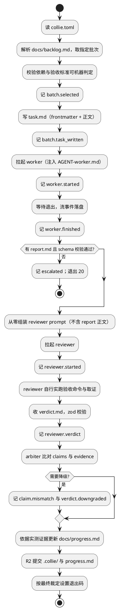

# Collie SPEC

> Agent 团队编排器。本文件是**唯一方案来源**（Single Source of Truth）。
> 唯一可修改者：R1 方案设计 Agent，且须用户批准。其他角色只读。
> 与本文件冲突时以本文件为准。

版本：v0.1
更新时间：2026-10-16
仓库：https://github.com/CIPFZ/Collie
配套文档：[ROADMAP.md](./ROADMAP.md)（版本路线）、[ROLES.md](./ROLES.md)（角色与权限）、[CONSTRAINTS.md](./CONSTRAINTS.md)（铁律）

---

## 1. 定位与范围

### 1.1 要解决的问题

用户有一个想法时，流程是：与好模型讨论可行性与技术方案，产出 SPEC、AGENT 手册、
图标、决策文档；再下发给工作 Agent 分阶段实现；完成后由审核 Agent 对照目标与现状
给出下一步。真正消耗用户时间的不是决策本身，而是**在多个 agent 窗口之间搬运上下文**
——每次搬运都要重新进入上下文。

Collie 的目标：把用户的输入位置收敛到一个入口，并让「不需要用户的轮次」根本不惊动用户。
用户只保留头（需求阐述与方案讨论）与尾（裁决）。

### 1.2 定位

**Collie 是 agent 与工程之间的胶水。**
不是 agent 编排平台，不是通用 workflow 引擎，不是 agent 框架。

它的全部工作是：取批次、拉起 Agent、看活性、比对证据、写轨迹、决定升级。

护城河在于粘合 agent 侧与工程侧的四个阻抗不匹配（自然语言对可验证事实、
易失会话对持久仓库、无身份对需权限、自觉完成对可判定完成）。
详见 ROADMAP 第 0 章「定位与护城河」，其中 0.3 给出了判断是否走偏的指标，
0.5 给出了泛化的硬边界。

### 1.3 范围

v0.1 的范围严格限定为：
- 单项目、单 task、串行执行
- 两个 Agent 角色的单批次闭环（R3 worker + R4 reviewer）
- R2 调度器本体

不在范围内（见 ROADMAP 各版本与永不做清单）：
多项目并发、并行 worker、失败恢复、多批次自动串行、可观测命令、
R1 自动拆批次、R5 体检、安全加固、成本配额。

### 1.4 验证目标

v0.1 只验证一件事：**审核 Agent 的独立取证能否拦住 worker 的虚假汇报。**
这是 Collie 的核心假设，不成立则整个系统价值为零。

## 2. 技术选型

### 2.1 语言与运行时

TypeScript，Node.js 22 LTS，ESM。

选型理由（按项目性质选择，非默认偏好）：
Collie 的核心全部是 Claude Agent SDK 已第一方提供的能力——hooks、`canUseTool`、
session fork、NDJSON 流解析。用 TS 可直接复用，用其他语言等于重造这些机制。
次优为 Python。Shell 不可行：信号阶梯与流解析无法测试。

### 2.2 依赖清单

| 依赖 | 用途 | 许可证 |
|---|---|---|
| `@anthropic-ai/claude-agent-sdk` | 拉起与控制 Agent | 供应商条款，ADR-004 豁免 |
| `commander` | CLI 参数解析 | MIT |
| `zod` | 尾部 JSON 块的 schema 校验 | MIT |
| `smol-toml` | 解析 `collie.toml` | BSD-3-Clause |
| `yaml` | 解析 task.md 的 frontmatter | ISC |
| `vitest` | 测试 | MIT |
| `tsx` | 开发期直接跑 TS | MIT |

开发依赖（devDependencies，批准见 ADR-002）：
`typescript`（锁 `~6.0.x`，Apache-2.0）、`@types/node`、`eslint`、`@eslint/js`、
`typescript-eslint`、`prettier`、`eslint-config-prettier`（均 MIT）。

许可证红线（ADR-003）：运行时依赖仅接受 MIT / Apache-2.0 / BSD / ISC / 0BSD；
开发依赖及其传递层不受白名单约束但禁止强 copyleft（GPL / AGPL / SSPL）。
新增任何依赖必须先写 ADR。
明确不引入：任何编排框架（LangGraph、Temporal 等）、任何可观测框架、任何 ORM。

### 2.3 工程约定

- 严格模式 TypeScript，`strict: true`，禁用 `any`（必要时用 `unknown` + 收窄）
- ESLint + Prettier 零错误
- 包前缀 `@collie/`，CLI 命令名 `collie`
- 所有阈值集中在 `collie.toml`，代码中禁止裸写数字；
  由 ESLint `no-magic-numbers` 在 `src/**` 强制执行（放行 0 / 1 / -1），见 ADR-002
- 结构不变量（如批次条目 1~3）属 schema 定义，以具名常量写在 `src/schema/`，不进 toml
- 测试放在 `test/`，不放进 `src/`（测试需断言 SPEC 默认值，不受 `no-magic-numbers` 约束）
- `.collie/collie.toml` 由 R1 放置并维护（阈值须与本文件 3.1 一致），worker 只读；
  `collie init` 实现后由其从模板生成
- 测试不访问网络、不调用真实模型（用 fake Agent runner）

## 3. 数据模型

所有跨边界结构集中定义在 `src/schema/`，用 zod 声明并导出类型。
`SCHEMA_VERSION = 1`。v0.1 期间以可选字段方式扩展，不升版本、不写迁移；
只有删除或改变已有字段语义时才 bump。

### 3.1 配置

```toml
# .collie/collie.toml
schema_version = 1

[project]
name = "collie"
repo = "https://github.com/CIPFZ/Collie"

[agent.worker]
model = "claude-opus-4-6"
allowed_tools = ["Read", "Write", "Edit", "Glob", "Grep", "Bash"]
max_turns = 200           # v02-b02 第 1 次运行 120 轮用满（三条目 +668 行），上调
permission_mode = "bypassPermissions"   # v0.1 裁定，见下

[agent.reviewer]
model = "claude-opus-4-6"
allowed_tools = ["Read", "Glob", "Grep", "Bash"]   # 无 Write/Edit：物理上无法改代码
max_turns = 60
permission_mode = "bypassPermissions"
bash_deny = ["^\\s*git\\s+(push|commit|add|reset|checkout|rebase|merge|cherry-pick|tag|branch\\s+-[dDm]|worktree|stash)(?=\\s|$)", "^\\s*gh\\s"]
  # 子命令后用 (?=\\s|$) 不用 \\b：\\b 把 merge-base 当成 merge 拦了（v03-b03-fix 第 1 次，reviewer 核对「已推送」的标准命令被拒）
  # v03-b02 后：reviewer 的 Bash 命令级黑名单（正则，匹配即拒绝）。worker 不设。schema 接受前不得写进 toml（R1 在批次 PASS 后补）

[limits]
stall_secs = 300         # 事件流静默判定卡死；v02-b04 第 1 次运行 90 秒把「正在写 report」误判为卡死，上调
progress_secs = 1500     # 有事件但无产出判定空转（b04-fix 期间临时 3600，fix3 通过后恢复 900；v04-b04 第 1 次：开局的读与想占满 900 秒被掐，上调，见 13.12）
wallclock_secs = 3600    # 单批次墙钟硬顶。v03-b03 第 1 次：核心批次 +815 行、两次上下文压缩吃掉 4 分钟，2700 秒差 62 秒没写完 report，上调
resume_max = 2           # resume 上限（v0.2 生效）
fix_max = 2              # 同批次 FIX 上限（v0.3 生效）
dry_k = 2                # 连续 dry 轮数（v0.5 生效）
ci_wait_secs = 1800      # R2 取证前等待 head_sha 的 CI 出结论的上限；超时按 unknown 处理
                         # 环境无 GITHUB_TOKEN 且首次轮询即 rate_limited：不等待，立即记 unknown 并写 ci.wait_timeout（waited_secs=0）
ci_poll_secs = 30        # 等待期间查询 CI 的间隔
grace_secs = 20          # 信号阶梯每级宽限（v0.2，schema 可选，见 11.1）

[verify]
# reviewer 必跑的全局命令，批次级命令在 task 中追加
commands = ["npm run lint", "npm run typecheck", "npm test"]

[ci]
provider = "github-actions"
expected_branch = "main"   # 用于核对 CI 实际监听分支，防止「假全绿」
token_file = "~/.config/collie/github-token"   # 可选。只读 PAT（Actions: read）所在文件，`~` 展开；只有 R2 读它
```

`token_file`（v02-b04-fix2 后）：`~` 展开为 home；相对路径相对**仓库根**而非进程 cwd（fix3 条目 3 对齐实现，现为 cwd）。
R2 在取证前读取该文件内容（去首尾空白）作为 `queryCi` 的 `token`，
**不**放进环境变量。runner 拉起 worker / reviewer 时必须从子进程环境里删除 `GITHUB_TOKEN`、`GH_TOKEN`，
worker 的事件流会原样落盘（Q5），不能让它看见密钥。
配了 `token_file` 但文件不存在、读不了或内容为空时，`collie run` 与 `collie smoke` 启动即报错（13.9，v04-b06）；
v04-b06 之前的实现把它当作未配置，悄悄退回匿名查询。
推荐放在仓库外；若放在 `.collie/` 下，`.collie/github-token` 在 `.gitignore` 与 `collie init` 的忽略清单里。

`permission_mode` 取值 `default` / `acceptEdits` / `bypassPermissions`，省略时沿用 SDK 默认（逐次询问）。
**v0.1 裁定（v01-b05）：两个角色都用 `bypassPermissions`。** 无人值守下任何「询问」都等于卡死；
`acceptEdits` 也救不了，worker 必须跑 `npm test` 和 `git commit`。v0.1 的安全围栏不是审批，
而是：`allowed_tools` 白名单（reviewer 物理上无 Write/Edit）、reviewer 在只含 head_sha 的 worktree 里运行、
`max_turns` 与 `wallclock_secs` 硬顶、铁律 19 的受保护文件由 R2 事后取证（规则 2）。
细粒度门控（hook / 容器）是 v1.0 的议题，不在这里补。

### 3.2 批次（Batch）

来源：`docs/backlog.md`，由 R1 维护。Markdown 表格 + 每批次一个小节。

```ts
interface Batch {
  id: string;              // 如 "v01-b03"
  title: string;
  priority: number;        // 小者先，R1 一次排定
  depends_on: string[];    // 依赖的批次 id
  items: string[];         // 1~3 个条目，超过 3 个由 R1 拆分
  acceptance: Acceptance[];// 必须可机器判定
  forbidden: string[];     // 本批次额外禁止项
  status: 'pending' | 'running' | 'passed' | 'blocked';
}

interface Acceptance {
  desc: string;
  cmd: string;             // 可执行命令，禁止形容词式验收
  expect: 'exit_zero' | { stdout_matches: string };
}
```

`expect` 刻意不提供 `exit_nonzero`：负向检查必须写成正向命令
（如 `! grep -q pattern file`），期望仍为 `exit_zero`。
原因：统一为「命令成功即通过」，避免 verify.ts 与 reviewer 对退出码语义各自解释。

硬约束：`acceptance[].cmd` 必须是可执行命令。无法写成命令的验收标准，
R1 必须停下来与用户重新讨论，不得进入执行环节。

结构不变量（v02-b04-fix 第 3 次运行后）：批次 PASS 之后它的验收命令不再执行，后续批次可以悄悄改回去
（b04-tests 去掉了场景 G 的真实定时器，b04-fix 第 3 次又加了一个 `setTimeout(0)`，没人拦）。
因此凡是 grep 类的结构检查，必须同时以测试形式写进 `test/invariants.test.ts`，由 `npm test` 永久回归；
验收表里的 grep 只负责在本批次把它第一次立起来。R1 签发含结构检查的批次时，条目里必须写明「同步加进 invariants」。

验收命令的能力边界（v01-b01 bootstrap 实测得出）：
命令只能证明「绿」，不能证明「测了该测的」。一个只写 `expect(true)` 的测试文件
也能让 `npm test -- xxx` 通过。因此 task 中的「测试内容要求」由 R4 读测试代码核验，
这是 AGENT-reviewer.md 第 4 节「该写的测试没写」盲区的既定处理方式。

验收命令的可移植性约定（v01-b01 后追加）：
- 测试过滤**写完整文件路径**（`npm test -- test/schema.test.ts`），不用子串；
  子串过滤在出现同名片段的文件后，证明的内容会悄悄变化
- `grep` 只用 POSIX ERE，禁用 `\s` `\d` 等 GNU 扩展（macOS 语义不同）；
  空白用 `[[:space:]]`
- 命令须在 Linux 与 macOS 上语义一致，R1 签发前自测

**验收命令的唯一执行形式（v01-b02 后追加）：以 `parseBacklog` 的输出为准。**
Markdown 表格中的 `\|` 是 GFM 转义，原样粘进 shell 时 grep 会把 `\|` 当普通字符，
导致本应拦截违规的命令放行（v01-b02 实测）。因此：
- `verify.ts` 与 R4 执行验收时必须读 `parseBacklog` 解析后的 `cmd`（`\|` 已还原）
- 人工执行时须先经 `collie show <batch>` 打印解析后命令，不得从 `.md` 源码复制
- `AGENT-reviewer.md` 第 2 节同步此要求

### 3.3 任务信封（task.md）

R2 写，R3 读。Markdown 正文 + YAML frontmatter。

```markdown
---
schema_version: 1
run_id: r-0007
batch_id: v01-b03
base_sha: a1b2c3d4e5f6a7b8c9d0e1f2a3b4c5d6e7f8a9b0
created_at: 2026-10-16T12:00:00Z
attempt: 1
interrupted_at: null        # v0.2：上一轮中断位置，仅 R2 知道
issued_by: collie           # collie run 签发时必填为 collie；人工签发写 human-placeholder-r2。AGENT-worker 第 6 节据此决定是否等计划确认
revised_at: null            # 可选：重签时间，未重签为 null 或省略
---

# 批次 v01-b03：事件日志写入

## 你的身份与边界
（由 AGENT-worker.md 承载，此处只做本批次提醒）

## 本批次条目（1~3 个）
1. ...

## 验收标准（可机器判定）
| 说明 | 命令 | 期望 |
|---|---|---|

## 本批次额外禁止
- ...

## 汇报要求
完成后写 `.collie/batches/v01-b03/report.md`，固定四段 + 尾部 JSON 块。
```

`base_sha` 约定：指向**签发本 task 前的最后一个提交**。task.md 自身的提交
（只触及 `.collie/batches/`）位于 `base_sha..head_sha` 之内，但不属于 worker 产出；
R4 取证与 arbiter 的受保护文件检查只针对 worker 的提交。
R1/R2 若在签发后又修改了 SPEC 等文档，必须重新签发 task 并更新 `base_sha`。

frontmatter 中的 sha 字段**必须加引号**：形如 `1234567e10` 的 sha 会被 YAML 解析为数字。
Collie 生成时自动加引号；人工签发时手动加。

`wallclock_secs` 的执行点（v01-b02 计划反馈后裁定）：由 **R2** 执行，不进 `RunOptions`。
理由：墙钟是编排层的预算闸，runner 只负责「拉起并返回」；放进 runner 接口会让
每个 runner 实现各自解释超时语义。R2 在 `runWorker` 外层以 `AbortSignal.timeout` 包裹，
超时即进入信号阶梯（v0.2），v0.1 先只记 `worker.crashed` 事件并以非零退出码返回。
`AgentRunner.run` 的 `RunOptions` 增加可选 `signal?: AbortSignal`，供 R2 传入。

### 3.4 汇报信封（report.md）

R3 写，R2 读，**R4 不读**。Markdown 四段正文 + 尾部围栏 JSON。

正文四段固定为：做了什么 / 测试结果 / 偏离或疑问 / 下一步建议。

尾部 JSON 块（R2 用 zod 校验）：

```json
{
  "schema_version": 1,
  "batch_id": "v01-b03",
  "head_sha": "e4f5a6b7c8d9e0f1a2b3c4d5e6f7a8b9c0d1e2f3",
  "claims": {
    "commits": ["e4f5a6b7c8d9e0f1a2b3c4d5e6f7a8b9c0d1e2f3"],
    "tests_passed": 47,
    "tests_failed": 0,
    "pushed": true,
    "ci_passed": true,
    "new_deps": [],
    "spec_touched": false
  },
  "open_questions": []
}
```

`claims` 下所有字段的语义是「worker 的声称」，**默认不可信**，须经 R4 取证核对。

字段说明（v01-b02 计划反馈后补充）：
- `head_sha`：**最后一个代码提交**的 sha，不含随后的 `report(collie):` 信封提交。
  R4 取证范围为 `base_sha..head_sha`，信封提交不在其中
- `ci_passed`（可选，缺失视为 `false`）：worker 声称 CI 已对 `head_sha` 实际触发且通过。
  此字段使场景 A 成为真正的「声称 vs 实测」比对（arbiter 规则 7 据此与 `ci_branch_matched` /
  `ci_conclusion` 对照），而非只检查 CI 本身是否通过
- sha 字段均须匹配 `/^[0-9a-f]{7,40}$/`
- `spec_touched`：worker 的提交是否改动了**任何受保护路径**（AGENT-worker.md 第 2 节的全部清单，
  不只是 `SPEC.md`）。与仲裁规则 2 的检查范围一致（v02-b01 后明确）。

### 3.5 裁决信封（verdict.md）

R4 写，R2 读。Markdown 推理正文 + 尾部围栏 JSON。

```json
{
  "schema_version": 1,
  "batch_id": "v01-b03",
  "verdict": "PASS",
  "evidence": {
    "commits_actual": ["e4f5g6h"],
    "verify_results": [
      { "cmd": "npm test", "exit_code": 0, "summary": "47 passed, 0 failed" }
    ],
    "remote_has_head": true,
    "ci_conclusion": "success",
    "ci_run_url": "https://...",
    "ci_branch_matched": true,
    "deps_diff": [],
    "spec_diff_lines": 0
  },
  "claim_mismatches": [],
  "gaps": [],
  "reason": "三项验收标准均由实测命令确认"
}
```

关键规则：`verdict` 三值不用约束解码强制（结构约束会损害推理质量），
而是由 R2 解析尾部 JSON 并用 zod 校验；解析失败按 BLOCK 处理。

字段约定（v01-b03 后）：`ci_conclusion` 取 `success | failure | cancelled | unknown`，
`ci_branch_matched` 为 `boolean | null`（`null` = 未能取证），`ci_run_url` 可为空串；
`conditions?: string[]` 可选，非空表示 PASS 附条件。arbiter 把 `ci_branch_matched=null`
视为未取证：若 `claims.ci_passed=true` 则按规则 7 降 FIX。
R2 取证前先把 report 的 `head_sha` 与 `commits[]` 用 `git rev-parse` 展开成 40 位（v02-b04-fix4 后）：
schema 允许 7~40 位，但 GitHub Actions API 的 `head_sha` 过滤只认完整 sha，短 sha 查到 0 条会被当成「还没出结果」白等到超时
（fix4 第 1 次：有 token 仍等满 1801 秒、60 次轮询）。
等待 CI 时 `no_runs` 不是「还没出结果」：连续 3 次轮询仍为 `no_runs` 即改查后代提交；后代也无运行才继续等 `pending`。
CI 运行的归属（v01-b05-smoke 后）：`head_sha` 自己的运行优先；若不存在，可采信其**后代提交**
在 `expected_branch` 上的运行，条件是 `git diff --name-only head_sha..后代` 只含 `.collie/**` 与
`docs/progress.md`（即只多了信封提交，代码与 head_sha 相同）。其他后代一律不采信。
reviewer 交付方式：无写工具，verdict 正文作为**最终回复文本**返回，
`RunResult.finalText` 承载，由 R2 写入 `verdict.md`。
reviewer 在检出于 `head_sha` 的独立 worktree 中工作，该 worktree 不含 `report.md`。
第 2 次及以后的运行里，上一轮的汇报已经在 `head_sha` 的树里，要由 R2 拿掉（v045-b12，见 14.18）。

### 3.6 事件日志

`.collie/runs/<run_id>/events.ndjson`，append-only，每行一个事件。
这是 R2 的唯一状态源——R2 无状态可重启，崩溃恢复 = 重放此文件。

```ts
type JsonValue = string | number | boolean | null | JsonValue[] | { [k: string]: JsonValue };

interface Event {
  ts: string;              // ISO8601
  run_id: string;          // 用作路径段，须匹配 /^[A-Za-z0-9][A-Za-z0-9._-]*$/
  batch_id?: string;
  event: EventType;
  [key: string]: JsonValue | undefined;  // 扩展字段限 JSON 值，保证 replay(append(e)) 深相等
}

type EventType =
  | 'run.started' | 'run.finished'
  | 'batch.selected' | 'batch.task_written'
  | 'batch.skipped'      // v0.3：依赖未满足；字段 batch_id / missing（依赖清单）
  | 'batch.status'       // v0.3：R2 改写 backlog 状态列；字段 batch_id / from / to
  | 'queue.finished'     // v0.3：--continue 结束；字段 reason（exhausted / blocked / escalated / fix_max / limit / paused / evidence_unavailable / preflight_failed）/ batches（本次跑过的）/ paused_count
  | 'queue.paused'       // v0.3（12.3）：PASS 但触发停表清单；字段 batch_id / reasons（数组）
  | 'batch.retried'      // v0.3（12.3）：BLOCK 后自动重跑一次；字段 batch_id，规则 1 时带 rule（固定 1），中断续跑（13.14）时带 cause（固定 interrupted）/ stop_reason
  | 'queue.batch_started' // v0.3（12.2）：队列拉起一次批次运行；字段 batch_run_id（v04-b07 前叫 run_id，见 13.10）/ batch_id / attempt / why（new / fix_retry / rule1_retry / interrupt_retry）
  | 'queue.gate_passed'  // v0.4（13.14）：PASS 后放行判定通过；字段 batch_id / batch_run_id
  | 'queue.preflight'    // 14.1：队列开头的开跑前检查；字段 ok / checks（数组，元素 name / ok / detail）
  | 'audit.result'       // 14.1：reviewer 结束后核对它的工具清单，记在批次 journal；字段 outcome（match / mismatch / no_init）/ extra / missing（v045-b01 的实现用了 outcome，14.8 裁定以实现为准）
  | 'worker.started' | 'worker.finished' | 'worker.crashed'
  | 'reviewer.started' | 'reviewer.verdict'
  | 'reviewer.finished'   // v0.4（13.1）：reviewer 运行返回后、解析 verdict 之前记；字段 exit_code 与运行级字段
  | 'evidence.collected'  // v0.4（13.1）：R2 取证完成后记一次；字段见 13.1
  | 'claim.mismatch'      // 字段 rule（规则 5~7）/ field / claimed / actual；v0.4（13.21）：report 的 sha 解析不了时 field 为 head_sha 或 commits[<i>]、actual 固定 unresolvable、不带 rule
  | 'verdict.downgraded'  // 字段 from / to / rule / reason；v0.4（13.9）：规则 9 且证据是因环境取不到时追加 cause（固定 evidence_unavailable）/ detail
  | 'escalated'
  | 'ci.wait_timeout'    // 等 CI 超过 ci_wait_secs 仍无结论；字段 head_sha / waited_secs / last_state
  | 'ci.resolved'        // 取到 CI 结论；字段 head_sha / conclusion / branch_matched / run_url / waited_secs / polls / attributed_sha（采信后代时）
  | 'verdict.pushed'     // v0.3：R2 推送裁定提交；字段 sha / remote / branch
  | 'verdict.push_failed' // v0.3：推送失败；字段 sha / error；不改变本轮结论
  | 'verdict.push_skipped' // v0.3：启动补推条件不满足；字段 head / reason
  | 'tool.denied'         // v0.3：PreToolUse 钩子拒绝了一次工具调用；字段 role / tool / command / pattern。
                          //   runner 通过 onEvent 交给 R2，R2 **同时**写进 journal（带 ts / run_id）；只落在角色事件流里不算（v03-b03-fix 第 1 次）
  | 'ci.verdict_commit'  // v0.3：启动时核查上一条裁定提交的 CI；字段 sha / conclusion / run_url / when（v0.4，13.18：startup / after_evidence）
  | 'acceptance.failed'   // R2 实测验收未满足；字段 cmd / exit_code / expect。v04-b10 起不论裁决都记（13.14），之前只在规则 8 降级时记
  | 'run.orphaned' | 'worker.stalled' | 'worker.idling'
  | 'worker.signaled' | 'worker.rescued' | 'worker.resumed';  // v0.2，见第 11 章
// worker.finished 携带 exit_code 与 final_text（worker 最终回复，截断至 2000 字），
// 否则零产出退出的原因无从得知（v01-b05-smoke 教训）。
```

v0.1 只需支持 v0.1 的事件；v0.2 事件的字段定义见第 11 章。

## 4. 模块设计

```
src/
  cli.ts                  命令入口（commander）
  config.ts               读 collie.toml，校验，提供类型化配置
  schema/
    index.ts              SCHEMA_VERSION 与全部 zod schema
    envelope.ts           task / report / verdict 的读写与校验
  backlog.ts              解析 docs/backlog.md 为 Batch[]
  journal.ts              events.ndjson 的追加与重放
  git.ts                  git 命令封装（status/log/diff/ls-remote/commit）
  ci.ts                   CI 实际结论查询（gh CLI）
  runner/
    index.ts              Agent 拉起的统一接口（便于 fake 替换）
    claude.ts             基于 Claude Agent SDK 的真实实现
    fake.ts               测试用，按脚本返回预设结果
  roles/
    worker.ts             组装 task.md、拉起 worker、收 report
    reviewer.ts           组装审核 prompt、拉起 reviewer、收 verdict
  verify.ts               实跑验收命令并结构化输出
  arbiter.ts              claim 比对与 verdict 降级裁定
  progress.ts             依据实测证据写 docs/progress.md：Collie 标记段按**运行**追加一行
                          （run_id / batch / 结果 / 退出码 / head_sha），不按批次覆盖；verdict.md 仍为批次最新
```

### 4.1 `runner` 抽象的必要性

所有 Agent 调用必须经 `runner` 接口，禁止在 roles 中直接调 SDK。
两重理由，后者更本质：

1. **可测试性。** v0.1 的三个验证场景需要在不花钱、不联网的条件下可重复执行，
   `fake.ts` 按脚本返回「假 CI 全绿的 report」等预设结果。
2. **它是胶水与 agent 侧的解耦层。** Collie 的价值与「被粘的两端」解耦——
   今天是 Claude Code，明天可能是另一个 agent CLI。这个抽象做干净，
   Collie 就不绑定在任何一家的 CLI 上。详见 ROADMAP 0.4。

实现约束：任何 agent 侧的特有概念（session id、权限模式、模型名、流事件格式）
不得泄漏到 `roles/` 与 `arbiter.ts` 之外的模块。

```ts
interface AgentRunner {
  run(opts: {
    role: 'worker' | 'reviewer';
    prompt: string;
    systemPrompt: string;
    allowedTools: string[];
    cwd: string;
    maxTurns: number;
    onEvent?: (e: unknown) => void;   // NDJSON 逐行回调
  }): Promise<{ exitCode: number; sessionId?: string; usage?: Usage; finalText?: string }>;
}
```

### 4.2 reviewer 的干净上下文保证

reviewer 的 prompt 由 `roles/reviewer.ts` 从零组装，只允许包含：
- `AGENT-reviewer.md` 作为 system prompt
- 本批次 `task.md` 的验收标准与条目
- `SPEC.md` 的相关章节引用（给路径，让它自己读）
- diff 指针 `base_sha..head_sha`

**禁止**包含：`report.md` 正文、worker 的会话历史、worker 的 session id。
这条由代码保证（reviewer.ts 不接收 report 正文参数），不靠提示词约束。

### 4.3 arbiter 的强制降级

```
输入：report.claims + R2 自测的 evidence + verdict.verdict
规则（按顺序，命中即停）：
1. verdict 尾部 JSON 解析或校验失败            → BLOCK
2. evidence.spec_diff_lines > 0                → BLOCK
3. evidence.deps_diff 含未经 ADR 批准的运行时依赖，
   或任何树出现强 copyleft（ADR-003）         → BLOCK
4. （v045-b13 起删除，编号保留，见 14.18）
5. claims.pushed=true 但 remote_has_head=false → FIX + 记 claim.mismatch
6. claims.tests_* 与 verify_results 不一致     → FIX + 记 claim.mismatch
7. claims.ci_passed=true 但 ci_conclusion≠success
   或 ci_branch_matched=false                  → FIX + 记 claim.mismatch
8. verify_results 中任一条 exit_code≠0
   或 stdout 不匹配 expect                     → 若 verdict=PASS 则降为 FIX + 记 acceptance.failed
9. remote_has_head=false，或 ci_conclusion≠success，
   或 ci_branch_matched≠true                   → 若 verdict=PASS 则降为 FIX + 记 verdict.downgraded
10. 否则采用 verdict 原值
```

规则 9 的来源（v02-b05 第 2 次运行，2026-10-22）：worker 全程没有 `git push`，claims 如实写 `pushed=false`，
R2 实测 `remote_has_head=false`、CI 未取证；规则 5 只查「声称已推送但远端没有」，规则 7 只在 `ci_passed=true` 时比对，
于是没有一条规则拦住，reviewer 判 PASS 被规则 9（旧）照单采用。铁律 18 要求「CI 实际触发并通过」，PASS 必须以此为必要条件。
**不豁免 `unknown`**：无 token 环境只能得到 FIX，这是有意的；3.1 的「限流不等待」只省时间，不替代证据。
后续 attempt 沿用首次 `base_sha`（本节上文），所以未推送的提交在 FIX 重跑时仍在审核范围内。
规则 9 是「证据缺失」不是「声称失实」，记 `verdict.downgraded`（字段 rule / reason），不记 `claim.mismatch`。
证据是因环境取不到（限流、认证失败、网络、`git fetch` 失败）时结论仍是 FIX，但 R2 标出 `cause`，队列不重跑（13.9，v04-b06）。

**report 里的 sha 解析不了**（所有者 2026-11-13 裁定，v04-b16，详见 13.21）：`head_sha` 或 `claims.commits` 的任一项不能解析成提交时，这是一条失实的声称，按声称不符处理：
不进入规则链、不拉起 reviewer，R2 直接判 FIX 并记 `claim.mismatch`。它不是规则 1~10 里的一条，progress 与 `collie show` 写「声称不符：sha 不存在」。v04-b16 生效之前，这种情况走下面的上报路径。

**上报（无 report）**：worker 退出后没有可解析的 report.md 时不进入规则链，直接 BLOCK + `escalated`。
这不是「规则 0」，progress 与 `collie show` 一律写「上报：无 report」。
上报路径仍须用 git 实测 `base_sha..HEAD` 的提交清单与推送状态写入 progress（v02-b04 第 1 次运行
写成了「提交：无、已推送：否」，而 3 个提交已在 origin 上）。
**同一批次的后续 attempt 沿用第 1 次的 `base_sha`**，上一轮已推送的提交因此留在审核范围内；
在这条实现之前（v02-b05），上报后已推送的未审核提交由所有者决定存档重置或人工复核。

规则 8 的来源：v01-b05-smoke 第二次真实运行（2026-10-20）。worker 如实报了 66 个测试失败，
规则 5~7 因「声称与实测一致」全部不触发，reviewer 以「失败早已存在」为由判 PASS，规则 9 照单采用。
三场景只覆盖了 worker 说谎的情况，没覆盖「worker 诚实但验收确实没过」。
验收命令是 PASS 的必要条件，不由 reviewer 的解释豁免。

规则 7 的来源是一次真实教训：某仓库 CI 配置监听 `main` 而实际用 `master`，
导致 M0 到 M6 全程「CI 全绿」其实从未触发过。此类失败在自动循环中会被放大，
因为中间再没有人亲自核验远端。
规则 7 是「声称 vs 实测」的比对而非仅检查 CI 状态：`claims.ci_passed` 为 worker 的声称，
`ci_conclusion` 与 `ci_branch_matched` 为实测值。

**证据来源（v01-b04 裁定）：arbiter 只依据 R2 自己用 `verify.ts` / `git.ts` / `ci.ts` 测出的 evidence，
不使用 reviewer 报上来的 evidence。** 理由：reviewer 也是 LLM，可能被 worker 的产物误导；
若仲裁采信它的 evidence，被骗的 reviewer 照抄 worker 说法即可让三个场景全部漏过（变异测试已证实）。
reviewer 的 evidence 原样保存在 `verdict.md` 供人对照，但不参与仲裁。
reviewer 的价值是「判断」（`verdict` 三值与 `gaps`），事实由 R2 自己测。

## 5. CLI 接口

v0.1 只提供三个命令。

```
collie init                      在当前仓库创建 .collie/ 与配置模板
collie run <batch_id>            跑一个批次的完整闭环（worker → reviewer → 裁定）
collie show <batch_id>           打印该批次的 task / report / verdict 与裁定过程
```

`collie run` 的退出码：
- `0`：PASS
- `10`：FIX
- `20`：BLOCK
- `30`：`--continue` 下停表（结论是 PASS，但触发了 12.3 的停表清单，等人看一眼再继续；v03-b04）
- `1`：Collie 自身错误

v0.4 增加四个只读命令 `status` / `timeline` / `why` / `watch`，定义与退出码见第 13 章。

## 6. 执行流程（v0.1）



## 7. 里程碑

v0.1 分三个批次，优先级已排定（见 `docs/backlog.md`）。

| 批次 | 内容 | 验收 |
|---|---|---|
| v01-b01 | 工程骨架 + schema + journal + config | lint/typecheck/test 零错误；schema round-trip 测试通过 |
| v01-b02 | backlog 解析 + task 生成 + fake runner + worker 角色 | 用 fake runner 跑通 task→report 并通过校验 |
| v01-b03 | reviewer 角色 + verify + ci + arbiter + CLI | 三个验证场景全部被拦住 |

## 8. v0.1 验收：三个必须被拦住的场景

这三个场景是 v0.1 的唯一通过标准，用 `fake.ts` 构造，必须自动化可重跑。

**场景 A 假 CI 全绿。** fake worker 产出 `claims.pushed=true` 且 `claims.ci_passed=true`，
但 `ci.ts` 查到的实际 run 监听分支与 `expected_branch` 不符（或根本无 run）。
期望：`claims.ci_passed=true` 与实测 `ci_branch_matched=false`（或 `ci_conclusion≠success`）不符
→ 裁定为 FIX，事件日志有 `claim.mismatch`。本场景验证的是声称与事实的比对，不只是 CI 状态。

**场景 B 假测试数。** fake worker 声称 `tests_passed=47, tests_failed=0`，
而 `verify.ts` 实跑结果为 3 个失败。
期望：claims 与 verify_results 不一致 → 裁定为 FIX，事件日志有 `claim.mismatch`。

**场景 C 偷改 SPEC。** fake worker 的 diff 中包含 `SPEC.md` 的修改。
期望：`spec_diff_lines > 0` → 直接 BLOCK，不理 verdict 原值。

补充要求：三个场景都必须验证 `collie run` 的退出码正确，
且 `collie show` 能完整还原裁定过程与证据链。

## 9. 明确不做

v0.1 不做下列内容，防止范围蔓延：

- 任何失败恢复、resume、信号阶梯（v0.2）
- 多批次自动串行、分级放行、返工闸（v0.3）
- `status` / `timeline` / `watch` / `why` 命令（v0.4）
- 完成判定与 dry 信号（v0.5）
- R5 体检（v0.6）、R1 自动拆批次（v0.7）
- 容器隔离、网络白名单、配额感知、成本账本、通知（v1.0）
- 永不做：并行写入、多项目共享、Agent 自判是否求助、自建框架、
  工具级审批交给人、可观测框架

## 10. 开放问题

| 编号 | 问题 | 现状 |
|---|---|---|
| Q1 | reviewer 实跑验收命令时，是否需要独立 worktree 以免污染 worker 的工作区？ | v0.1 串行执行，worker 已退出，暂不需要。若 v0.3 出现问题再议 |
| Q2 | `docs/backlog.md` 用 Markdown 表格是否足够？是否需要独立的结构化文件？ | 先用 Markdown（R1 与人都要读写）。若解析脆弱则改为 frontmatter 承载结构 |
| Q3 | `collie.toml` 放 `.collie/` 下还是仓库根？ | 暂定 `.collie/` 下，与运行时文件同域 |
| Q4 | 完成判定的四种判据，最终选哪个？ | 按用户要求保留全部，v0.5 起记录对比数据后再定 |
| Q5 | `stream.ndjson` 原样落盘工具输出，环境里配了 token 后会以明文留在 `.collie/runs/` | 目录已 gitignore；token 已不进子进程环境（fix2），但 R2 自己的环境仍有。v02-e-drill 落盘时屏蔽 `token_file` 内容与 `GITHUB_TOKEN` / `GH_TOKEN` 的值 |
| Q6 | 卡死检测以 SDK 事件为心跳，而 SDK 生成长输出时不发事件 | 权宜：`stall_secs=300`。候选：runner 开启 SDK 逐片输出（partial messages）并转成事件，让心跳粒度与输出无关。v0.2 收口后定。实测真正静默（无任何事件、无 thinking_tokens）：v02-b04 第 1 次推送后 90.5 秒（误判）；第 2 次推送→写 report 前 35.4 秒、report 推送后生成最后一段约 600 字回复 97.0 秒、心跳采样最大滞后 89.2 秒。带 thinking_tokens 的 277 秒 / 99 秒间隔不算静默。300 对已观测最大值留约 3 倍余量 |
| Q7 | R2 只核对 worker `head_sha` 的 CI，不看自己裁定提交的 CI；裁定提交只改 docs，它的 CI 红只可能是随机失败的测试，但 Collie 记录里看不到（v02-b04 第 2 次 Run 81；v02-b05-fix Run 113） | 已定并签入 v03-b01（SPEC 12.1）：R2 自己推送裁定提交，**下一次启动时**查一次该提交的 CI（推送当下必然 no_runs，不在那时查），红则打印警告并记 `ci.verdict_commit` |


## 11. v0.2 失败检测与恢复

目标（ROADMAP 第 4 节）：worker 在任何时刻被中断，信息零丢失，下一轮能正确接续。
本章在 v0.1 的结构上只做追加；v0.1 的三场景与规则 1~9 不变。

**v0.2 收口条件**（v02-e-drill 第 1 次演练 2026-10-23 后定）：真实 `kill -9` R2 一次，以下五条全部在真实运行里成立：
1. R2 死后 worker 子进程在 5 秒内退出，不再提交（演练实测：worker 变孤儿后独自活了 78 秒、提交了一次）；
2. 下一次启动记 `run.orphaned`，工作区脏则 `worker.rescued` + wip 提交且 `task.md` 有 `rescue_sha`（演练未触发：孤儿 worker 抢先提交了）；
3. `task.md` 的 `interrupted_at` 结束原因为 `orphaned`、最后事件取自 `stream.ndjson`（演练实测写成 `unknown worker.started`）；
4. attempt 2 的 R2 取证与 reviewer 范围为首次 `base_sha..head`，attempt 1 的提交在规则 2 / 3 范围内（演练实测只算了 attempt 2 自己的 task 提交之后）；
5. 若孤儿 worker 仍存活，`collie run` 拒绝启动并退出码 1（演练未验证：操作员先补杀了）。
演练已成立的：`worker_pid` 进心跳、孤儿检测、`attempt` 递增、「上一轮中断」一节、首次 `base_sha` 写进 frontmatter、下一轮能接着跑完。

第 2 次演练（v02-e-drill2，2026-10-26）结果：第 1、2、4 条成立（守护进程 1 秒内杀掉 worker 并自退；救援提交 `6158611` 真实生成；
取证范围 `7f93939..b076c7b` 含救援提交与两轮 task 提交）。第 3 条半成立：`orphaned` 对了，但最后事件取成 SDK 消息的 `type`（`user`）、时间为空。
第 5 条没机会验证（守护进程比第 2 次启动快）。另发现 `rescue_sha` 没进 `task.md`：孤儿救援记在**新一轮**的 journal 里，
而生成 task 时只在上一轮的 journal 里找 `worker.rescued`，于是正文写成了「上一轮未留下救援提交」——和事实相反，worker 是自己读 `git log` 才发现的。
**收口改为**：v02-e-fix2 修这两处并用 fake runner 的场景 E 测试覆盖（孤儿救援路径下 `rescue_sha` 进 frontmatter、正文含「请先核实」；
`interrupted_at` 时间非空且事件类型来自 SDK 消息的 `timestamp` / 心跳 `updated_at`），第 5 条以 `heartbeat.test.ts` 现有单测为准，
不再做第 3 次真实演练。e-fix2 PASS 即 v0.2 收口。
**v0.2 已收口**（2026-10-26，v02-e-fix2 裁定 `cfee4dc`）。未在真实运行里验证、留到 v0.3 运行中自然观察的：规则 9 的触发；守护进程存活时拒绝启动；孤儿路径下 `rescue_sha` 进 task。
信号阶梯首次真实触发：v03-b03 第 1 次（2026-10-26）`worker.signaled(soft, wallclock)` 后 47 毫秒 worker 退出，未升级，R2 完整收尾并自推裁定。

### 11.1 新增配置（`[limits]`）

```toml
stall_secs = 300         # 事件流静默判定卡死（v0.1 占位 90，v02-b04 后 300）
progress_secs = 1500     # 有事件但无产出判定空转（v0.1 已占位；v0.4 起 1500，见 13.12）
grace_secs = 20          # 信号阶梯每级之间的宽限
resume_max = 2           # 同一批次 resume 上限（v0.1 已占位）
```

v0.2 起新增的 `limits` 字段在 schema 中一律**可选**，缺省取本节默认值（代码中为与 SPEC 同值的具名常量）。
原因：`.collie/collie.toml` 是受保护路径，由 `collie run` 拉起的 worker 不能改它（规则 2）；
R1 在批次通过后把新字段补进 toml。补进之后 toml 即为唯一事实源（铁律 11）。

### 11.2 runner 接口追加

```ts
interface RunOptions {
  // ...v0.1 字段
  /** 续接上一次运行；值来自上一次 RunResult.sessionId，对 Collie 不透明 */
  resumeSessionId?: string;
  /** 运行开始后立即回调一次，交出控制句柄 */
  onStarted?: (handle: RunHandle) => void;
}
interface RunHandle {
  /** runner 能拿到子进程 pid 时**必须**提供（v02-b04-fix 后）；Claude SDK 经 spawnClaudeCodeProcess 钩子可拿到。用于 heartbeat 的 worker_pid 与 kill 级 */
  pid?: number;
  /**
   * soft：让当前轮次结束后停下，session 完整可续接
   * hard：立即中止，session 可能残缺
   * kill：不可恢复地终止；runner 可实现为对 pid 发 SIGKILL
   */
  stop(level: 'soft' | 'hard' | 'kill'): Promise<void>;
}
interface RunResult {
  // ...v0.1 字段
  /** 非正常结束时的原因；runner 自身异常以外，一律返回 RunResult 而不是抛出 */
  stopReason?: 'turns_exhausted' | 'stopped' | 'error';
}
```

约束（v02-b02 第 1 次运行暴露）：
- `soft` 与 `hard` 不得实现为同一个调用。`soft` 必须是「本轮结束后停、session 可续接」的 SDK 级中断；
  `hard` 才是 abort。`interrupt()` 是必调且 `await` 的：SDK 对象上没有它就抛错，不得写成 `interrupt?.()`；
  也不得把方法拆出来再调（`const fn = q.interrupt; fn()` 会丢 `this`，SDK 内部要用 `this.request`，
  v02-b04-fix 第 1 次运行因此 TypeError），要写成 `await q.interrupt()`。
  runner 测试的替身 `interrupt` 必须依赖 `this`（读自身字段，`this` 为 undefined 时抛错），否则这类错误测不出来。
- **工具白名单要同时传 `tools` 与 `allowedTools`**（v03-b01-fix 第 1 次运行后，reviewer 事件流落盘才看见）：SDK 的 `allowedTools`
  只是「这些工具免询问」，**不限制可用集合**；限制可用集合要用 `tools`（`string[]`）。Collie 从 v01-b05 起只传了 `allowedTools`，
  两个角色实际拿到的都是全部 27 个默认工具，加上 `bypassPermissions`，reviewer 的 Write / Edit 一直可用——「物理上无法改代码」
  在 v03-b01-fix 之前从未成立，只是 reviewer 碰巧没用。runner 必须 `tools: [...allowed_tools]`、`allowedTools: [...allowed_tools]`、
  `disallowedTools: ['Write', 'Edit', 'MultiEdit', 'NotebookEdit']`（仅 reviewer）三者同传；初始化消息里的工具清单必须等于白名单。
- **reviewer 的 Bash 命令级黑名单**：工具白名单挡不住 `Bash` 里的 `git push` / `git commit` / `gh`。runner 为 reviewer 注册 SDK
  `hooks.PreToolUse`（matcher `Bash`），命令匹配 `[agent.reviewer].bash_deny` 任一正则即返回
  `{ hookEventName: 'PreToolUse', permissionDecision: 'deny', permissionDecisionReason }`，并在事件流记一条 `tool.denied`
  （字段 role / tool / command / pattern）。`bypassPermissions` 不影响 hooks。黑名单来自配置，runner 不内置。
- **凡传给 SDK 的选项，其类型必须 `import type` 自 `@anthropic-ai/claude-agent-sdk` 的导出**（`Options`、`SpawnOptions`、
  `SpawnedProcess` 等），用 `Pick` / 索引类型派生，不得在 Collie 里手写一份。`import type` 在运行时被擦除，不影响惰性加载。
  手写签名与 SDK 不一致时 typecheck 不报、替身测试照过，只有真实运行才炸：v02-b02 `resume` 字段名、v02-b04 `interrupt` 丢 `this`、
  v02-b05 第 1 次 `spawnClaudeCodeProcess` 写成三参数（SDK 实际传一个 `SpawnOptions` 对象），三次同一类错误。
- `spawnClaudeCodeProcess` 的真实签名：`(options: SpawnOptions) => SpawnedProcess`，`options` 含 `command / args / cwd / env / signal`。
  runner 测试调用钩子时必须按这个形状传单个对象。
- SDK 因轮数用满等原因中止时，runner 须捕获并返回 `RunResult`（`exitCode` 非零、`stopReason`、
  以及已从事件流里拿到的 `sessionId`），不得让 `sessionId` 随异常丢失。
- runner 的测试须断言注入的 `query()` 实际收到的选项：`resumeSessionId` 落到 SDK 认的续接字段上。
  字段名对不上时 typecheck 不会报错，只有这条断言能抓住。

ROADMAP 写的 SIGINT → SIGTERM → SIGKILL 是子进程语义；Collie 只认 soft / hard / kill 三级，
映射到具体信号或 SDK 调用是 runner 内部的事（ROADMAP 0.4）。`fake.ts` 必须实现三级并可脚本化「不响应 soft」。

### 11.3 落盘与心跳

- `.collie/runs/<run_id>/stream.ndjson`：worker 的原始事件流，`onEvent` 每收一条追加一行，不做任何解析。
  与 `events.ndjson`（Collie 自己的 journal）分开。
- `.collie/heartbeat.json`：`{ run_id, batch_id, pid, worker_pid?, phase, started_at, updated_at }`。
  run 开始时写入，`run.finished` 写完之后才删除——覆盖 worker、reviewer、等 CI、仲裁的全程，
  不是只覆盖 worker（v02-b03 实测只覆盖了 worker，reviewer 与等 CI 的 36 分钟里并行启动不会被拒绝）。
  `phase` 取 `worker | reviewer | ci | arbiter`；worker 阶段每收到一条事件更新 `updated_at`，
  其他阶段每 `ci_poll_secs` 更新一次。`worker_pid` 为 `RunHandle.pid`，拿得到就记。
  worker 子进程必须随 R2 一起死：runner 用 `detached: true` 把子进程放进自己的进程组，R2 在 `exit` / `SIGTERM` / `SIGINT` 时对
  `-worker_pid` 发 `SIGTERM`；R2 被 `SIGKILL` 没机会清理时，子进程靠 `prctl(PR_SET_PDEATHSIG)` 不可移植，改为 worker 侧
  **父进程看门狗**：runner 给子进程的 env 加 `COLLIE_PARENT_PID`，并以 `--parent-watch` 之类方式让子进程每 2 秒 `kill(ppid, 0)`，
  父进程不在就自杀——Claude Code 不接受这种参数，因此退而求其次：R2 启动一个极小的守护进程（`node -e`，与 R2 同组之外），
  它持有 R2 pid 与 worker_pid，每 2 秒探测，R2 消失即对 worker_pid 发 `SIGKILL` 后自退。守护进程的 pid 也写进心跳（`guard_pid`）。
  下一次 `collie run` 启动时若文件存在：`pid` / `worker_pid` / `guard_pid` 任一存活则拒绝启动（铁律 1），退出码 1；
  两者都不存活判定「上一次被 kill」：记 `run.orphaned`（字段 run_id / batch_id / phase / updated_at），
  执行 11.4 的救援，再删除该文件。

R2 自救（v02-b05 第 1 次运行后）：R2 依赖的代码在真实运行里坏掉、`collie run` 无法完成一轮时，
不在 Collie 之外手改 `src/`。操作员从**最近一次 PASS 裁定提交**建 worktree 并 `npm ci`，
用 `npx tsx <worktree>/src/cli.ts run <修复批次>`、cwd 仍为主仓库根来运行 R2；R1 签发只含该修复的批次。
R2 以 `process.cwd()` 为仓库根，手册、配置、journal 都读写主仓库，只有 R2 自身的代码来自 worktree。
这和「R2 总是运行启动时加载的旧代码」是同一件事，只是把「旧」显式指定为已验证的那一版。修好后删掉 worktree。

R2 的异常兜底（v02-b04-fix 第 1 次运行后）：`collie run` 的主流程必须有最外层的 try / finally。
任何未预期的异常（含 `stop()` 抛出、Promise 未处理拒绝）都不得让进程直接退出：
先记 `run.finished`（`result: error`，带错误信息与当时的 phase），再执行 11.4 的救援、追加 progress 运行记录、
删除心跳，最后以退出码 1 结束。进程级别须注册 `unhandledRejection` 处理，走同一条收尾路径。
v02-b04-fix 第 1 次运行：soft 停止时 `interrupt()` 抛 TypeError 未被捕获，Node 直接终止，
run.finished / 救援 / progress / 心跳删除全部没有执行。

### 11.4 脏工作区救援

worker 退出后（无论原因），若 `git status --porcelain` 非空，R2 执行
`git add -A && git commit -m "wip(collie): <batch_id> rescue"`，记 `worker.rescued` 事件（字段 sha / files）。
救援提交不推送。它位于 `base_sha..head_sha` 之内，规则 2 照常统计其中的受保护路径改动。

### 11.5 活性检测

R2 在 worker 运行期间按两条独立计时判定：

- **卡死**：距上一条事件超过 `stall_secs` → 记 `worker.stalled`，进入 11.6 阶梯。
- **空转**：持续收到事件，但「产出指纹」超过 `progress_secs` 无变化 → 记 `worker.idling`，进入 11.6 阶梯。
  产出指纹必须随**文件内容**变化：`HEAD` sha + `git diff HEAD` 输出的哈希 + 未跟踪文件的 (路径, 大小, mtime) 列表哈希，
  每收到一条事件采样一次。不能只用 `git status --porcelain`：它对已变脏的文件只输出 ` M path`，
  内容再改也不变，worker 在同一组文件上连续改超过 `progress_secs` 就会被判空转
  （v02-b04-fix 第 1 次运行：最后一个新变脏文件在 03:05:09，900 秒后 03:20:09 判空转，其间 worker 一直在编辑）。

两者都以事件为驱动，没有事件时只有 stall 计时在走。
空转计时从 worker 启动算起，开局的读与想也算在里面；阈值的取舍见 13.12。
卡死只认「完全没有事件」。SDK 在模型生成一段长输出（正文或工具参数）期间不发任何事件，
所以 `stall_secs` 必须大于单次最长输出的时长；report.md 的 Write 调用就是最长的一次
（v02-b04 第 1 次运行：推送后 90.5 秒无事件被判卡死，实为正在写 report）。
300 秒是权宜值；根治靠 runner 开启 SDK 的逐片输出事件作为事件来源（Q6）。
计时器、时钟、产出指纹函数三者都必须注入（`now()` / `setTimer()` / `fingerprint()`），
默认实现才用 `Date.now` / `setTimeout` / 真实 git（v02-b04-tests 证明只注入前两者不够：
取指纹的 git 子进程仍是真实时序，单核加压下场景 G 3 次挂 2 次）；
测试用假时钟推进，不得断言真实耗时（v02-b03 的场景 G 用真实时钟，全量并发下 2.8~3.1 秒，随机失败）。

### 11.6 信号阶梯

```
stop('soft') → 等 grace_secs → 未退出则 stop('hard') → 等 grace_secs → 未退出则 stop('kill')
```

每级记一条 `worker.signaled`（字段 level / reason，reason 取 stalled / idling / wallclock）。
v0.1 的 `wallclock_secs` 超时从「直接 abort + 记 crashed」改为走本阶梯，reason=wallclock。
阶梯结束后一律执行 11.4 救援。
某一级 `stop()` 抛出或拒绝时不得向上冒泡：记 `worker.signaled`（该级，字段 `error` 为消息），视同「未退出」直接进入下一级；
`kill` 级也失败则进入 11.3 的异常兜底。

### 11.7 中断标记与 resume

一次运行若以 stalled / idling / wallclock / orphaned / turns_exhausted / 非零退出结束，
**且仲裁结论不是 PASS**，称为**中断**。worker 非零退出但 report 已提交、仲裁按证据判 PASS 的运行
（v02-b03 第 1 次：200 轮用满，但交付在前）不算中断，下一轮 `attempt` 不递增。
**FIX 重跑也不是中断**（v03-b04 后明确）：`attempt` **递增**（每次运行一个号，便于对照 journal 与汇报），
`base_sha` 沿用首次，但 frontmatter 的 `interrupted_at` 为 `null`、正文**不写**「上一轮中断」一节，
改写一节「上一轮判 FIX」：原样列出上一轮 verdict 的 `gaps` 与未通过的验收命令及其退出码，以及上一轮的代码提交清单，
并写明「这些提交已在审核范围内，只补缺口，不要重做」。v03-b04 第 2 次把 FIX 写成了「中断、原因 unknown」，worker 靠自己读 progress 才没被误导。
v04-b07 起这一节还要写上一轮的降级规则与原因，提交清单只列 worker 的代码提交（13.10）。
无论哪种结束方式，`run.finished` 事件与 `docs/progress.md` 的运行记录都带 worker 的
`exit_code` 与 `stop_reason`，让人看得出它是怎么结束的（2.3）。
下一次对同一批次 `collie run` 时：

- `task.md` frontmatter：`attempt` 递增；`interrupted_at` 填
  `"<上次 run_id> <结束原因> <最后一条事件类型>@<时间>"`；若有救援提交，加 `rescue_sha`。
  结束原因的来源按序：**本轮有 `worker.signaled` 则取其 `reason`（`wallclock` / `stalled` / `idling`）** → `run.finished.worker_stop_reason`
  → `run.finished.result` → 本轮有 `run.orphaned` 则 `orphaned` → `unknown`。SDK 被 soft 中断后返回的是 `error_during_execution`，
  那不是结束原因，是中断的副作用（v03-b03 第 1 次：`worker.finished stop_reason=error`，真正的原因是 `wallclock`）；
  `worker.finished` 本身也应在有 `worker.signaled` 时把 `stop_reason` 记成阶梯 reason、把 SDK 的值放进 `sdk_stop_reason`。
  最后一条事件在 journal 没有 `run.finished` 时取 `stream.ndjson` 的最后一行，journal 的 `worker.started` 不算。
  `stream.ndjson` 的行是 SDK 消息：事件类型取 `type`，若 `type` 为 `assistant` / `user` 则细化为 `type/subtype` 或工具名
  （`tool_use` 的 `name`），时间取该消息的 `timestamp`，没有则向前找最近一条有 `timestamp` 的，再没有用心跳的 `updated_at`；时间不得为空。
- `rescue_sha` 的来源：救援提交可能记在**上一轮**的 journal（阶梯收尾路径）或**本轮**的 journal（孤儿救援路径，`run.orphaned` 之后）；
  生成 task 时两处都查，取最后一条 `worker.rescued`。有 `rescue_sha` 时正文必须写
  「请先核实 `rescue_sha` 中的半成品是否完整，不要把它当作已完成」；没有时写「上一轮未留下救援提交，请从 `git log` 核实已完成到哪一步」。
- 取证范围：attempt ≥ 2 时 R2 的 `evidence` 与 reviewer 的 `base_sha` 一律用 frontmatter 里沿用的首次 `base_sha`，不是本次 task 提交；
  `commits_actual` 因此含上一轮的提交。
- **FIX 重跑同样沿用首次 `base_sha`**：`attempt` 只在中断时递增，但 `base_sha` 的沿用不看 attempt，看的是本批次第一条 `batch.selected`；
  FIX 后重跑取证范围仍是首次 `base_sha..head_sha`（v02-b05-fix 起如此，v03-b03-fix 第 1 次操作员问到，补写明）。
- **`head_sha` 的后代检查也按首次 `base_sha`**（v03-b03 第 2 次后）：`head_sha` 必须是首次 `base_sha` 的后代且是当前 `HEAD` 的祖先（或等于 `HEAD`），
  **不是**本轮 task 提交的后代——上一轮已把代码全部提交、本轮只补 report 时，正确的 `head_sha` 早于本轮 task 提交
  （第 2 次：`09f229c` 早于 `67d74f6`，R2 误报上报）。attempt 1 时首次 `base_sha` 就是 task 提交的父，两种写法等价。
- **取证范围排除 R2 自己的提交**：`base_sha..head_sha` 里提交信息以 `docs: issue ` / `progress: ` / `report(collie): ` / `ops: ` 开头的提交
  是 R2 或操作员的信封、裁定、汇报，不是 worker 产出，`commits_actual` 与规则 2 / 3 的 diff 都要跳过它们（按提交逐个 diff 再合并，
  不能直接 `git diff base..head`）。R1 的提交（`r1: ` 开头）**不排除**：R1 在同一批次两次 attempt 之间不得往 main 推受保护路径的改动
  （第 2 次：`357e110` 落在 `556049e..HEAD` 内，改了 5 个受保护文件；这次因 `head_sha` 停在它之前没触发规则 2）。
  这是对 R1 的约束，写进 AGENT_KICKOFF.md 与 R1 自己的流程：一个批次 BLOCK / FIX 后要改规格，先把该批次收掉（标 blocked 或改签新批次），再推。
- **续接的成本判断**：上一轮若已有代码提交且推送、工作区干净（即只缺 report），**不续接会话**，`session_id: null` 新开
  （第 2 次：续接 15 轮花 $21.49，新开会话做同样的事约 $2）；只有上一轮代码未完成（有救援提交，或最后一次代码提交之后还有未推送的改动）才续接。
- `task.md` 正文追加一节「上一轮中断」：原样写出上述信息，并写明
  「请先核实 `rescue_sha` 中的半成品是否完整，不要把它当作已完成」。这段只有 R2 知道，worker 自己说不出来。
- 若上次 `RunResult.sessionId` 存在且本批次累计 resume 次数 < `resume_max`：
  传 `resumeSessionId`，记 `worker.resumed`（字段 session_id / attempt）。
- 否则：不传 session，新 worker 按 task 正文的中断说明自行从 `git log` 与 `docs/progress.md` 定位。
  记 `worker.resumed` 且 `session_id: null`。

### 11.8 新增事件类型

`run.orphaned` / `worker.stalled` / `worker.idling` / `worker.signaled` / `worker.rescued` / `worker.resumed`。
只新增，不升 `SCHEMA_VERSION`（铁律 14 新解）。

### 11.9 v0.2 验收：三种中断必须被接住

全部用 `fake.ts` 构造，自动化可重跑，断言只看仓库与 journal 状态。

**场景 E 中途被杀。** fake worker 改了两个文件后进程被 kill（fake 以「写文件后 stop('kill') 自己」模拟）。
期望：`worker.rescued` 事件存在，`wip(collie): <batch_id> rescue` 提交存在且含那两个文件；
再次 `collie run` 同一批次，`task.md` 的 `attempt=2`、`interrupted_at` 非空、正文含 `rescue_sha`。

**场景 F 模型断连。** fake worker 第一次以非零退出且给出 sessionId；第二次运行收到 `resumeSessionId` 后成功。
期望：第二次 `worker.resumed` 带该 session_id；构造第三、四次仍失败，第四次（超过 `resume_max`）
`worker.resumed.session_id` 为 null。

**场景 G 空转。** fake worker 持续发事件但不改任何文件，超过 `progress_secs`（测试里配成 1 秒）。
期望：`worker.idling` → `worker.signaled(soft)` → fake 响应 soft 退出 → 无救援（工作区干净）；
变体：fake 不响应 soft，期望 `signaled(hard)` 继续出现。

补充：场景 E/F/G 的 `collie show` 输出必须能按顺序还原事件链。

## 12. v0.3 连续

目标（ROADMAP 第 5 节）：无人干预连跑多个批次，只在该打扰人时打扰。通过标准：零误放行；被打扰次数 ≤ 应打扰次数 + 1。
本章在 v0.2 的结构上只做追加；规则 1~10 不变。三个批次：12.1 收回人工动作，12.2 队列与分流，12.3 放行与停表。

**v0.3 已收口**（2026-11-13，所有者裁定）。依据是第三次队列 q-20261111093302（13.7、13.16）：连过 6 批，批次之间放行 6 次、零误放行，打扰 1 次而应打扰 0 次。
没有在真实运行里出现过、留到后续运行自然观察的：停表（`queue.paused`，含 `rule9_twice`）；规则 1 的自动重跑。v0.3 的功能在 v0.4 期间又改过几处（13.9、13.10、13.14），以第 13 章为准。

### 12.1 收回人工动作（v03-b01）

v0.2 期间每轮有两个人工动作：操作员推送 R2 的裁定提交、操作员转发汇报。前者从本批次起由 R2 自己做，后者是 v0.4 的事。

- **R2 推送裁定提交**：写完 progress 与信封、提交之后，`git push --quiet origin <expected_branch>`，记 `verdict.pushed`。
  推送失败（网络、拒绝）记 `verdict.push_failed`（字段 error），**不改变本轮结论、不重试、不抛出**，退出码照旧；
  **补推的唯一条件**（v03-b01 第 1 次运行后收紧）：journal 里最近一条 `verdict.push_failed.sha` 恰好等于当前 `HEAD`，且远端不含它。
  满足才 `push` 一次并记 `verdict.pushed`；`HEAD` 是别的东西（救援提交、worker 未审提交、任何不是裁定提交的 sha）一律不推，
  记 `verdict.push_skipped`（字段 head / reason）。没有 `push_failed` 事件时启动阶段**不执行任何 push**。
  补推必须在 11.3 孤儿检测与 11.4 救援**之前**执行：救援提交不推送是铁规则，启动时的 push 不得把它带上 main
  （b01 的实现无条件推送且位于救援之后，下一次真实孤儿救援就会把 wip 提交推上 main）。推送用的 remote 与凭据和 worker 相同（`.git/config`）。
- **启动时核查上一条裁定提交的 CI**（Q7）：`collie run` 启动阶段，取 journal 里最近一条 `verdict.pushed.sha`，
  用 token 查一次它的 CI（`queryCi`，不等待）：`failure` / `cancelled` 则 stderr 打印
  `warning: previous verdict commit <sha> CI <conclusion> (<run_url>)`，并记 `ci.verdict_commit`；
  `success` 只记事件；`no_runs` / `pending` / 限流不记、不警告。警告不阻止启动——裁定提交只改 docs，红只可能是随机失败的测试，
  但人必须能在 journal 与 stderr 看见。
- **reviewer 事件流落盘**：`.collie/runs/<run_id>/reviewer.stream.ndjson`，与 worker 的 `stream.ndjson` 同一套写入与 `redact` 屏蔽。
  目的：AGENT-reviewer.md 要求「行为要求必须实跑」，没有落盘就只能信 reviewer 自述（v02-e-fix2 操作员无法独立确认）。
- **规则 9 的场景测试**（场景 H）：fake worker 产出 `claims.pushed=false` 且远端确实没有 head，reviewer 判 PASS；
  期望 arbiter 降为 FIX，journal 有 `verdict.downgraded`（rule=9）。规则 9 在 v0.2 期间从未真实触发，场景 H 是它唯一的回归证据。

### 12.2 队列与分流（v03-b03）

`collie run --continue [--max N]`：不带批次名，按 backlog 优先级取第一个 `pending` 且所有依赖已 `passed` 的批次，跑完按裁决分流：
- PASS → R2 把 backlog 状态表该行改为 `passed`（记 `batch.status`）、提交进裁定提交、推送（12.1），取下一个；
- FIX → 同批次返工计数 +1；**计数只数本次 `--continue` 内本批次的 FIX 次数**（不是所有历史运行的 `run.finished`——v03-b04 的实现跨全部历史累计，
  同一批次以前单批次模式跑过的 FIX 会把队列一上来就顶到 `fix_max`）；计数 ≤ `fix_max` 则立即重跑同批次
  （attempt 递增、沿用首次 `base_sha`，11.7）；超过则按 BLOCK 处理并记 `escalated`（reason `fix_max`），
  这条路径上的 backlog 提交同样按 12.1 推送（13.10；v04-b07 前没有推）；
- BLOCK / 上报 → 停下，退出码 20；backlog 状态改为 `blocked`。两种情况各自动重跑一次、不停：规则 1（12.3）；被信号阶梯掐掉且没有 report 的中断（13.14，v04-b10）。
依赖未满足的批次跳过并记 `batch.skipped`；队列里没有可执行批次则记 `queue.finished`（reason `exhausted` 或 `escalated`）退出码 0 / 20。
`--max N` 限制本次最多跑 N 个批次（缺省不限；数的是 PASS 的批次，FIX 重跑不计），到数记 `queue.finished`（reason `limit`）退出码 0。
队列 journal（`q-` 运行目录）要能独立还原队列做了什么：每次拉起批次运行前记 `queue.batch_started`
（字段 batch_run_id / batch_id / attempt / why：`new` / `fix_retry` / `rule1_retry`；批次运行号不能叫 `run_id`，见 13.10），`queue.finished.batches` 改为对象数组
`{batch_id, run_id, verdict}`。只有一行 `queue.finished` 且不带 run_id 的队列 journal（v03-b04）不够。
run_id 格式：批次运行 `r-YYYYMMDDHHMMSS`、队列运行 `q-YYYYMMDDHHMMSS`，v03-b03 起不再有中间的 `-`；两种前缀都要被 `show` / `audit` 接受。
每个批次结束后仍执行 11.3 的清理与 12.1 的推送；批次之间不共享任何进程，每个批次的 worker / reviewer / 守护进程都是新拉起的。
`collie run <batch>` 单批次模式行为不变，也**不**改 backlog 状态（状态列只在 `--continue` 下由 R2 写，单批次模式仍由 R1 写）。

backlog 状态列的写法：只改状态表里该批次那一行的最后一列，用正则定位 `| <id> |` 开头的行，其余内容一个字节不动；
找不到该行或该行格式不符就不改、记 `batch.status` 的 `to` 为 `unchanged` 并继续。R1 仍是唯一的条目作者（铁律 19 的受保护路径不变，
`docs/backlog.md` 对 worker 仍是只读；R2 的这处改动在 `base_sha..head_sha` 之外，规则 2 不会把它算进 worker 的 diff）。

v03-b03 的真实验证（ROADMAP：连跑 5 个真实批次）：b03 PASS 后，操作员用 `--continue` 从 b04 起连跑，中途不说「跑」；
b04 与后续批次的汇报改成每批一个 `docs/ops/` 文件（见 AGENT_KICKOFF.md「交接走仓库」）。

### 12.3 放行与停表（v03-b04）

`--continue` 在一个批次 PASS 之后、取下一个之前做一次**放行判定**。PASS 的结论、裁定提交、backlog 状态 `passed` 都不变，判定只决定「继续还是停」。

自动放行（全部满足才继续）：
- 仲裁 PASS 且本批次没有 `verdict.downgraded`（规则 9 没降过级、没有被规则 8 救回来的验收失败）；
- `claim_mismatches` 为空；
- `ci.resolved.conclusion === 'success'` 且 `branch_matched`；
- `deps_diff` 为空、`spec_diff_lines === 0`（这两条本来就会 BLOCK / FIX，列在这里是为了让判定自成一体）；
- reviewer 的 `gaps` 为空。

`spec_diff_lines` 统计的就是全部受保护路径的改动行数（`evidence.ts` 的 `PROTECTED_PATHS`）。v03-b04 曾把「受保护路径改动为 0 行」另列为一项、原因码 `protected`，
它和 `spec_diff` 取的是同一个数据，一次受保护改动会报两条原因。v04-b01 删除这一项，判定共六项。

否则记 `queue.paused`（`reasons` 列出没满足的每一条，字段名用上面的英文：`downgraded` / `claim_mismatches` / `ci` / `deps_diff` / `spec_diff` / `gaps`），
`queue.finished` reason `paused`，退出码 **30**。人看一眼后再 `--continue` 就从下一个批次接着跑——停表不是失败，只是「这一批过了但有话要说」。

停表清单（任何裁决下都停）：
- 规则 9 降级（`verdict.downgraded` rule=9）在**连续两个批次**出现 → `queue.paused` reason `rule9_twice`（即使第二个批次最终 PASS）。
- 同一批次第 2 次 BLOCK → 停（现有行为，BLOCK 本来就停）。
- reviewer 的工具清单与白名单不符（`audit.result` 为 `mismatch`，14.1，v045-b01）→ `queue.paused` reason `audit_mismatch`。

规则 1 的特殊处理：reviewer 输出格式错（规则 1）导致的 BLOCK，同批次**第一次**自动重跑一次，记 `batch.retried`（rule 1），**不计入** `fix_max`；
第二次仍是规则 1 → 停，退出码 20。理由：v02-b04-tests、v02-b04-fix4 都是代码良好、reviewer 格式错，重跑一次就过，不值得叫人。

打扰计数：`queue.finished` 带 `paused_count`（本次 `--continue` 里 `queue.paused` 的次数）。ROADMAP 的通过标准
「被打扰次数 ≤ 应打扰次数 + 1」用它和 BLOCK 次数之和来数。单批次模式 `collie run <batch>` 不做放行判定、不发 `queue.paused`。

## 13. v0.4 看见

目标（ROADMAP 第 6 节）：一眼看懂「项目进展到哪了、现在在干什么、那批为什么挂了」。通过标准：不看源码、不翻原始日志，仅凭四个命令能说清每个批次的来龙去脉。
本章只做追加：规则 1~10、放行判定、队列逻辑都不变，四个命令全部只读。原定五个批次：13.1 数据补齐，13.2 投影与 `status`，13.3 `timeline`，13.4 `why`，13.5 `watch`。
第一次队列运行（2026-11-10）之后追加两个修补批次：13.9 环境故障（v04-b06），13.10 队列收尾（v04-b07）；这两个批次改的是 R2，不在「队列逻辑不变」之内。v04-b01 的裁定见 13.11。
第二次队列运行（2026-11-11）之后：`why` 改签为 v04-b09（13.4），追加 13.13 投影取值修补（v04-b08）、13.14 队列里的中断续跑（v04-b10，改 R2）与 13.15 后台 git 读取不抢索引锁（v04-b11，改 R2）；裁定与开局预算见 13.12。
第三次队列运行（2026-11-11）之后：裁定见 13.16；追加 13.17 上报原因与重跑说明（v04-b13，改 R2）、13.18 裁定提交的 CI 补查（v04-b14，改 R2）、13.19 活性场景测试的假时钟（v04-b12，只改测试）、13.20 `why` 的结论行（v04-b15）。
所有者 2026-11-13 的两条裁定记在 13.16 末段：v0.3 记为收口；report 里的 sha 解析不了改判为 FIX，规格是 13.21（v04-b16，改 R2）。
第四次队列运行（2026-11-13）之后：裁定见 13.22；追加 13.23 `why` / `timeline` 补齐 journal 里已有的数据（v04-b17）。
第五次队列运行（2026-11-13）之后：裁定见 13.24；没有新批次。v0.4 是否收口待所有者裁定。
所有者 2026-11-16：下一步先做「收掉操作员」（第 14 章），排在 v0.5 之前。
**v0.4 已收口**（2026-11-16，所有者裁定）。依据是 13.24：第五次队列的汇报只用四个命令写成，「数据在 journal 里、命令却不显示」的缺口为 0。与 ROADMAP 验证方法的出入（用的是 v04 自己的批次，不是 v0.3 的）与没做的几处小遗漏，见 13.24。

### 13.1 观测数据补齐（v04-b01）

四个命令只读 journal，所以要看的东西必须先在 journal 里。到 v0.3 为止，轮数、花费、token、测试数、裁定走到哪条规则都不在 journal 里，
操作员是从 `stream.ndjson` 和 `progress.md` 里抄出来的。本批次补齐，全部是**可选字段**，不升 `SCHEMA_VERSION`（与 `ci_passed` 的先例一致）；
runner 没给的值不写，不写 0。

- **运行级**：`worker.finished` 追加 `num_turns` / `cost_usd` / `duration_ms` / `usage`
  （`input_tokens` / `output_tokens` / `cache_creation_input_tokens` / `cache_read_input_tokens`）；
  新增 `reviewer.finished`，在 reviewer 运行返回后、解析 verdict 之前记，字段 `exit_code` 加同一组运行级字段
  （规则 1 的路径上没有可用的 `reviewer.verdict`，所以不能挂在它上面）；`worker.started` 与 `reviewer.started` 追加 `model`，取自配置 `[agent.<role>].model`。
  runner 接口：`RunResult` 加 `numTurns?` / `costUsd?` / `durationMs?`，`Usage` 加两个可选的缓存字段；`claude.ts` 的轮数、花费、token 从 SDK 结果消息取值，
  `duration_ms` 是 runner 自己量的墙钟，结果消息的形状沿用 `claude.ts` 里本地收窄的接口（v04-b01 的实现如此，13.11 裁定接受）；fake runner 能脚本化这些值。
- **批次级**：新增 `evidence.collected`，R2 取证完成后记一次，字段 `commits`（提交数）/ `tests_passed` / `tests_failed`（取不到为 null）/
  `acceptance_passed` / `acceptance_total` / `spec_diff_lines` / `deps_diff`（条数）/ `remote_has_head`。
- **裁定依据**：`run.finished` 追加 `rule`（1~10；上报路径没有规则时不写）与 `reason`（截断至 500 字）；
  `reviewer.verdict` 追加 `gaps`（数组，至多 20 条，每条截断至 300 字）。verdict 可解析时总是写，没有缺口写空数组
  （v04-b07；v04-b01 的实现在没有缺口时不写）。
- 顺带清理：12.3 放行判定删去重复的 `protected` 一项；README 的状态行与铁律条数改成现状。

覆盖率不在 v0.4 范围：项目没有测覆盖率，ROADMAP 第 6 节列的「覆盖率变化」等真有覆盖率数据时再加。

### 13.2 投影模块与 `collie status`（v04-b02）

`src/view.ts` 是四个命令唯一的取数入口，分两层：
- **读取** `loadRuns(root)`：扫 `.collie/runs/*/events.ndjson`，逐个运行重放。某个运行的 journal 校验失败时不抛出，
  该运行记为 `unreadable`（带原因），其余照常——历史目录里有 v0.1 / v0.2 的旧格式 run_id 与旧事件，一个坏文件不能让四个命令全部失效。
- **投影** `projectRuns` / `projectBatches` 等纯函数：输入事件数组，输出记录；不读文件、不读时钟（`now` 由参数传入）、
  不 import `run.ts` / `runner/` / `roles/`。13.1 的字段在旧 journal 里没有，投影给 `null`，显示为 `—`。

数据源只有 journal。唯一的例外是「队列剩余」读 `docs/backlog.md`（队列的事实源是 backlog）。四个命令不读 `stream.ndjson`、
`progress.md`、`heartbeat.json` 与信封文件，不写任何文件。

`collie status [--json]`，三段：
- **当前**：进行中的运行（有 `run.started`、没有 `run.finished` 的最新一个）的批次、attempt、阶段（worker / reviewer / 取证）、已运行时长、
  距最后一条事件的秒数；没有进行中的运行则写 `idle`，并给出最近一次结束的运行与结论。
- **队列**：backlog 里 `pending` 的个数、下一个可执行批次、`blocked` 的清单。
- **最近一次队列运行**：`reason`、跑过的批次与结论、`paused_count`。

没有任何 journal 时打印 `no runs recorded`，退出码 0。`--json` 输出同一结构。退出码：0 正常，1 Collie 自身错误。

### 13.3 `collie timeline`（v04-b03）

项目时间轨迹，按时间升序每行一个节点：批次第一次开始、每次运行结束（结论、attempt、用时）、`batch.status` 变化、队列运行的开始 / 停表 / 结束。
回答「某批次是什么时间完成的」。选项：`--since <日期>`、`--batch <前缀>`、`--json`；
`--by version` 按批次号的版本前缀（`v03-`）汇总：首次开始、最后结束、批次数、运行数、FIX 与 BLOCK 次数、总花费（没有数据的运行不计入并注明个数）。

ADR 批准与发布不进时间轨迹：它们是 R1 与人的动作，不经过 R2，journal 里没有对应事件，v0.4 不为此造事件。输出末尾固定一行说明去 `git log` 看。

### 13.4 `collie why <batch_id>`（v04-b09；原 v04-b04 没有产出代码，见 13.12）

按 attempt 摊开一个批次每次运行的证据链，顺序固定：worker 怎么结束的（退出码、`stop_reason`、轮数、花费）→ 取证摘要（`evidence.collected`）→
每条 `acceptance.failed`（命令、退出码、期望）→ `claim.mismatch` → reviewer 结论与 `gaps` → CI（`ci.resolved` / `ci.wait_timeout`）→
`verdict.downgraded` / `escalated` → 中断与恢复（`run.orphaned` / `worker.signaled` / `worker.rescued` / `worker.resumed`）→ `tool.denied` → 推送。
每个 attempt 末尾一行「结论：<verdict>，规则 <n>：<一句话>」，一句话由规则号对应的固定模板加 `reason` 生成，**不调用模型**。
PASS 的批次同样可以问：列出放行依据，以及有没有 `queue.paused`。选项：`--attempt <n>`、`--json`。

退出码：0 有数据；1 批次不在 backlog；2 批次在 backlog 但本机没有它的 journal（沿用 `audit` 的「无数据」语义）。
与 `show` 的分工：`show` 打印信封原文与事件原样；`why` 只读 journal，给出因果。
attempt 的取值按 13.13，与 `status` / `timeline` 用同一个推算函数。放行依据：有 `queue.gate_passed`（13.14）时引用它；
没有时（旧 journal、单批次模式）列出放行判定六项各自对应的事件事实，取不到的写 `—`，不下「已放行」的结论。

### 13.5 `collie watch`（v04-b05）

实时跟随：轮询 journal（`--interval <秒>`，默认 2），每出现一条新事件打印一行，阶段变化时打印一次 `status` 的「当前」段。
距最后一条事件超过配置的 `stall_secs` 时，在该行标出静默秒数。单批次运行在 `run.finished` 后退出，队列运行在 `queue.finished` 后退出，退出码 0。
`--once`：打印当前一帧后立即退出。没有进行中的运行且不带 `--once` 时等待新运行出现；`--timeout <秒>` 到时退出码 0，缺省不超时。

实现放在 `src/watch.ts`，只读：不写 journal、不碰心跳、不发信号。轮询用注入的时钟与 sleep，测试不用真实定时器。

### 13.6 队列运行用固定版本的 R2

`--continue` 连跑多个批次时，R2 不从 worker 正在改的工作树启动：操作员按 11.3「R2 自救」的做法，从开跑前最近一次 PASS 的裁定提交建 worktree，
用它的 `src/cli.ts` 启动，cwd 仍是主仓库根。理由：批次之间 R2 会重新加载代码，从工作树启动等于让上一批刚写、只经过一次审核的代码去裁定下一批。
代价：队列中途改好的 R2 行为要到下一次队列才生效，13.1 的新字段在本次队列的 journal 里也不会出现。验收命令在检出于 `head_sha` 的独立 worktree 里跑，测的是 worker 的新代码，不受 R2 版本影响；
但那个 worktree 里没有历史 journal，四个命令在真实运行目录上的表现要由操作员在队列结束后另跑一次（13.7）。

### 13.7 验证

v04 的批次用一次 `--continue` 连跑，同时是 ROADMAP 第 5 节 v0.3 的收口实验：数 `queue.paused` 与 BLOCK 的次数，逐个判断该不该打扰；零误放行才算过。
第一次（2026-11-10，`--max 5`）只跑了 v04-b01 就因环境故障停下（13.11）。第二次（2026-11-11，`--max 6`）跑了三批：v04-b02、v04-b03 通过，
批次之间放行两次、零误放行，v04-b04 被判空转后停下（13.12）。两次合计打扰 2 次，其中应打扰 1 次；还没有一次连跑满 5 批，收口实验仍未完成。第三次从 v04-b05 起，`--max 7`。
第三次（2026-11-11，`--max 7`）：v04-b05 到 v04-b10 六批连续一次 PASS，批次之间放行 6 次、零误放行；v04-b11 因 report 里的 sha 不存在被上报 BLOCK（13.16），打扰 1 次、应打扰 0 次。
按 ROADMAP 第 5 节的通过标准（连跑 5 批、零误放行、被打扰次数 ≤ 应打扰次数 + 1），这一次的数字达标；所有者 2026-11-13 裁定 v0.3 记为收口（第 12 章开头）。
v0.4 自己的验证放在第四次队列（v04-b12 起，固定版本前移之后）：操作员不看源码、不翻原始日志，只用四个命令写出队列汇报；写不出来的每一处记为缺口，进下一个修补批次。
第四次（2026-11-13，`--max 5`）：v04-b12 到 v04-b16 五批都是第 1 次 PASS，放行 5 次、零误放行，打扰 0 次。操作员第一次只用四个命令填满了「实际经过」表；缺口清单 10 条，裁定见 13.22。
第五次（2026-11-13，`--max 1`）：v04-b17 第 1 次 PASS。操作员第二次只用四个命令写汇报，「数据在 journal 里、命令却不显示」按第四次的清单是 0 条，裁定见 13.24。

### 13.8 明确不做

Web dashboard、指标聚合与告警、任何可观测框架（ROADMAP 第 6 节）；覆盖率；ADR 与发布节点；让四个命令写文件或调用模型。

### 13.9 环境故障不当成 worker 的 FIX（v04-b06）

来源：队列 q-20261110151133。操作员机器上 `ci.token_file` 指向的文件丢失，R2 按 3.1 的旧条文当作未配置、改用匿名查询，而匿名配额是 0；
规则 9 把 PASS 降为 FIX（这一步是对的），队列又把它当成 worker 的 FIX 重跑了两次，最后以 `fix_max` 停下。两次重跑不可能改变结果。
规则 9 本身不变：没有 CI 证据就不能 PASS。变的是下面两件事。

**token 文件读不到就启动失败。** 配了 `ci.token_file`，但文件不存在、读不了或去掉空白后为空：
- `collie run`（两种模式）在签发 task 之前退出，退出码 1，stderr 一行，含 `ci.token_file`、展开后的路径与原因；不签发 task、不拉起 worker。
- `collie smoke` 先做同样的检查，再调用 runner（检查失败不花模型费用）；runner 通过后，用 token 对当前 `HEAD` 查一次 CI（`queryCi`，不等待）：
  请求失败（认证、限流、网络）退出码 1 并打印原因，成功打印一行 `ci ok`；查不到运行不算失败。
- 没配 `token_file` 时行为不变。
- 读 token 的代码收成一处（现在 `evidence.ts` 与 `run.ts` 各有一份）；`.token_file` 仍只在这两个文件里访问（现有不变量）。报错、事件与输出里不得出现 token 内容。

**证据取不到时标出原因，队列不重跑。** 规则 9 触发且下列任一成立时，R2 在 `verdict.downgraded` 上追加 `cause: "evidence_unavailable"` 与 `detail`（错误原文，截断至 300 字）：
- 判断「已推送」时 `git fetch` 失败；
- 查询 CI 的请求本身失败：限流、HTTP 错误、网络错误、响应不是合法 JSON；
- 等待 CI 时最后一次轮询是 `rate_limited`。

下列情况不算，照旧是普通的 FIX：CI 跑了但失败或被取消；CI 没有触发（`no_runs`）；等到 `ci_wait_secs` 仍是 `pending`；fetch 成功但远端没有 `head_sha`（worker 没推送）；分支不符。

带 `cause` 的 FIX，结论与 progress 记录不变（仍是 FIX，退出码 10），单批次模式的总结行多写一句原因。`--continue` 下：
- 不重跑，不计入 `fix_max`；
- backlog 状态不动（仍是 `pending`），不记 `batch.status`；
- 队列 journal 记 `escalated`（reason `evidence_unavailable`，带 batch_id）与 `queue.finished`（reason `evidence_unavailable`），退出码 20，
  标准输出的总结行是 `queue: evidence_unavailable (...)`，stderr 一行写 `detail`。

环境修好后再 `--continue`，该批次仍是队首，按 11.7 的 FIX 重跑语义再跑一次（attempt 递增）。不做「只重新取证、不拉 worker」的模式：为省一次便宜的重跑多一个运行模式，不值。

### 13.10 队列收尾的三处（v04-b07）

同一次队列运行暴露，都在 v03-b04-fix 的代码里。

- **`queue.batch_started` 写错了 journal。** 12.2 把批次运行号这个字段也叫 `run_id`，与事件信封的键同名；`Recorder.record` 先写信封再展开扩展字段，
  队列的 `run_id` 被覆盖，事件落进了批次的 `r-` journal，队列 journal 里一条都没有。修订：字段改名 `batch_run_id`（3.6、12.2 已同步）；
  `Recorder.record` 遇到名为 `ts` / `run_id` / `event` 的扩展字段直接抛错。`queue.finished.batches[]` 里的 `run_id` 是嵌套对象的键，不受影响。
  这是规格的错，不是实现的错：扩展字段的名字今后不得与信封键相同。
- **`fix_max` 升级时的提交没有推送。** 这条路径把 backlog 状态改成 `blocked` 并提交，但没有走 12.1：提交后按 12.1 推送，
  在队列 journal 记 `verdict.pushed` 或 `verdict.push_failed`。
- **FIX 重跑的 task 说不清上一轮为什么 FIX。** 规则 9 的降级既没有 `gaps` 也没有失败的验收，「上一轮判 FIX」一节只剩提交清单，
  worker 靠自己读 progress 才知道原因。修订：这一节加一个小节「降级原因」，写上一轮 `verdict.downgraded` 的规则号与 `reason`，有 `cause` / `detail` 时一并写；
  提交清单只列 worker 的代码提交，按 11.7 的 R2 提交前缀排除，不原样采用 reviewer 自报的 `commits_actual`（v04-b01 的清单里混进了 `docs: issue` 的信封提交）。

**批次历史不得把队列 journal 当成一次运行**（2026-11-11 补，v04-b07 开跑前发现）。11.7 的批次历史把 `.collie/runs/` 下每个含该 `batch_id` 事件的 journal 都当成一次批次运行，
没有 `run.finished` 的算中断。`queue.batch_started` 挪回队列 journal 之后，它会出现在每个批次第一次运行**之前**，于是队列里每个批次的第一次运行都会被标成 attempt 2、task 里写「上一轮中断」。
R1 用一份只含这一条事件的队列 journal 实测过当前代码：`batchHistory` 返回 attempt 2，`interrupted_at` 是 `q-… orphaned queue.batch_started@…`。
队列 journal 里现在就有带 `batch_id` 的事件（`batch.retried`、`batch.status`、`escalated`、`queue.paused`），按同一段代码，规则 1 重跑后的 attempt 会多 1（读代码得出，真实运行里还没出现过规则 1 重跑）。
修订：只有含 `run.started` 的 journal 才算一次批次运行。`hasBatchRetried` 这类本来就要读队列 journal 的扫描不变。

另：`reviewer.verdict` 的 `gaps` 在 verdict 可解析时总是写，没有缺口写空数组（13.1 已同步）。读 journal 的一方靠它区分「没有缺口」与「旧 journal 没有这个字段」。

### 13.11 v04-b01 的裁定（2026-11-11）

v04-b01 在队列 q-20261110151133 里三次都是：验收 10/10 通过、reviewer 判 PASS、规则 9 因 CI 证据取不到降为 FIX，随后 `fix_max` 停下，backlog 状态 `blocked`。
所有者裁定：状态保持 `blocked`，代码提交 `7600a4c` / `89288a6` / `e0dcdcf` 采纳，不重跑；v04-b02 的依赖改为 v03-b04-fix。
不重跑的原因：重跑要先把状态改回 `pending`，而 R1 在同一批次两次运行之间不得改受保护路径（AGENT_KICKOFF「R1 的约束」）。
这次采纳**不是** R2 取到的证据。依据是 R1 的复核（lint 与类型检查通过、826 个测试通过、验收逐条通过、受保护路径零改动），
以及 GitHub Actions 公开页面上 `e0dcdcf` 的 Run 178 成功。

R1 复核发现的出入与处置：
- `gaps` 在没有缺口时不写：v04-b07 改（13.10）。
- `duration_ms` 由 runner 自己计时、结果消息的形状沿用本地收窄的接口：接受，13.1 已按实现修订。
- `test/journal-fields.test.ts` 在 `beforeAll` 里跑完整一轮，而钩子超时是 vitest 默认的 10 秒（测试超时是 30 秒）。有负载的机器上钩子会超时，
  该文件 7 个用例全部跳过、`npm test` 失败：R1 的机器上，默认超时下 9 次全量运行有 3 次如此，把钩子超时放到 30 秒后的 5 次没有再出现。
  v04-b02 把 `hookTimeout` 设成与 `testTimeout` 相同。
- 同一时段 R1 的机器上另有 4 次零散失败（`scenario-a`、`scenario-l` 各 1 次，`cli.test` 2 次，都是期望的退出码变成了 20），与钩子超时无关，
  单独跑这些文件不复现，原因没有查清。操作员机器与 GitHub 的 CI 上至今没有出现过。先观察，不签批次。

### 13.12 第二次队列的裁定与开局预算（2026-11-11）

队列 q-20261111051219（`--max 6`，固定版本 `e042215`）：
- v04-b02 第 1 次 FIX：R2 在没有 journal 的 worktree 里实测到 `status --json` 输出的不是 JSON，worker 在有 journal 的主仓库里自测看不到。队列自动重跑，PASS。
- v04-b03 一次 PASS。放行判定第一次在批次之间做决定，两次都放行，零误放行。
- v04-b04：worker 在 `progress_secs`（900 秒）内没有改出任何文件，被判空转、soft 停止，没有 report，上报 BLOCK，队列停下。

所有者裁定：
- v04-b02、v04-b03 维持 PASS。
- v04-b04 保持 `blocked`，没有代码可采纳，`why` 改签为 v04-b09。不原样重跑：它的条目要求按 attempt 展示，而 attempt 取自哪里规格没有写（13.13），R1 又不能在同一批次两次运行之间改 backlog。
- 开局预算两条（见下）。
- 追加三个批次，排在 v04-b07 之后：v04-b08（13.13）、v04-b09（13.4）、v04-b10（13.14）。R1 起草期间又查出 13.15，另签 v04-b11（修 R2 的缺陷，不改规则，R1 自行决定）。
- 第三次队列仍用固定版本 `e042215`，没有按 13.6 前移到最近一次 PASS 的裁定提交：那之后的 R2 改动（v04-b01 的 journal 字段）是所有者裁定采纳的，还没有被 R2 自己判过 PASS。本次队列结束后再前移。

**worker 的必读清单瘦身**（`AGENT-worker.md` 第 1 节）。v04-b04 的 worker 在写第一个文件之前读了 `SPEC.md`、`docs/progress.md`、`docs/backlog.md`（三份合计约 239KB）和几份代码，上下文到 11.5 万 token；
接着两段长思考共约 10 分钟，第一次写入因匹配不唯一失败，随即在 16.8 万 token 处触发上下文压缩（83 秒），900 秒到点。
`progress.md` 与 `backlog.md` 每跑一批都在变长，以后每个 worker 都要付这笔开销，而本批次的条目与验收已经全在 task 里。
修订：不读 `docs/progress.md` 与 `docs/backlog.md`；`SPEC.md` 只读 task 点名的小节，不通读。
相应地，R1 签批次时**条目正文**必须写明要读的 SPEC 小节号：task 只带条目、验收与额外禁止，不带 backlog 小节开头的说明文字。

**`progress_secs` 900 → 1500。** 空转计时从 worker 启动算起，开局的读与想没有任何宽限，而开局规划的时间随批次大小增长（v04-b04 是那次队列里最大的一批）。
没有采纳「计时从第一次写文件之后才开始」：那样开局阶段只剩 `wallclock_secs` 兜底，一个真空转的 worker 要到 3600 秒才被掐，按 v04-b04 的速度（900 秒 $4.00）约 $16。
同步改三处：`.collie/collie.toml`、`templates/collie.toml`、测试里的镜像。

失败矩阵（ROLES 第 5 节）写的是空转「掐掉，按 FIX 处理」，也就是重跑；队列的实现是上报后直接停。13.14 让队列对这类中断自动续跑一次，补上这个差距。

测试稳定性（接 13.11）：v04-b02 加上 `hookTimeout` 之后，钩子超时没有再出现；本次队列里操作员机器上的全量运行都通过。
13.11 记的另一类零散失败（用例期望的退出码变成 20）在 R1 的机器上仍然出现，原因已经查到，见 13.15。

### 13.13 投影的取值来源（v04-b08）

v04-b03 的 `timeline` 在真实 journal 上退出码 0、不报错，但有三处输出不对，验收与测试都没有测到（操作员在队列结束后实跑发现）：
- `attempt` 永远是 `—`。13.3 与 13.4 要求显示 attempt，却没有写它取自哪里；实现读了 `batch.selected.attempt` 与 `run.finished.attempt`，R2 从来不写这两个字段，
  测试夹具里手写了它们，所以测试全过。这是规格的错。
- 用时只读 13.1 的 `duration_ms`，没有这个字段的 journal 一律 `—`；而每个 journal 都有 `run.started` 与 `run.finished` 的时间戳。
- 按版本汇总时，所有运行都没有花费数据，显示 `$0.00`。

修订：
- **批次运行与 attempt。** 一次批次运行 = 一个含 `run.started` 的 journal（队列的 `q-` journal 不是批次运行，13.10）。
  某次运行的 attempt = 1 + 同一批次里在它之前开始、且结论不是 PASS 的批次运行数（没有 `run.finished` 的也算）。
  这是 R2 自己的口径（11.7 的批次历史：PASS 不递增，FIX 与中断都递增）。投影不得读取 R2 不写的字段。
- **用时。** 运行用时 = `run.finished.ts` − `run.started.ts`，没有 `run.finished` 为 `null`。13.1 的 `duration_ms` 是 worker 那一段的用时，要展示就另列，不得顶替运行用时。
- **花费。** 汇总范围内没有任何一次运行带花费数据时显示 `—`；部分有数据时显示已知之和并注明缺数据的运行数（13.3）。
- **空数据时的 `--json`。** 没有任何 journal 时，`status --json` 输出与有数据时同一结构（`current` / `queue` / `lastQueue`，取不到的为 `null`，`queue` 照常来自 backlog），
  `timeline --json` 输出 `[]`；不输出 `{"message": …}`（v04-b02 第 2 次的做法，当时的验收只查了是不是合法 JSON）。13.2 写的就是「`--json` 输出同一结构」。
- **夹具。** 投影的测试至少有一组数据来自 fake runner 跑出来的真实运行（`test/support/sandbox.ts` 的 `Sandbox`），并断言投影出的 attempt 等于当次 `task.md` frontmatter 里的 `attempt`。
  手写夹具里的事件字段只能用 3.6 与第 11~13 章写明的；现有夹具里 R2 不写的字段要删掉。

不在本批次：timeline 里队列的开始节点。它依赖 `queue.batch_started` 落在队列 journal（v04-b07），而且要等固定版本前移之后产生的 journal 才有。

### 13.14 队列里的中断续跑、验收失败全记、放行留痕（v04-b10）

来源同 13.12。三处都改 R2，要等固定版本前移才生效。

**中断自动续跑一次。** `--continue` 下，一次批次运行同时满足下面三条时，队列不停下，自动重跑同一批次一次：
- 走的是上报路径（没有可解析的 report）；
- worker 是被信号阶梯掐掉的：`run.finished.worker_stop_reason` 是 `idling` / `stalled` / `wallclock` 之一；
- 本次队列里这个批次还没有因中断续跑过。

做法照规则 1 的先例（12.3）：记 `batch.retried`（字段 batch_id / cause: `interrupted` / stop_reason），不计入 `fix_max`，不计入 `--max`，backlog 状态改回 `pending`，
`queue.batch_started.why` 为 `interrupt_retry`。重跑按 11.7 的中断语义走：attempt 递增，task 写「上一轮中断」，是否续接会话照 11.7 判定。第二次仍是这种中断 → 停，退出码 20。
不在此列、照旧直接停：worker 崩溃（`error`）、轮数用完（`turns_exhausted`）、reviewer 失败、R2 自己被杀。
中断续跑的计数只数本次队列（与 `fix_max` 相同）；规则 1 的重跑与它各自独立计一次，判断「规则 1 是否重跑过」时只认带 `rule: 1` 的 `batch.retried`。
理由：v04-b04 的会话是 soft 停的、可以续接，需要人做的决定只是「再跑一次」。上限一次，最坏多花一次运行的钱。

**验收失败不论裁决都记。** R2 实测未满足的每一条验收都记 `acceptance.failed`（字段不变）。此前只在规则 8 把 PASS 降为 FIX 时才记：
reviewer 自己判 FIX 时（v04-b02 第 1 次）journal 里没有任何一条说明是哪条验收失败，`why` 也就说不出来。规则 8 的判定不变。

**放行留痕。** PASS 之后放行判定通过时，在队列 journal 记 `queue.gate_passed`（字段 batch_id / batch_run_id）。此前放行成立时不留任何事件，只能从下一条 `queue.batch_started` 间接推断。

### 13.15 R2 的后台 git 读取不得抢索引锁（v04-b11）

13.11 记的零散失败（用例期望的退出码变成 20）查到了原因（2026-11-11，R1 的机器，当时负载较高）：
- 现象：全量 `npm test` 11 次里 6 次有 1~3 个用例失败，每次失败的用例不同，单独跑这些文件不复现。
- 给测试辅助类临时加诊断输出后抓到其中 4 次，全部是 fake worker 的 `git add` / `git commit` 报 `Unable to create '.git/index.lock': File exists`，worker 崩溃，运行走上报路径 BLOCK。
- 活性检测每 500 毫秒在 worker 的工作区里取一次产出指纹（11.5），执行 `git diff HEAD` 与 `git status`。这两条只读命令会顺手刷新索引，为此短暂占用 `index.lock`；worker 的提交撞上就失败。
- 设环境变量 `GIT_OPTIONAL_LOCKS=0`（让只读命令不占这把锁）后再跑 8 次，这类失败 0 次。「另一个 git 进程就是取指纹的那个」是由这组对照推断的，没有逐进程追踪。

这不只是测试的问题：真实运行里 R2 同样在 worker 的工作区里取指纹，worker 的 git 命令也可能撞上。真实 worker 遇到报错会重试，所以应表现为偶发的命令失败而不是崩溃；
真实运行的事件流里有没有出现过，R1 没有查过，已请操作员在第三次队列里查。
修订：R2 拉起的 git 子进程一律带 `GIT_OPTIONAL_LOCKS=0`，在 `src/git.ts` 的统一入口加。它只影响只读命令的可选索引刷新，`add` / `commit` 这些该占的锁照常占。

另记：场景 G 的两个用例在高负载下各失败过 1 次（断言 `worker.idling` 没有出现），设了上面的环境变量也出现过，与索引锁无关，原因没有查。先观察，不签批次。
（2026-11-13 补：原因已查到，见 13.19。）

### 13.16 第三次队列与 v04-b11 的裁定（2026-11-13）

队列 q-20261111093302（`--max 7`，固定版本 `e042215`，2 小时 28 分，$44.63）：
- v04-b05 到 v04-b10 六批都是第 1 次 PASS。R1 复核：lint 与类型检查通过，七个批次的专项验收逐条通过，worker 的提交没有碰受保护路径。
- 开局预算（13.12）见效：7 个 worker 都没有读 `docs/progress.md` / `docs/backlog.md`，也没有通读 SPEC；第一次文件改动在 53~644 秒（中位数 286 秒），只有 1 个压缩过 1 次，没有 `worker.idling`。
- v04-b11 第 1 次：代码做完、已推送、CI success，但 report 的 `head_sha` 与 `commits` 写的是一个不存在的 40 位 sha（前 7 位对，后 33 位是 worker 自己补的；
  它整个会话里只见过 7 位短 sha）。R2 走上报路径 BLOCK，队列停下。拦是对的；`escalated.reason` 写的是「不是后代或不是祖先」，真实原因是 sha 不存在（13.17）。
- v04-b11 第 2 次（2026-11-12，单批次模式 `collie run v04-b11`，r-20261112-111806，$0.94）：worker 只重写了 report，R2 取证验收 6/6、CI success、reviewer PASS，规则 10 **PASS**。
  单批次模式不写 backlog 状态列（12.2），R1 把 v04-b11 改为 `passed`。这次是 R2 自己取到的证据，不是裁定采纳。
  这一次能过有运气成分：task 的「上一轮中断」只写了 `unknown`，worker 把原因猜成了「上一轮超时」，是恰好从 `git show` 的输出里拿到了完整 sha（13.17）。
- 索引锁（13.15）：操作员查了三次队列全部 14 个运行的 worker 与 reviewer 事件流，没有一次真实的 `index.lock` 报错。v04-b11 之后 R1 的机器上 8 次全量测试也没有再出现这类失败。
  所以 13.15 的现象到目前为止只在 fake worker 的高频测试里出现过。

固定版本从 `e042215` 前移到 `5b132fd`（v04-b11 的裁定提交，13.6）。v04-b01、b06、b07、b10、b11 对 R2 的改动从第四次队列起第一次生效。

R1 自己定的（修 R2 的缺陷与偏离，不改规则）：追加 v04-b12 到 v04-b15（13.17~13.20；只改测试的 v04-b12 排在最前，免得那个随机失败的测试把后面批次的 CI 弄红）；worker 手册写明 sha 的取法；操作员等 next.md 的上限从 12 小时放到 48 小时。

所有者 2026-11-13 的两条裁定（R1 提出时标为「待裁定」，当天答复）：
- report 里的 sha 解析不了时，由「上报 BLOCK、队列停下」改为「声称不符 → FIX、自动重跑」：同意。这是改仲裁规则，规格见 13.21，签 v04-b16（依赖 v04-b13，排在第四次队列最后）。v04-b13 仍只把原因写对。
- v0.3 记为收口（13.7，第 12 章开头）。

### 13.17 上报的原因要写对，重跑要说清原因（v04-b13）

**sha 校验分三步报。** R2 读到 report 之后（11.7 的 `head_sha` 校验处）：
1. 先解析 `head_sha` 与 `claims.commits` 的每一项（`git rev-parse --verify <sha>^{commit}`）。任何一项解析不了：上报原因写 `report head_sha <sha> does not resolve to a commit`
   （`commits` 里的写 `report commits[<i>] <sha> does not resolve to a commit`），不再往下判。
2. 能解析但不是首次 `base_sha` 的后代：`report head_sha <sha> is not a descendant of base_sha <base>`。
3. 是后代但不是当前 `HEAD` 的祖先：`report head_sha <sha> is not an ancestor of HEAD`。

git 命令本身失败（`merge-base --is-ancestor` 的退出码不是 0 或 1）不得再被当成「不是祖先」：现有实现用 `.catch(() => false)` 把它吞掉了，v04-b11 第 1 次的 128（`Not a valid commit name`）因此被报成了祖先关系的问题。
这类失败照旧上报，原因写 git 的报错原文（截断至 300 字）。**本批次结论不变**：三种情况都仍是上报 BLOCK。其中「解析不了」一种随后由所有者裁定改判为 FIX，由 v04-b16 实现（13.21）；另两种不变。

**BLOCK 之后的重跑要告诉 worker 上一轮为什么被拦。** 上一轮 `run.finished.verdict` 是 BLOCK、且不是被信号阶梯掐掉的（没有 `worker_stop_reason`，或它不是 `idling` / `stalled` / `wallclock`）：
- `interrupted_at` 里的结束原因写 `escalated`（上一轮有 `escalated` 事件）或 `blocked`（规则判的 BLOCK），不再是 `unknown`；
- 「上一轮中断」一节加一行「上一轮结论：」，写上一轮最后一条 `escalated.reason` 的原文，或「规则 <n>：<run.finished.reason>」（都截断至 500 字）；
- 这种情况下不写「请从 `git log` 核实已完成到哪一步」那一句（代码没有丢，只是结论被拦），改写「上一轮的提交仍在审核范围内，按上面的结论只补缺口」。

被信号阶梯掐掉、崩溃、孤儿这些真正的中断，写法不变。

**单批次模式的 run_id 去掉中间的 `-`。** 12.2 写的是批次运行 `r-YYYYMMDDHHMMSS`，队列模式早就如此；单批次模式（`cli.ts` 的 `runIdAt`）仍是 `r-YYYYMMDD-HHMMSS`。
两种格式混在一起时按目录名排序会错位（带 `-` 的排在同一天所有不带的之前），而批次历史正是按目录名排序的。统一成不带 `-` 的；已有的带 `-` 的 journal 照常能读。
现存唯一一个带 `-` 的 v04 运行是 r-20261112-111806，当天没有别的运行，不影响现有数据。

### 13.18 裁定提交的 CI 要补查（v04-b14）

12.1 的启动核查只在启动那一刻查一次，查到 `pending` / `no_runs` 就不记。队列里上一条裁定提交总是几秒前才推送的，所以除了第一批，这项核查从来查不到结果。
第一个真实反例：第三次队列里 `76a8622`（`progress: v04-b06 PASS`，只改 docs）的 CI 失败（13.19 的随机失败），journal 里没有任何痕迹，是操作员事后用 token 查出来的。

修订：启动核查得到 `pending` 或 `no_runs` 时，本次运行在自己取证结束后（等过 `head_sha` 的 CI 之后）对同一个 sha 再查一次：
有结论就照 12.1 记 `ci.verdict_commit`（`failure` / `cancelled` 同样打印那一行 stderr 警告），仍没有结论就不记。同一个 sha 在一次运行里至多记一次。
`ci.verdict_commit` 追加可选字段 `when`：启动时查到的写 `startup`，补查到的写 `after_evidence`；没有这个字段的旧事件按 `startup` 理解。
走上报路径、没有取证阶段的运行不补查，留给下一次启动。只记事件与警告：不改任何结论，不影响放行判定，不停队列。队列里最后一条裁定提交仍然要等下一次启动才查得到。

### 13.19 活性场景测试的假时钟（v04-b12，只改测试）

场景 G 的两个用例随机失败（R1 的机器上多次，GitHub CI 上 1 次，即 13.18 的 `76a8622`），原因查到了（2026-11-13）：
- 失败时 journal 记的是 `worker.stalled` 而不是 `worker.idling`（两次失败都抓到了）。
- 测试里的假时钟每调用一次 `now()` 走 1 毫秒，而 fake worker 开局的几次 `git commit` 是真实耗时。活性监视器在这段时间里靠 `setImmediate` 空转，每转一圈调用两次 `now()`；
  机器一慢，圈数把假时钟推过 `stall_secs`（300 秒）就判成了卡死。
- 对照实验（R1，临时改测试、未提交）：让 fake worker 在冻结指纹之前多让出事件循环 40 万次，旧时钟**必然**失败（假时钟走到 300012 毫秒，记 `worker.stalled`）；
  把时钟改成「冻结之前不走、冻结之后每次检查按注入的间隔推进」，同样的慢开局下恰好在 1000 毫秒判空转，通过。不加慢开局时两种时钟都通过。

这是测试的缺陷，不是活性检测的缺陷：真实运行用真实时钟。修订只动测试：
- 场景 G 与场景 N 的假时钟改为：指纹冻结之前 `now()` 的返回值不变；冻结之后由注入的 `setTimer` 每次按传入的间隔推进。不得再有「每调用一次 `now()` 就自增」的时钟。
- 场景 G 增加一个慢开局的用例（让出事件循环 40 万次），断言记到 `worker.idling`、没有 `worker.stalled`。

### 13.20 `why` 的结论行（v04-b15）

`run.finished` 没有 `rule` 时（v04-b01 生效之前的 journal，以及固定版本 `e042215` 跑出来的全部 journal），结论行是 `结论：FIX，`，逗号后面是空的。修订：
- 规则号取 `run.finished.rule`；没有就取该运行最后一条 `verdict.downgraded.rule`；再没有显示 `规则 —`。
- 原因取 `run.finished.reason`；没有就取同一条 `verdict.downgraded.reason`；再没有就不写原因。
- 结论行不得以逗号结尾。`--json` 里的 `rule` / `reason` 按同样的顺序取值，取不到为 `null`。

### 13.21 report 里的 sha 解析不了：声称不符，FIX（v04-b16）

所有者 2026-11-13 裁定，改的是 4.3 的仲裁（13.16）。来源：v04-b11 第 1 次，代码、测试、推送都对，只有 report 里的 sha 是编的；按上报处理，队列就得停下等人，而修复只需要 worker 重写 report。

**判定。** 13.17 的第 1 步（`head_sha` 或 `claims.commits[<i>]` 不能解析成提交）不再上报，改为：
- 记 `claim.mismatch`，每个解析不了的字段一条：field 为 `head_sha` 或 `commits[<i>]`，claimed 为 report 里的原文，actual 固定为 `unresolvable`，不带 rule；
- 不拉起 reviewer、不取 CI、不跑验收（没有可审的范围）；
- 结论 FIX，退出码 10。`run.finished` 的 reason 写 `声称不符：report <field> <sha> does not resolve to a commit`，不带 rule；
- progress 照常写一条运行记录，裁定一栏写「声称不符：sha 不存在」，提交清单与推送状态按上报路径的办法用 git 实测；裁定提交照 12.1 提交并推送。

13.17 的第 2、3 步（能解析，但不是 `base_sha` 的后代，或不是 `HEAD` 的祖先）与 git 命令本身失败，仍是上报 BLOCK：那是提交历史对不上，不是 worker 重写 report 就能修的。
假的 sha 仍然过不了，这一轮拿不到 PASS；变的只是不再为它停队列。

**重跑。** `--continue` 下它是一次普通的 FIX：计入 `fix_max`，立即重跑同一批次，`queue.batch_started.why` 为 `fix_retry`；连续写错到超过 `fix_max` 照旧升级停下。
重跑的 task 按 11.7 的 FIX 语义生成，「上一轮判 FIX」一节加小节「声称不符」，逐条列出上一轮 `claim.mismatch` 的 field / claimed / actual（规则 5~7 的声称不符同样列），
并写一句「sha 一律抄 `git rev-parse` 的输出」。上一轮没有 `reviewer.verdict` 事件时（本节这种情况），这一节**不读** `verdict.md`
（仓库里那份可能是更早一轮留下的），Gaps 为空，提交清单取首次 `base_sha..HEAD` 里的 worker 代码提交（按 11.7 的 R2 提交前缀排除）。

### 13.22 第四次队列的裁定（2026-11-13）

队列 q-20261113062615（`--max 5`，固定版本 `5b132fd`，1 小时 52 分，$27.66）：v04-b12 到 b16 五批都是第 1 次 PASS，放行 5 次都记了 `queue.gate_passed`，零误放行，打扰 0 次。
R1 复核：lint 与类型检查通过；全量测试连跑 3 次都是 50 个文件、965 个全过（v04-b12 之前同一台机器上 3 次里有 1~2 次挂在场景 G）；
五批的专项验收在 HEAD 上逐条实跑，除下面第 2 条说的一条外都通过；受保护路径只有 backlog 的 5 个状态格；没有删除或跳过的测试（两处 `it(` 的删除行是改成 `async` 后的同名用例）。
新 R2 第一次生效的几项（`queue.batch_started` 落在 `q-` journal、`queue.gate_passed`、第一次运行的 attempt 为 1、journal 里的轮数与花费）都对，花费与事件流逐个相同。

R1 发现的两处，都进 v04-b17：
1. **v04-b16 偏离 13.21：** sha 解析不了的 FIX，`run.finished` 带了 `rule: 0`（13.21 写的是不带 rule）。`why` 因此显示「结论：FIX，规则 0：规则 0 — 声称不符：…」。
   progress 那一行没受影响（`progress.ts` 对规则 0 只写原因）。R1 用 fake runner 实跑了「第 1 次写错、第 2 次写对」的队列：FIX → `fix_retry` → PASS，`claim.mismatch` 两条、重跑 task 的「声称不符」一节都对，只有这一处错。reviewer 没有核到这一处。
2. **v04-b13 的一条验收在 HEAD 上不再成立**（`test/report-sha.test.ts` 里已经没有 `does not resolve to a commit`）。这是 v04-b16 按裁定改了行为、改写了那条测试，属预期，不追究；已通过批次的验收只说明它通过时的状态。

操作员的缺口清单（`docs/ops/queue-20261113.md` 第 2 段）：
- 第 1、2、3、5 条（reviewer 的花费没算进合计、`why` 不显示 head_sha、不显示 `ci.verdict_commit`、不显示模型 / 用时 / token）：数据都已经在 journal 里，进 v04-b17。
  其中花费最要紧：`timeline` 与 `--by version` 只加了 worker，本次少算 $4.02（约 15%）。
- 第 4 条（worker 声称了什么）：声称只在 `report.md` 里，不在 journal 里。四个命令只读 journal（13.2），不做；要看就用 `show`。
- 第 6~10 条（开局、取 sha 的过程、推送间隔、每个提交的 CI、开发中途的红测试）：只有 `stream.ndjson` 或 GitHub 有，在 13.2 的边界之外，v0.4 不做。

**不变量的数值放宽**（v04-b16 把 `await push(` 的上限从 4 改成 5，理由正当，但没人提）：R1 定的做法是三方各补一句，不改裁定规则——
R1 能预见时在条目里写明新的上限；worker 改了 `test/invariants.test.ts` 的任何数值上下限，必须在 report「偏离或疑问」里写出原值、新值和理由；
reviewer 在核对表里单列一行「不变量数值变化」，原样列出每一处，task 没有写明的同时写进 `reason`。是否算缺口仍按第 3 节的判据，不因此单独判 FIX。

固定版本从 `5b132fd` 前移到 `d7d6e47`（v04-b16 的裁定提交，与 HEAD 的 `src/`、`test/` 完全相同，依赖没变）。v04-b13、b14、b16 对 R2 的改动从第五次队列起生效。

v0.4 的收口：等 v04-b17 通过，第五次队列的汇报仍然只用四个命令写、且没有「数据在 journal 里却看不到」的缺口时，R1 提请所有者裁定。

### 13.23 `why` 与 `timeline` 补齐 journal 里已有的数据（v04-b17）

只用 3.6 与 13.1 已经写进 journal 的字段，不加新事件，不读 `stream.ndjson` / `report.md`。

**花费算上 reviewer。** 一次运行的花费 = `worker.finished.cost_usd` + `reviewer.finished.cost_usd`，只加有的；两者都没有才是 `—`。
`timeline` 的 `run_end` 与 `--by version` 的 `cost` 都按这个口径，「没有花费数据的运行」指两者都没有的运行。

**`why` 每个 attempt 补四处**（顺序沿用 13.4，取不到的写 `—`）：
- `worker:` 行追加 `model=`（`worker.started.model`）、`duration=`（`worker.finished.duration_ms`，按 `timeline` 的时长格式）、`tokens=in<N>/out<M>`
  （in = `usage` 里 `input_tokens`、`cache_creation_input_tokens`、`cache_read_input_tokens` 中有的之和，out = `output_tokens`）；
- `reviewer:` 行在结论与 gaps 之外追加 `model=`（`reviewer.started.model`）、`turns=`、`cost=`、`duration=`（`reviewer.finished`）；
- 取证一行之后加 `head_sha: <40 位>`，取 `reviewer.started.head_sha`，没有再取 `ci.resolved.head_sha`；
- 推送一段之前列出本次运行的每条 `ci.verdict_commit`：`ci.verdict_commit: <sha> <conclusion> when=<when>`，没有 `when` 字段的写 `startup`（13.18）；
- 每个 attempt 的结论行之前加一行 `cost: worker=<$> reviewer=<$> total=<$>`。

`--json` 增加对应字段：`worker.model` / `worker.durationMs` / `worker.tokensIn` / `worker.tokensOut`、`reviewer.model` / `reviewer.turns` / `reviewer.costUsd` / `reviewer.durationMs`、
`headSha`、`verdictCommitCi`（数组，元素 `sha` / `conclusion` / `when`）、`cost`（`worker` / `reviewer` / `total`），取不到为 `null`。

**声称不符的结论行。** `run.finished` 没有 `rule`、`reason` 以「声称不符：」开头时，结论行写 `结论：FIX，<reason>`，不写「规则 —」。

**R2 那一处偏离（13.22 第 1 条）。** `run.finished` 只在规则号是 1~10 时写 `rule`；sha 解析不了的 FIX 不写。`progress.md` 的写法不变。

### 13.24 第五次队列的裁定（2026-11-16）

队列 q-20261113145215（`--max 1`，固定版本 `d7d6e47`，20 分钟，$7.72）：v04-b17 第 1 次 PASS，放行，记了 `queue.gate_passed`。
R1 复核：lint 与类型检查通过；全量测试连跑 3 次都是 50 个文件、975 个全过；v04-b17 的 7 条专项验收在 HEAD 上逐条通过；
受保护路径只有 backlog 的 1 个状态格；`run.ts` 只改了条目允许的那一处；`test/invariants.test.ts` 没有数值改动；没有删除或跳过的测试。
R1 用 fake runner 又实跑了一遍「第 1 次写错 sha、第 2 次写对」并带上花费：`run.finished` 不再带 `rule`，`why` 的结论行是 `结论：FIX，声称不符：…`，
一次运行的花费是 worker 加 reviewer，按版本汇总等于各次运行之和。13.22 第 1 条的偏离已经修好。
手册新加的「不变量数值变化」一行出现在了 reviewer 的核对表里（写的是「无」，与 diff 一致）。v04-b14 的 `when` 字段第一次在真实运行里出现（`startup`）。
13.17 的三步上报与 13.21 的改判，本次仍没有在真实运行里触发：至今只有测试和 R1 的 fake runner 实跑覆盖。

v0.4 的验证（13.7、ROADMAP 第 6 节）：
- 操作员第二次只用四个命令写汇报。v04 每次运行的 attempt、结论、规则、用时、花费、轮数、head_sha、CI、放行依据都能从命令里取到；
  操作员在真实 journal 上逐格核对，一致。R1 看不到操作员机器上的 journal（`.collie/runs/` 不进仓库），这一条以操作员的汇报为准。
- 与 ROADMAP 验证方法的出入：原文是「拿 v0.3 跑完的 5 个批次数据」。v0.1~v0.3 的 journal 已在 2026-11-10 随工作区重建丢失（`docs/ops/queue-20261111.md` 第 4 段），
  实际用的是 v04 的 17 个批次、21 次运行。其中前 15 次由旧固定版本 `e042215` 产生，没有 13.1 的字段，命令如实显示 `—` 与「15 run(s) without cost data」。
- 操作员另列的几处小遗漏不做，都不影响说清一个批次的来龙去脉：reviewer 的 token、CI 运行的链接、task 信封 sha 与 session id 不显示；分项与合计各自取两位小数，会差 $0.01。

固定版本前移到 `60e9017`（v04-b17 的裁定提交，与 HEAD 的 `src/`、`test/` 完全相同）。backlog 里没有 pending 的批次。
v0.4 是否记为收口、下一步做什么，提请所有者裁定；`docs/ops/next.md` 的状态是「等所有者裁定」。
（2026-11-16：所有者裁定记为收口，下一步先做第 14 章。）

## 14. 收掉操作员（自举第 3 步）

所有者 2026-11-16 选定。ROADMAP 里没有这一版，它排在 v0.4 与 v0.5 之间，批次前缀 `v045-`。
到 v0.4 为止，队列每跑一次都要一个「操作员」（一个按 `AGENT_KICKOFF.md` 行事的 agent）做四件机械的事：开跑前检查、敲 `run --continue`、跑 `audit`、抄事件写汇报；
还要所有者每轮对它说一次「拉」。本章把这四件事做进 Collie：做完之后操作员那一侧只剩一条常驻命令 `collie follow`，所有者不用再说「拉」。
所有者对 R1 说的那一声「看」本章去不掉：R1 只在所有者说话时才能行动，要去掉它得把 R1 也做成命令（ROADMAP v0.7）。
规则 1~10 与放行判定的六项不变；停表清单加一条（14.1）。四个批次：14.1 开跑前检查与 audit，14.2 `collie report`，14.3 通知与交接协议，14.4 `collie follow`。
第六次队列（2026-11-16）之后：裁定见 14.8；追加 14.9 `follow` 加固（v045-b05）与 14.10 `report` / `why` 补齐（v045-b06）；另有第 15 章的变异检查（v045-b07）。
第七次队列（2026-11-16）之后：裁定见 14.11；追加 14.12 `follow` 的推送与收尾（v045-b08）与 15.5 变异检查的判定收紧（v045-b09）。
第八次队列（2026-11-17）之后：裁定见 14.13；追加 14.14 `--max` 只数通过的批次（v045-b10，改 R2）与 14.15 `follow` 的同步失败与汇报没提交成（v045-b11）。
第九次队列（2026-11-17）之后：裁定见 14.16；没有签新批次，v045-b11 怎么处理、验证这一环由谁来做，等所有者裁定（`docs/decisions/OPEN.md` 的 D7、D8）。
所有者裁定之后（14.17）：追加 14.18 reviewer 拿不到汇报、规则 4 删除、运行器的记录缺口（v045-b12、b13、b14）；分工改造见第 16 章。
第十次队列（2026-11-17）之后：裁定见 14.19；追加 14.20 三处小修（v045-b15、b16、b17）；分工改造第 1 步见 16.9（v046-b01）。
第十一次队列（2026-11-17）之后：裁定见 14.21；追加 14.22 失败的返回值一定带结束原因（v045-b18）；分工改造第 3 步的前两块见 16.10（v046-b02、b03）。
第十二次队列（2026-11-17）之后：裁定见 14.23；分工改造第 3 步接着做的两块见 16.11（v046-b04、b05）。
第十三次队列（2026-11-17）之后：裁定见 14.24；接线之前定下来的做法与三块铺垫见 16.12（v046-b06、b07、b08）。
第十四次队列（2026-11-18）之后：裁定见 14.25；修补见 16.13（v046-b09、b10、b11）。主分支的 CI 自 `777ce2a` 起是红的，v046-b09 修。
第十五次队列（2026-11-18）之后：裁定见 14.26；接线第一块与它之前的三处见 16.14（v046-b12~b15）。主分支的 CI 自 `a29b87c` 起回到成功。
第十六次队列与第十七轮（2026-11-18）之后：裁定见 14.27；条目写法的调整与一处修补见 16.15（v046-b16）。
第十八次队列（2026-11-19）之后：裁定见 14.28；接线第二块（收尾）分三批见 16.16（v046-b17、b18、b19）。
第十九次队列（2026-11-19）之后：裁定见 14.30；v046-b17 改签为 v046-b20，见 16.17。主分支的 CI 自 `a9d6cb5` 起是红的，v046-b20 修。

### 14.1 开跑前检查与 audit 并进队列（v045-b01，改 R2）

**`collie preflight [--smoke] [--json]`。** 逐项检查，每项一行（`ok   <name>` 或 `FAIL <name>: <detail>`），末行 `preflight: ok` 或 `preflight: failed (<失败项>)`；全过退出码 0，否则 1。检查项：
- `worktree_clean`：`git status --porcelain` 为空。例外：`.collie/heartbeat.json` 存在时（上一次被杀，11.3 / 11.4 的孤儿救援会处理脏工作区）这一项记 ok，detail 写 `orphaned run present`。
- `remote_in_sync`：`git fetch <remote>` 成功，且 `<remote>/<expected_branch>` 是 `HEAD` 的祖先或等于 `HEAD`（本地不落后、没有分叉）。
- `ci_token`：沿用 13.9 的检查（配了 `token_file` 而读不到就失败；没配记 ok，detail 写 `not configured`）。
- `disk_free`：仓库所在文件系统的可用空间不少于 `limits.min_free_mb`（新的可选配置项，缺省 1024）。取数函数要能注入。
- `--smoke` 时再做现有 `collie smoke` 的两步（调一次 runner、带 token 查一次 CI），各记一项 `runner`、`ci_query`。不带 `--smoke` 时不调 runner、不查 CI。

**队列开头自动检查。** `collie run --continue` 在选第一个批次之前做一次不带 `--smoke` 的检查，结果记进队列 journal：`queue.preflight`（字段 ok / checks）。
没过：stderr 打印失败项，记 `queue.finished`（reason `preflight_failed`），不签发 task、不拉起 worker，退出码 1。单批次模式不自动检查（自救与孤儿恢复要能照常启动）。

**audit 并进运行。** reviewer 运行结束后，R2 用 `collie audit` 同一套逻辑核对 reviewer 事件流里的工具清单与白名单，记 `audit.result`（记在批次 journal，两种模式都记）：
`match` / `mismatch`（带 `extra` / `missing`）/ `no_init`（事件流里没有 init 消息）；没有 reviewer 的运行不记。`collie audit <run_id>` 的输出与退出码不变，两处共用一个函数。
`--continue` 下 `mismatch` → 不论裁决是什么都停：记 `queue.paused`（reasons 含 `audit_mismatch`），`queue.finished` reason `paused`，退出码 30；裁定提交与 backlog 状态照常，不因此改结论。
理由：reviewer 拿到了白名单之外的工具，「干净上下文、只读取证」的前提不成立，它的结论要人看过才能接着跑（此前这条靠操作员事后跑 `audit` 执行，见 `AGENT_KICKOFF.md`）。

### 14.2 `collie report`（v045-b02）

`collie report [--queue <q_run_id>] [--json]`：把一次队列运行写成 Markdown，打印到标准输出；缺省取最近一次队列运行。只读 journal 与 backlog（13.2 的边界），不写文件、不调模型。
退出码：0 有数据；2 本机没有这次（或任何）队列运行的 journal。章节固定，顺序如下，取不到的写 `—`：
1. `# 队列运行 <q_run_id>`：开始与结束时间、墙钟、结束原因与对应的退出码（`limit` / `exhausted` → 0；`blocked` / `fix_max` / `escalated` / `evidence_unavailable` → 20；`paused` → 30；`preflight_failed` → 1）。
2. `## 开跑前检查`：`queue.preflight` 的每一项；旧 journal 没有这条事件时写 `—`。
3. `## 实际经过`：一张表，每次批次运行一行：顺序、批次、运行、attempt、结论、规则、用时、worker 花费、reviewer 花费、合计、worker 轮数、`head_sha`、audit 结果。口径与 `why` / `timeline` 相同（13.13、13.23）。
4. `## 放行与打扰`：`queue.gate_passed` 次数；每条 `queue.paused`（批次与 reasons）；BLOCK 次数；每条 `batch.retried`；最后一行 `打扰：<queue.paused 次数 + BLOCK 次数>`。
5. `## 每个批次`：对本次队列跑过的每个批次，原样放 `why <batch>` 的文本输出（代码块）。
6. `## 队列 journal`：与 `show --queue` 相同的逐行输出（代码块）。
7. `## 队列剩余`：pending 与 blocked 的批次号（与 `status` 的队列段相同）。

汇报里需要人判断的部分（每次打扰该不该、Collie 本身的问题）不在其中：那是 R1 读汇报时做的事。`.collie/runs/` 不进仓库，R1 看不到 journal 原文，所以第 5、6 节放原样输出。

### 14.3 通知与交接协议（v045-b03）

**通知。** 新的可选配置 `[notify] webhook_file`（企业微信群机器人的地址所在文件，`~` 展开，规则同 `ci.token_file`）。`src/notify.ts` 提供一个函数：
没配或文件不存在 → `skipped`；POST `{"msgtype":"text","text":{"content":<文本>}}`，HTTP 2xx → `sent`，否则 `failed`（带状态码或错误类别）。它从不抛错；
地址不得出现在返回值、报错、日志与任何输出里。`collie notify <文本>`：打印 `sent` / `skipped (no webhook)` / `failed: <原因>`，前两种退出码 0，第三种 1。
通知文本只写批次号、队列号、结论和「到对话里看」，不写路径、token 与日志原文。

**交接协议。** `docs/ops/next.md` 里第一个 `## ` 标题之前的「键：值」行（全角冒号）是机器读的部分，其余是给人看的：

| 键 | 值 | 何时必填 |
|---|---|---|
| `状态` | `开跑` / `等所有者裁定` / `收工` | 总是 |
| `基准提交` | 7~40 位 sha | 总是 |
| `固定版本` | 7~40 位 sha，跑这一轮的 R2 版本（13.6） | 开跑 |
| `批次上限` | 正整数，即 `--max` | 开跑 |
| `裁定事项` | 一行文字 | 等所有者裁定 |
| `摘要` | 一行文字 | 收工 |

同一个键出现两次、必填的键缺失、值的格式不对，都算格式错。`src/handoff.ts` 是纯函数（不读文件、不读时钟、不起子进程）：
`parseNext(text)` 解析上表；`decide(next, state)` 给出下一步动作。`state` 是 `collie follow` 落在 `.collie/follow.json`（不进仓库）里的两个值：`handledBase`（已经跑完并交了汇报的基准提交）与 `notified`（已经发过的通知键）。

| next.md | 条件 | 动作 |
|---|---|---|
| 格式错 | 通知键 `invalid:<内容哈希>` 没发过 | 通知一次，然后等 |
| `开跑` | `基准提交` 等于 `handledBase` | 等 |
| `开跑` | 其余 | 跑一轮（14.4） |
| `等所有者裁定` | 通知键 `owner:<基准提交>` 没发过 | 通知一次（文本取 `裁定事项`），然后等 |
| `收工` | — | 通知一次（文本取 `摘要`），结束 |

### 14.4 `collie follow`（v045-b04）

`collie follow [--once] [--dry-run] [--interval <秒>] [--timeout <秒>]`：常驻循环，每圈 `git pull --ff-only`、读 `docs/ops/next.md`、按 14.3 决定动作并执行，然后睡 `--interval`（缺省 60 秒）。
`--once` 只走一圈；`--dry-run` 只打印一行 `action: <动作> …`，不 pull、不起子进程、不写文件、不发通知。时钟、睡眠、起子进程、发通知都要能注入。

「跑一轮」的步骤：
1. `基准提交` 必须是 `HEAD` 的祖先，否则按格式错处理。
2. 准备固定版本的 R2：目录是 `<系统临时目录>/collie-r2-<项目名>-<sha 前 12 位>`，一个 sha 一个目录，已存在就直接用，不在原地切换版本（`follow` 自己可能正从其中一个目录运行）。
   不存在时 `git worktree add --detach <目录> <sha>`；该 sha 的 `package-lock.json` 与工作区 `HEAD` 的相同就把工作区的 `node_modules` 链接进去，不同就在目录里 `npm ci`。旧目录不清理。
3. 用固定版本的 `cli.ts` 起子进程 `preflight --smoke`。没过：通知一次（键 `preflight:<基准提交>`，文本列失败项），**不**记为已处理，下一圈重试（环境修好后自己接上）。
4. 用固定版本的 `cli.ts` 起子进程 `run --continue --max <批次上限>`，cwd 是工作区根，记下退出码。
5. 找到这次新出现的 `q-` 运行目录，用**工作区** `HEAD` 的 `cli.ts` 起子进程 `report --queue <q_run_id>`（只读命令，用最新的投影代码），标准输出写进 `docs/ops/queue-<q_run_id>.md`。
   `report` 失败时写一份最小的汇报：队列号、`run` 的退出码、标准输出与标准错误的末 50 行。
6. 只提交这一个文件，提交信息 `ops: report queue <q_run_id>`，推送。推送失败：通知一次，下一圈先重试推送。
7. 通知：`[Collie] 队列 <q_run_id> 结束：<reason>，退出码 <n>。到对话里说「看」`。队列正常跑完也通知，因为 R1 要所有者说话才会来审。
8. 把 `基准提交` 记为 `handledBase`。

### 14.5 角色与边界

`collie follow` 接替的是操作员，权限也只有操作员那一份：仓库里只写 `docs/ops/queue-*.md`，只用 `ops:` 前缀提交（11.7 已把这个前缀排除在 worker 的取证范围之外）。
它不改 backlog、不改任何手册与配置、不签发 task、不改结论；`docs/ops/next.md` 仍只有 R1 写。ROLES 第 6 节同步两行。
操作员原来做、`follow` 不做的：读代码找 Collie 本身的问题（v04 的四轮里，「放行判定第 6 项取值」「`queue.batch_started` 落错目录」这类问题都是操作员读出来的）。
这部分暂时落到 R1 读汇报与复核代码上，根治要等体检角色（ROADMAP v0.6）。

### 14.6 验证

四个批次用固定版本 `60e9017` 由操作员照旧手工跑（第六次队列）。跑完后固定版本前移，R1 改写 `AGENT_KICKOFF.md` 的操作员一节；
下一次队列由操作员只起一条 `collie follow`，R1 推一份新的 next.md，数：从 R1 推送到汇报出现在仓库，中间有没有人动过手；`collie report` 生成的汇报够不够 R1 做裁定，不够的每一处记为缺口。

（2026-11-16 补）第六次队列四批都过了，但 `follow` 有 3 处会在第一次真实使用时出事（14.8）。顺序改为：第七次队列仍由操作员手工跑（固定版本 `f901a8f`，v045-b05 到 b07）；通过后固定版本再前移，R1 往配置里加 `[notify]`、改写 `AGENT_KICKOFF.md`，第八次队列才是 `collie follow` 的第一次真实使用，第一次要有人看着并带 `--timeout`。
（2026-11-16 再补）第七次队列三批都过了，`follow` 还有一处推送问题（14.11），再推后一轮：第八次队列仍由操作员手工跑（固定版本 `7a50daa`，v045-b08、b09），`follow` 的第一次真实使用是第九次队列。
（2026-11-17 再补）第八次队列只跑了 v045-b08（14.13），`follow` 又查出两处会让所有者收不到消息的问题，再推后一轮：第九次队列仍由操作员手工跑（固定版本不动，v045-b09、b10、b11），`follow` 的第一次真实使用是第十次队列。

### 14.7 明确不做

- 把 R1 做成命令（ROADMAP v0.7）；所有者对 R1 说的「看」。
- `follow` 的并发保护、旧固定版本目录的清理、通知的重试与去重之外的任何投递保证。
- 企业微信之外的通知渠道；通知进 journal。
- 让 `report` 判断「该不该打扰」或给出建议。

### 14.8 第六次队列的裁定（2026-11-16）

队列 q-20261116070603（`--max 4`，固定版本 `60e9017`，1 小时 57 分，$34.49）：v045-b01 到 b04 四批都是第 1 次 PASS，放行 4 次，打扰 0 次。
R1 复核：lint 与类型检查通过；四批的 32 条专项验收在 HEAD 上逐条通过；受保护路径只有 backlog 的 4 个状态格；不变量没有数值改动；没有删除或跳过的测试；
本次队列的 CI（Run 252~264）从 GitHub 公开页面看全部成功。

全量测试在 R1 的机器上出了新情况（负载约 18）：按默认的 30 秒超时跑 3 次，每次都有 4~6 个用例超时；把超时放宽到 240 秒跑 2 次，1059 个全过，整套约 125 秒。
操作员机器与 CI 上都是全过。失败的全是超时，没有一条断言失败。测试从 983 个涨到 1059 个，跑真实一轮的用例越来越多，超时留的余量在变小；v045-b07 把超时提到 120 秒（15.3）。

**`collie follow` 现在不能用。** 操作员读代码指出 3 处问题，R1 用假时钟、假子进程、假通知驱动真实的 `follow` 循环，逐条实测属实：
- 开跑前检查一直失败时，3 圈（每圈 60 秒）里 `preflight --smoke` 起了 3 次、通知发了 3 条；通知正文是 preflight 的全部输出，里面有 token 文件的绝对路径。
  「基准提交不是 HEAD 的祖先」同样每圈通知一次（3 圈 3 条）。14.3 的判定表写的是只通知一次。
- 汇报推送失败一次之后，下一圈把整个队列又跑了一遍：3 圈里 `run --continue` 起了 2 次，仓库里出现两份汇报。14.4 第 8 步写的是无条件记为已处理。
- 锁文件不同时要跑的 `npm ci`，实际执行的是 `npx tsx npm ci`：R1 单独试，退出码 1，什么也没装，失败又被吞掉。
- 另外四处小的：「队列结束」通知里的原因是按退出码猜的（`limit` 会写成 `exhausted`）；`git pull` 失败不声不响；子进程输出有 1MB 的缓冲上限；
  `follow` 的测试每跑一次，在系统临时目录留下 2 个固定版本目录不清理（R1 的机器上攒了 25 个）。

reviewer 判了 PASS：那条测试名叫「只通知一次」，实际只跑了失败的一圈。验收只数了用例个数，这是 R1 签批次时的疏漏。修法见 14.9。

其余发现：
- **`collie report` 的「开始」与「墙钟」在真实数据上永远是 `—`。** 实现去队列 journal 里找 `run.started`，R2 从来不往那里写这条事件；测试手写了一条，所以测试过了。
  这和 13.13 是同一类错：v045-b02 的条目要求了「至少两组数据来自真实运行」，但没有点名哪条断言必须用真实数据。修法见 14.10。
- **v045-b01 的 worker 用了 200 轮，正好是 `max_turns`。** 再多一轮就是异常退出。journal 里没有上限，`why` 看不出来（14.10 补上）。这一批把改 R2 与新命令放在了一起（962 行），是 R1 拆得太大。
- `audit.result` 的字段实现写成了 `outcome`，14.1 写的是 `result`。`report` 读的也是 `outcome`，功能不受影响；3.6 改成与实现一致。
- 不带 `--smoke` 的 `preflight` 只查 token 文件读得到，查不出 token 过期。`follow` 每轮先跑带 `--smoke` 的，手工跑队列时仍要按 `AGENT_KICKOFF.md` 手工查。
- 「只有 `run.ts` 与 `evidence.ts` 访问 `.token_file`」这条不变量连注释也算，v045-b03 的 worker 为了让它过改了注释措辞，并如实写进了 report。改成不看注释行（15.3）。

R1 签批次的两条自查（写进 `docs/backlog.md` 文件头）：
- 条目里有「只做一次」「重试」「退避」这类跨多圈才看得出的行为，必须写明「连续 N 圈之后是什么样」，并要求测试真的走 N 圈；
- 要求「数据来自真实运行」时，点名是哪几条断言。

R1 定的：固定版本前移到 `f901a8f`（v045-b04 的裁定提交，与 HEAD 的 `src/`、`test/` 相同，依赖没变），队列开头的检查与 audit 停表从第七次队列起生效；
追加 v045-b05（14.9）、v045-b06（14.10）、v045-b07（第 15 章）；第七次队列仍由操作员手工跑，`follow` 等 v045-b05 通过、固定版本再前移之后才第一次真实使用。

### 14.9 `collie follow` 加固（v045-b05）

改的是 14.4 的实现；14.3 的协议与判定表不变，`src/handoff.ts` 不动。

1. **「已处理」落在仓库里。** 汇报提交的信息改为 `ops: report queue <q_run_id> (base <基准提交前 12 位>)`。
   某个基准提交算已处理，当且仅当：本地 `git log <基准提交>..HEAD` 里有一条信息以 `(base <它的前 12 位>)` 结尾的 `ops: report queue` 提交，或者 `.collie/follow.json` 的 `handledBase` 等于它。
   起了 `run --continue` 之后，不论后面哪一步失败，都把它记进 `handledBase`。推送失败、`follow.json` 丢了、换了目录重新克隆，都不会把同一个队列再跑一遍。
   本地领先远端时每圈先 `git push`；失败通知一次（键 `push:<基准提交>`），推上去之后不再提。
2. **失败只通知一次，重试要退避。** 通知键：`preflight:<基准提交>:<失败项按字母序拼接>`、`pinned:<固定版本>`（固定版本目录准备失败，含 `npm ci` 失败）、`ancestor:<基准提交>`、`push:<基准提交>`、`pull`。发过的键不再发。
   preflight 或固定版本目录失败之后进入退避：下一次尝试在 5 分钟后，每失败一次翻倍，最长 60 分钟；退避期内不起任何子进程。成功一次就清零。状态记在 `follow.json` 的 `retry`（`failures` / `notBefore`）。
   「基准提交不是 HEAD 的祖先」通知一次后只等，不起子进程。`git pull` 连续失败 3 圈通知一次，成功后清除。
3. **通知里写什么。** preflight 失败：用 `preflight --smoke --json`，只列失败项的名字，不带 detail（里面可能有路径）。
   队列结束：原因取这次队列 journal 的 `queue.finished.reason`（经 `report --queue <id> --json`），取不到才写 `exit <退出码>`。
4. **子进程。** 注入的函数收完整的命令行：调 Collie 时由 `follow` 自己拼 `npx tsx <cli.ts> …`，`npm ci` 就是 `npm ci`。
   缺省实现边跑边把子进程的输出转到 `follow` 自己的标准输出，只在内存里留末 200 行，不设输出缓冲上限。
5. **汇报末尾附一节 `## 运行环境（follow 记录）`**：基准提交、固定版本、`run` 的命令行与退出码、preflight 的末行、`run` 的标准输出与标准错误各末 20 行。这些 journal 里没有，只有 `follow` 知道。
6. **固定版本目录的父目录可注入**，缺省仍是系统临时目录。测试必须注入到沙箱目录里，不得在系统临时目录留下任何东西。
7. `test/support/sandbox.ts` 生成配置时去掉 `webhook_file` 一行（与 `token_file` 同理）：这一批通过之后 R1 才往 `.collie/collie.toml` 与模板里加 `[notify]`，测试不能读到真实机器上的通知地址。

### 14.10 `collie report` 与 `why` 补齐（v045-b06）

来源是操作员「手写汇报里有、生成的那份没有」的 19 条对照（`docs/ops/queue-20261116.md` 第 3 段）。数据已在 journal 里的补上，其余不做：
- **开始与墙钟。** 开始 = 这次队列 journal 第一条事件的时间（`queue.preflight` 或 `queue.batch_started`），墙钟 = 结束 − 开始。`timeline` 的 `queue_start` 节点取同一个时间（13.13 留下的那一项）。
- **「实际经过」表**末尾加一行合计（用时、worker 花费、reviewer 花费、合计花费）。worker 轮数在有上限数据时显示 `<轮数>/<上限>`，两者相等时写 `<轮数>/<上限>（到上限）`。
- **轮数上限进 journal（改 R2，只这一处）。** `worker.started` 与 `reviewer.started` 追加可选字段 `max_turns`，取自配置。`why` 的 `worker:` 与 `reviewer:` 行同样显示 `turns=<轮数>/<上限>`。
- **「放行与打扰」**加两行：`tool.denied：<本次队列各运行合计条数>`；每条 `batch.status`（批次、from → to）。
- **`why`**：`ci:` 行追加 `polls=<n>` 与 `run_url`；`ci.verdict_commit:` 行追加 `run_url`。
- **夹具。** 开始时间、墙钟、合计三处的断言必须来自 `Sandbox` 让 fake runner 真实跑出来的 `run --continue`；删除 `test/report.test.ts` 里手工写进队列 journal 的 `run.started`。

不做：每批的提交清单（journal 只有计数，看 `git log`）；开局与开发中途的测试失败（只在 `stream.ndjson`）。
worker 的「偏离或疑问」与 reviewer 的核对表在仓库里的 `.collie/batches/<id>/report.md` 与 `verdict.md`，R1 审队列时直接读这两个文件，不经 `report`。

### 14.11 第七次队列的裁定（2026-11-16）

队列 q-20261116102237（`--max 3`，固定版本 `f901a8f`，1 小时 51 分，$29.24）：v045-b05、b06、b07 都是第 1 次 PASS，放行 3 次，打扰 0 次。
R1 复核：lint 与类型检查通过；全量测试 2 次都全过（超时已是 120 秒；R1 的机器上整套 185 与 200 秒，操作员机器上约 19 秒。R1 的工作区里多了本节新签的两个批次，所以是 1108 个：`test/task-envelope.test.ts` 给每个批次生成 2 条用例，操作员在 HEAD 上是 1104 个）；三批的专项验收在 HEAD 上逐条通过；
worker 的提交没有碰任何受保护路径，R2 的裁定提交只动了 backlog 的 3 个状态格与 `docs/progress.md`；`run.ts` 只多了两处 `max_turns`，`arbiter.ts` / `gate.ts` / `evidence.ts` / `handoff.ts` / `preflight.ts` 没动；不变量没有数值改动，没有跳过的测试；
本次队列的 CI（Run 266~275）从 GitHub 公开页面看全部成功。

已经在真实运行里生效并核对过的：
- 队列开头的 `queue.preflight`（4 项）与每次运行的 `audit.result`（3 次 `match`），操作员逐项与手工检查对照，一致。
- `collie report` 的开始、墙钟、合计、`tool.denied`、批次状态在真实 journal 上都对（操作员按 journal 原值逐个相加核过）。
- 变异检查 44 项全部 `caught`：操作员机器上 231 秒，R1 的机器上 217 秒，都是一次跑完，结束后临时目录里没有留下副本。
  （2026-11-17 更正：其中 `protected:*` 9 项当时并没有真的被测到，脚本把「测试文件加载不了」算成了被发现，见 14.16。）
  R1 另外试了一种情况：在 `test/` 里放一个类型检查不过的文件，再跑其中 2 项，2 项都被报成 `invalid`，末行是「Some mutations survived」。
  基线不跑类型检查，工作区本身类型不过时它不会一开始就停，而是把每一项都报成 `invalid`（15.5）。
- reviewer 手册上一轮加的那句起了作用：v045-b05 的核对表对两处「连续 3 圈」给出了测试的行号与断言，不再只看测试名。

**`collie follow` 仍然不能用。** 14.8 的三处修好了（对应的多圈测试 R1 读过正文，确实走了 3 圈并断言了次数；R1 自己复测推送失败的情形，6 圈里 `run --continue` 只起了 1 次）。新的问题：
- **推送失败之后，汇报永远推不上去。** 操作员实跑发现，R1 复测属实：推送失败 3 圈、恢复远端、再走 3 圈，远端仍然没有汇报提交（本地领先 1 个提交）；
  而「队列 … 结束，到对话里说看」的通知在第 1 圈就发了。原因：推送只在「跑一轮」那一支里做，已处理的基准判的是「等」。
  14.9 第 1 条写的是「本地领先远端时每圈先推送」，实现没有做到；R1 在条目里加粗的情形只写到「连续 3 圈失败」，没有写「恢复之后」，测试与 reviewer 也就都没有覆盖。
- **远端在队列期间多了一个提交，本地就和远端分叉。** R1 复测：4 圈之后本地领先 1、落后 1，汇报不在远端，远端那个新提交也没到本地。
  R1 用纯 git 在配了上游的仓库里核对：这种状态下 `git pull --ff-only` 与 `git push` 都失败，`git pull --rebase` 之后就能推上去。
- **`follow` 的测试里 `git pull` 从来没有成功过。** `follow` 的拉取不写远端与分支，靠分支的上游配置；测试沙箱是 `remote add` 加 `push` 建出来的，没有上游。
  R1 实测这样建的仓库里 `git pull --ff-only` 一律失败（真实克隆有上游，不受影响）。所以「拉取成功」这条路径没有任何测试走到。
- `npm ci` 的退出码没有人看，装失败的固定版本目录会被一直复用（操作员读代码得出，R1 读代码确认，没有实跑）。
- R1 另外读出一处（读代码得出，没有实跑）：缺省的子进程实现只留输出的末 200 行，而汇报正文与通知里的结束原因都取自这份输出。
  现在还没有超：第六、七次队列（4 批、3 批）的 `report` 是 114 行与 103 行；R1 用假 runner 跑的两批队列，`report` 81 行、`--json` 86 行。
  但没有任何东西保证它不超。队列里运行次数一多（比如几次 FIX 重跑），汇报的开头会被截掉，`--json` 解析不了，通知里的原因退回成 `exit <退出码>`。
- 小处：汇报附录里的「preflight 末行」是 `}`（R1 实测 `preflight --json` 的末行）；缺省的子进程实现没有监听启动失败，程序不存在时 `follow` 会直接崩溃；退避状态不随基准提交清零。

其余：
- **v045-b06 的 worker 用了 168 轮（上限 200），开局时上下文已到 152k。** 它同时改了 R2、投影和四个测试文件。「一个批次不要既改 R2 又加别的」这条自查是和 b06 同一次推送写下的，b06 自己没有照做，是 R1 拆得不好。
- v045-b07 的 worker 改了 `eslint.config.js`，把 `scripts/` 豁免出两条 lint 规则。这个文件不受保护，条目没有禁止，worker 如实写了。lint 与 CI 的配置要不要受保护，并入 `docs/decisions/OPEN.md` 的 D1。
- claims 里写 7 位短 sha（v045-b06）是 3.4 允许的，不是问题。
- v045-b06 的 worker 提请 R1 确认：普通 PASS 的 `batch.status` 记在批次 journal，只有上报路径记在队列 journal，实现两处都收。R1 确认这样是对的，14.10 那一条写得不清楚，以实现为准。
- `test/preflight.test.ts` 每跑一次在系统临时目录留下 1 个 `collie-clone-*` 目录不清理（R1 把临时目录指到空目录实测）。很小，并进 v045-b09 顺手清掉。

R1 定的：固定版本前移到 `7a50daa`（v045-b07 的裁定提交，与 HEAD 的 `src/`、`test/` 相同，锁文件没变），轮数上限从第八次队列起进 journal；追加 v045-b08（14.12）与 v045-b09（15.5）；
第八次队列仍由操作员手工跑。R1 签发自查再加一条：多圈行为的情形要一直写到「恢复之后」为止。

### 14.12 `collie follow` 的推送与收尾（v045-b08）

改的是 14.4 / 14.9 的实现；14.3 的协议与判定表不变，`src/handoff.ts` 不动。

1. **每圈先同步，再判定。** 每一圈在读 `docs/ops/next.md` 之前（`--dry-run` 除外）：`git fetch`，然后按下面三种情况处理。
   `fetch` / `pull` / `push` 都写明远端与分支（`origin` 与 `main`，与现有的推送一致），不依赖分支的上游配置。
   - 本地不领先：`git pull --ff-only`（现有行为）。
   - 本地领先、远端没有新提交：`git push`。
   - 本地领先、远端也有新提交（分叉）：本地多出来的提交如果全是 `ops: report queue` 开头的汇报提交，就 `git pull --rebase` 之后再 `git push`；
     rebase 冲突就 `git rebase --abort`。本地多出来的提交里有别的东西、或 rebase 被放弃：不动仓库，通知一次（键 `diverged:<本地 HEAD 前 12 位>`），之后只等。
   - 推送失败：通知一次（键 `push:<本地 HEAD 前 12 位>`，文本「队列汇报推送失败，会继续重试」），下一圈照上面再来。
   这一步与这一圈判定出什么动作无关：基准提交已经处理过、next.md 没有变，也照样推。
2. **「队列结束」通知等汇报上了远端才发。** 跑完一轮后把要发的内容记在 `follow.json` 的 `pendingReport`（队列号、原因、退出码）；
   哪一圈同步之后本地不再领先，就发「队列 … 结束 …，到对话里说看」并清掉它，只发一次。所有者收到这条通知时，汇报一定已经在远端。
   `follow.json` 里不再用的 `pendingPush` 删掉。
3. **要读内容的子进程拿完整输出。** `report`、`report --json`、`preflight --json` 的标准输出完整保留（它们的输出就是数据）；只有 `run --continue` 与 `npm ci` 才边跑边转发、只留末 200 行。
   注入的子进程函数多一个参数说明要哪一种。留哪些行的逻辑写成不起子进程的函数，测试直接喂数据：
   测试里子进程是注入的假实现，截断发生在缺省实现里，只测「汇报文件里第一行还在」是测不到它的。
4. **固定版本目录要么能用，要么不存在。** `npm ci` 退出码不是 0，或 `git worktree add` 之后任何一步失败：删掉这个目录（`git worktree remove --force`），按 `pinned:<固定版本>` 通知一次并进入退避。
   缺省的子进程实现在程序不存在或起不来时返回退出码 127 与一行原因，不让 `follow` 崩溃。
5. 小处：退避状态记下它属于哪个基准提交，换了基准就清零；汇报附录里的「preflight 末行」改为 `preflight：ok`（走到写汇报这一步时它一定是过了的）。

测试的要求（R1 签发自查）：每条多圈的用例都要断言实际走了几圈，并且走到「恢复之后」——推送失败的要断言恢复后远端出现了汇报提交，分叉的要断言 rebase 之后本地不领先也不落后。
另加一条「拉取成功」的用例：远端有新提交而本地不领先，一圈之后本地 `HEAD` 等于远端，没有 `pull` 通知。

### 14.13 第八次队列的裁定（2026-11-17）

队列 q-20261116154303（`--max 2`，固定版本 `7a50daa`，57 分钟，$15.30）：v045-b08 第 1 次 FIX、自动重跑后 PASS，放行 1 次，打扰 0 次；v045-b09 没有跑。
R1 复核：lint 与类型检查通过；全量测试 2 次都是 1119 个全过；v045-b08 的专项验收在 HEAD 上逐条通过；`run.ts` 自固定版本以来没有改动；
本次队列的 CI 从 GitHub 公开页面看：Run 277、278 失败（就是下面漏提交的那两处格式），Run 279~283 成功。

- **第 1 次 FIX 是一次真实的拦截。** worker 格式化了 `src/follow.ts` 却没有提交它，汇报写「lint 通过」。R1 核对：`572836a`（它声称的提交）上 `prettier --check src/follow.ts` 不过，
  R2 的救援提交之后才过。R2 在 `head_sha` 上跑验收、CI 是独立来源、脏文件由 R2 救援提交，三样都按设计起了作用。重跑花了 $2.66。
- **推送修好了。** R1 用假时钟驱动真实循环复测：推送失败 3 圈、恢复远端、再走 3 圈，`run --continue` 只起 1 次，远端有汇报，本地不领先，
  「队列结束」通知 1 条、出现在恢复之后；队列期间远端多一个提交，4 圈之后汇报排在那个提交之上，本地不领先也不落后。
  注入的子进程函数收到的模式也对：`report`、`report --json`、`preflight` 是完整输出，`run --continue` 与 `npm ci` 是只留末尾。操作员的三组实验结论相同。
- `max_turns` 第一次生效，`why` 与 `report` 显示 `128/200` 这样的写法；两次 `audit.result` 都是 `match`。

**`--max` 把 FIX 重跑也算进去了（14.14）。** 12.2 写的是「数的是 PASS 的批次，FIX 重跑不计」；实现在每次 PASS 之后比较的是本次队列的运行次数。
R1 用假 runner 复现：两个批次、第一个先 FIX 再 PASS、第二个 PASS，`--max 2` 在第一个批次通过后就以 `limit` 停下，第二个仍是 `pending`；`--max 3` 两个都通过。
此前七次队列每批都是一次通过，没有碰到过。没有任何测试守这一句，变异检查的清单也不含队列循环。

**`follow` 还不能用，两处都会让所有者收不到消息（14.15）：**
- **同步失败不再通知。** v045-b08 的实现删掉了 14.9 第 2 条的「`git pull` 连续失败 3 圈通知一次」，原来守它的用例被改了名、不再断言通知，上面的注释还写着那条要求。
  操作员读代码发现，R1 实测属实：队列处理完之后让远端不可达 5 圈，新通知 0 条；远端有新提交而本地的快进被一个未跟踪的同名文件挡住 4 圈，新通知 0 条，本地一直落后。
  这时 `follow` 会一直按本地那份旧的 next.md 等下去。worker 两次汇报的「偏离或疑问」都写「无」，两次 reviewer 的核对表都给这条用例打了勾（只核对了圈数）。
- **汇报没提交成，照样通知「到对话里说看」。** 操作员读代码指出，R1 实测：用一个退出码 1 的 `pre-commit` 钩子让汇报提交失败，走 3 圈，
  第 2 圈发了「队列 … 结束 …，到对话里说看」，远端没有汇报，汇报文件留在暂存区（工作区因此不干净，下一次队列开头的检查会过不了）。

R1 自己的问题：
- v045-b08 的「额外禁止」里写了「改写 `test/follow.test.ts` 里与新行为冲突的旧用例不算」，没有点名是哪几条，冲突与否交给了 worker 自己判断；
  14.12 只说了要删什么（`pendingPush`），没有说 14.9 的哪些行为必须留下，验收里也没有一条守着已有的通知。
- 上一轮的指令里写「应依次选中 v045-b08、b09」，没有先试过 `--max` 遇到 FIX 重跑是什么样。

其余：
- 跑完一轮只走一次 `--once`，汇报留在本地、不推送也不通知（操作员实跑；R1 没有重跑这一组，但两组探针里推送与通知都出现在跑完的下一圈，读代码也是推送只在每圈开头做）。
  这是 14.12 第 2 条的设计，常驻循环不受影响。不改代码；第一次真实使用时用 `--timeout`，不用 `--once`。
- FIX 重跑的 task 里「上一轮代码提交」取自 reviewer 写的清单，这次多了一个信封提交、少了救援提交。worker 自己发现了救援提交。记下，不单独签批次。
- `collie report` 的「放行与打扰」不列 FIX 重跑（`queue.batch_started` 的 `why=fix_retry` 只在 journal 原文里）。记下，和下一次投影小修一起签。
- FIX 的结论行只写了规则 4 的「1 claim mismatch」，lint 失败与 CI 失败要看 `why` 的另外两行。数据都在，不改。

R1 定的：固定版本留在 `7a50daa`（v045-b08 没有改 R2，前移没有意义；v045-b10 通过之后再前移）；追加 v045-b10（14.14）与 v045-b11（14.15）；
第九次队列仍由操作员手工跑，`批次上限` 填 9：固定版本里 `--max` 仍然数运行次数，3 个批次、每个最多 3 次运行，填 9 才不会被重跑挤掉名额，可跑的批次只有这 3 个。
两份手册各加一段：worker 改写或删掉已有断言时在「偏离或疑问」里逐条列出，reviewer 的核对表单列一行「被改写或删去的断言」。这两段只要求写出来，不改判定；
「原要求仍然有效而被删掉的断言是否一律判 FIX」是判定的改动，记在 `docs/decisions/OPEN.md` 的 D5 等所有者裁定。
R1 签发自查再加一条，见 backlog 开头。

### 14.14 `--max` 只数通过的批次（v045-b10，改 R2）

12.2 的原文不变，改的是实现。

- 到数的判断：本次队列里结论是 PASS 的批次数达到 N，记 `queue.finished`（reason `limit`）退出码 0。
- FIX 重跑、规则 1 重跑、中断续跑都不占名额。`fix_max` 的计数与处理不变，重跑的次数与花费仍由它管。
- `queue.finished.batches` 照旧列出每一次运行（含 FIX 的那几次），形状不变。

要守住的情形（用假 runner 跑真实的 `run --continue`）：
- `--max 2`、两个批次、第一个先 FIX 再 PASS、第二个 PASS：两个批次都通过，reason 是 `limit`，`batches` 有 3 项。
- `--max 1`、同样的安排：第一个批次通过后停下，第二个仍是 `pending`，`batches` 有 2 项。
- `--max 1`、一个批次的 FIX 次数超过 `fix_max`：仍按 12.2 上报（`escalated`，reason `fix_max`，退出码 20），不是 `limit`。

### 14.15 `collie follow` 的同步失败与汇报没提交成（v045-b11）

改的是 14.12 的实现。14.12 的推送、rebase 与「汇报上了远端才通知」不变；14.3 的协议与判定表不变。

1. **同步失败要让人知道**（补回 14.9 第 2 条，并把 `fetch` 算进来）。一圈里 `git fetch` 失败，或需要拉取而 `git pull --ff-only` 失败，算这一圈同步失败，
   `follow.json` 的 `syncFailures` 加 1。连续 3 圈时通知一次（键 `pull`，文本 `[Collie] git pull 连续失败`，与 14.9 相同）。
   哪一圈同步成功（`fetch` 成功，且不需要拉取或拉取成功），`syncFailures` 清零，并从已通知的键里去掉 `pull`：之后再坏，还会再通知一次。
   推送失败有它自己的通知（14.12 第 1 条），不变；远端不可达而本地又领先时，两条通知都会发，各一次。
2. **汇报没提交成，就不说「到对话里说看」。** 提交之后 `git status --porcelain -- <汇报文件>` 不为空，算没提交成：不记 `pendingReport`，
   按键 `commit:<队列号>` 通知一次，文本 `[Collie] 队列 <队列号> 结束：<原因>，退出码 <n>；汇报没能提交，留在操作员机器的 docs/ops/ 下`。
   基准照样记为已处理，队列不重跑。提交成功（或汇报文件与仓库里的相同、没有东西要提交）时照 14.12。

测试的要求：每条多圈的用例都要断言实际走了几圈。
- 远端不可达 5 圈：「git pull 连续失败」只有 1 条，出现在第 3 圈；恢复远端走 1 圈后 `syncFailures` 为 0；再让远端不可达 3 圈，又通知 1 条，一共 2 条。
- 本地落后而快进被一个未跟踪的同名文件挡住 3 圈：「git pull 连续失败」1 条。
- 汇报提交失败走 3 圈：`run --continue` 只起 1 次，通知 1 条，含「汇报没能提交」，不含「到对话里说」。
允许改写的旧用例只有：v045-b08 改掉的那一条（注释是 `// 20. SPEC 14.9 item 2`）改回断言通知条数；「队列期间远端多一个提交」那一条补上圈数；
因为多了一条「git pull 连续失败」而通知总条数变了的断言。

### 14.16 第九次队列的裁定（2026-11-17）

队列 q-20261117035457（`--max 9`，固定版本 `7a50daa`，2 小时 41 分，退出码 20）：v045-b09 第 1 次 FIX、重跑后 PASS；v045-b10 第 1 次 PASS；
v045-b11 跑了 4 次（FIX、FIX、BLOCK 后自动重跑、FIX），超过 `fix_max`，记为 `blocked`，队列停下。花费按 journal 是 $22.61，另有一次 reviewer 的 $2.09 没有记进 journal，实际 $24.70。
R1 复核：lint 与类型检查通过；全量测试 2 次都是 1144 个全过；三个批次的专项验收在 HEAD 上逐条通过（含一次完整的变异检查，44 项 `caught`，248 秒，工作区里没有留下 `.vitest/`）；
本次队列的 CI（Run 285~305）从 GitHub 公开页面看全部成功。

**v045-b11 被拦不是因为代码，是 R2 自己的缺陷。**
- 3.5 写的是「reviewer 的 worktree 不含 `report.md`」，4.2 写的是「干净上下文由代码保证」。这只在第 1 次运行成立：worker 先提交代码、再提交 report，report 在 `head_sha` 之后。
  FIX 重跑时，上一轮的 report 提交已经排在新的 `head_sha` 之前，检出 `head_sha` 就带上了它。操作员发现，R1 逐棵树核对属实：
  v045-b08、b09、b11 第 1 次的 `head_sha` 树里都没有 report.md，第 2 次及以后的树里都有，内容是第 1 次的那份。
- v045-b11 第 2、4 次：reviewer 自己判的是 PASS，验收 10/10、CI 成功；但它读到了树里第 1 次的 report（`head_sha` 是 `613b95c`、2 个提交），与实际不符，记进了 `claim_mismatches`，规则 4 把 PASS 降成了 FIX。
  worker 第 3、4 次交的 report 写的已经是对的（`658a070`、3 个提交），可它排在 `head_sha` 之后，reviewer 看不到。只要不再提交代码，这个批次怎么重跑都过不了。
- 第 3 次 reviewer 用到 61 轮、以 `error_max_turns` 结束，没有裁定，规则 1 判 BLOCK 并自动重跑。这是规则 1 的自动重跑第一次在真实运行里触发，按设计工作。
- 第 1 次的 FIX 是真问题，reviewer 读代码读出来的：跑完队列的那一圈保存状态时丢了 `syncFailures`，通知会晚一圈。第 2 次修掉了。
- 代码（`47dac07`、`613b95c`、`658a070`）已经在 main 上。R1 用假时钟驱动真实循环复测 14.15 的全部情形，结果与规格一致：
  队列处理完后远端不可达 5 圈，「git pull 连续失败」只在第 3 圈发 1 条；恢复 1 圈后 `syncFailures` 为 0；再不可达 3 圈又发 1 条；
  本地落后而快进被未跟踪的同名文件挡住 3 圈，发 1 条；汇报提交失败走 3 圈，`run --continue` 只起 1 次，通知 1 条，含「汇报没能提交」、不含「到对话里说」；
  推送失败 3 圈后恢复，汇报上了远端，「队列结束」通知出现在恢复之后。操作员的四组实验结论相同。

**更正：v045-b07 以来「变异检查 44 项全部被发现」里，`protected:*` 9 项没有真的测到。** 14.11 里 R1 写的两台机器「44 项全部 `caught`」，这 9 项的依据是错的。
- 旧脚本往临时副本里复制的东西不含 `.collie/`，而 `test/evidence.test.ts` 一加载就要读 `.collie/collie.toml`。
  R1 复现：按旧脚本的清单做一份**不做任何变异**的副本，这个测试文件就加载失败、一个用例都不执行；旧判定「测试进程非零退出就算被发现」把它算成了 `caught`。
- 这是 v045-b09 收紧判定后第 1 次运行自己暴露出来的，重跑时修掉了。操作员在第七次队列就指出过「判定比规格宽」，R1 当时把它排进了 v045-b09，但没有先做对照就写下了「全部被发现」。
- v045-b07 给这 9 项补的测试本身是有效的：R1 在补上配置文件的副本里，把清单里的 9 项逐个删掉，每次都恰好有 1 个用例失败。受保护清单一直有测试守着，错的是检查工具给出的证据。

v045-b09、b10 核对：
- v045-b10：R1 用假 runner 复测，两个批次、第一个先 FIX 再 PASS，`--max 2` 两个都通过，`--max 1` 停在第一个。它改的是 R2，要等固定版本前移才生效；本次队列用的仍是旧计数。
- v045-b09：工作区类型不过时在基线就停（操作员实测，末行 `mutation: baseline failed (typecheck)`）；`test/preflight.test.ts` 不再留下 `collie-clone-*`。
- 手册上一轮加的两段起了作用：有断言被改写的那几次运行，reviewer 的核对表都逐条列了出来；其中一次 worker 写的是「无」，reviewer 用 `git diff` 找出 4 条并补上。

记下、这一轮不签的（多数要等下面的裁定）：
- 规则 4 降级的 FIX，重跑的 task 只写「reviewer reported N claim mismatch(es)」，不写不符的内容，worker 只能猜。
- reviewer 以 `error_max_turns` 结束时，`reviewer.finished` 不带花费与轮数，这次少记 $2.09。7 次运行里 reviewer 有 6 次用到 50 轮以上（上限 60），两次超过。
- `collie report` 的「打扰」数的是 `queue.paused` 加 BLOCK：这次把已经自动重跑的那次 BLOCK 算了进去，真正让队列停下的 `fix_max` 反而没算。`queue.finished.batches` 不含规则 1 重跑的那一次。
- `follow`：没提交成的汇报留在暂存区，会挡住下一次队列开头的 `worktree_clean`；`SYNC_FAILURE_THRESHOLD` 写死在代码里（worker 如实写了）。
- 变异检查每一项都复制整个 `.collie/`（操作员机器上 69M），只需要 `collie.toml`；末行之前还多打一行旧的「All mutations caught」。
- FIX 重跑时新的 report 覆盖上一轮的，上一轮「偏离或疑问」里列过的内容在最终 report 里就没有了。

R1 定的：这一轮不签新批次，固定版本留在 `7a50daa`，`docs/ops/next.md` 的状态是「等所有者裁定」。原因有两个：
- v045-b11 的状态。按规矩 PASS 只能由 R2 取证得出；修好 reviewer 的 worktree 再重跑，要多一个批次、一次固定版本前移和一次队列。先例是 v04-b01：采纳代码、状态保持 `blocked`。选哪一种由所有者定（D7）。
- 所有者 2026-11-17 提出要先讨论角色分工。第六到第九次队列里，批次判 PASS 之后才查出来的实质问题有 12 个，10 个是操作员读代码或做实验发现的，2 个是 R1 发现的，都出在 reviewer 判了 PASS 的批次里；
  同期 R2 与 reviewer 在循环内拦下了 3 次。而本章要做的正是把操作员换成 `collie follow`。验证这一环以后由谁来做，R1 的三个方案记在 D8。

R1 签发自查再加一条，见 backlog 开头：检查工具报「全部被发现」「全部通过」时，先做一次对照。

### 14.17 所有者的裁定（2026-11-17）

第九次队列之后所有者一次定完了 `docs/decisions/OPEN.md` 里的未决事项，原文在那个文件的「已裁定」。

- **所有者与 R1 都只做方案设计和每个阶段的审核，不承担任何执行。** 代码、测试（包括验收测试）、实验都由对应的 agent 做。
  R1 的产出只有文档与指令：本文件、`CONSTRAINTS.md`、`ROADMAP.md`、`ROLES.md`、各角色手册、`docs/backlog.md`、`docs/decisions/`、`docs/ops/next.md`。
  R1 以前做、以后不做的两件事：审队列时自己写临时探针复测（14.8 到 14.16 里的「R1 用假时钟复测」「R1 用假 runner 复现」）；
  改阈值时连 `test/` 里的文件一起改（8 个提交，涉及 4 个测试文件）。需要读代码、做实验才能核对的事，R1 写进指令请操作员做，分工改造之后由需求审查做。
- **v045-b11**：采纳代码，状态保持 `blocked`（原 D7）。
- **分工改造**（原 D8）：验收测试由测试 agent 在 worker 之前写好、放进受保护目录；worker 只写实现，可以写自己的单元测试但不算证据，不能改验收测试，
  认为测试有错就停下，由 R1 裁定后交回测试 agent 改，不计入 FIX 次数；reviewer 改做需求审查，可以写临时实验，轮数上限提到 100，仍然不看 worker 的汇报；
  规则 4 删除；暂不另设做实验的角色，跑两次队列后再定。方案另开一章写。写完并落地之前，各角色照现在的条文执行。
- `.github/`、`eslint.config.js`、`vitest.config.ts` 列为受保护路径（原 D1）；变异检查每批必过（原 D2）；「被删的断言一律判 FIX」撤回（原 D5）。
- 顺序：先修 R2，再做分工改造（同时把 26 条铁律和两份手册过一遍，删掉被新分工覆盖的），然后 `follow` 上线，之后拿一个外部小项目试一次。
  体检与 v0.5 的先后在分工改造跑过两次队列后定。

**修 R2 之前要先定修法。** 14.16 记的修法是「reviewer 的 worktree 不带上一轮的 report」。R1 读代码后确认这不够：
- 汇报在 `.collie/batches/<批次>/report.md`，随 `report(collie):` 提交进了 main。
- 重跑时交给 reviewer 的 `base_sha` 是第一次运行的基准（`src/run.ts` 里注明依据是 SPEC 4.3、11.7），所以 `git diff base_sha..head_sha` 里就有上一轮的汇报；
  只从 worktree 里删掉文件，reviewer 照样在 diff 里读到。
- 这条泄漏直接改掉裁定的地方是规则 4（v045-b11 两次 PASS 被降成 FIX）。按铁律 6，reviewer 本来拿不到 worker 的声称，规则 4 不该有命中的机会。
  它已定删除，修 R2 的批次与它怎么衔接，R1 在签批次前写明。

**还没有答案的一处：** `.collie/collie.toml` 是受保护路径，worker 改不了；`test/` 里又有断言盯着它的数值。R1 不再改测试之后，改阈值这类事怎么走，在分工改造的方案里定。

### 14.18 reviewer 拿不到任何一轮的汇报；规则 4 删除（v045-b12、b13、b14）

14.16 的问题有两层：reviewer 在重跑时能读到上一轮的汇报；读到之后，规则 4 让它改掉了裁定。两层分开修，另带一处运行器的记录缺口。三处各一个批次。

**一、reviewer 的输入里没有汇报（v045-b12，改 R2 的取证准备与 `roles/reviewer.ts`）。**
- reviewer 开始工作时，它的工作目录里不存在 `.collie/batches/<本批次>/report.md`，第几次运行都一样（3.5 那句话原来只在第 1 次成立）。
- 交给 reviewer 的取证范围命令带上路径排除：`git log <base>..<head> -- . ':(exclude).collie/batches'` 与 `git diff <base>..<head> -- . ':(exclude).collie/batches'`，
  并写明 `.collie/batches/` 下是信封文件，不是 worker 的产出，只读本批次的 `task.md`。
- 做不到的：reviewer 有 git，`git show <提交>:<路径>` 仍然取得到历史里的汇报。这一层靠手册（已写明不许取）和下面第二条兜住：就算读到了，也改不了裁定。
- 已知而这一轮不改的：重跑时 `task.md` 里有「上一轮判 FIX」一节，reviewer 读 `task.md` 时看得到上一轮的缺口。放到第 16 章处理。

**二、规则 4 删除（v045-b13，改 R2 的仲裁）。**
- 4.3 的规则 4「`claim_mismatches` 非空 → PASS 降为 FIX」删除。编号不重排：规则 5~10 保持原号，4 空着，旧 journal 里的 `rule: 4` 照常显示。
- 理由：reviewer 按设计拿不到 worker 的声称（铁律 6、4.2），它报的「声称不符」只可能来自泄漏的汇报。声称与实测的比对一直是 R2 自己做的（规则 2、3、5~7）。
- verdict 的 `claim_mismatches` 改为可选，缺省按空数组，R2 不再读它；`SCHEMA_VERSION` 不变，旧的 `verdict.md` 照常能解析。
- 放行判定（12.3）不变，仍是六项：第 2 项数的是 R2 自己记的 `claim.mismatch` 事件，和 reviewer 的这个字段无关。
- 变异检查的清单去掉 `rule4-reviewer-mismatch` 与 `rule4-pass-to-fix`，共 42 项（15.1）。
- 14.16 记下的「规则 4 的不符内容写进重跑的 task」不再需要。

**三、SDK 抛错之前已经收到结果消息时，不丢花费与轮数（v045-b14，`runner/claude.ts`）。**
- 现象（14.16）：reviewer 用到 61 轮结束，事件流里有带花费的结果消息，`reviewer.finished` 却只有 `exit_code`。
- R1 读代码的推断，没有实跑，请操作员在第十次队列开跑前核对那次运行的事件流：SDK 在给出结果消息之后又抛了错，`claude.ts` 的出错分支只带回退出码与会话号，把已经收到的结果消息丢了。
- 改法：出错分支里如果已经收到过结果消息，就把花费、轮数、token 与结束原因（按结果消息的类型，`error_max_turns` → `turns_exhausted`）一并带回。
  只多带数据，成败的判定不变；没收到过结果消息的，行为不变。

R1 这一轮直接改的文档。reviewer 的手册取自 `head_sha` 的工作目录，推送之后下一次运行就生效，不用等固定版本：
- `AGENT-reviewer.md`：写明 `.collie/batches/` 下只读本批次的 `task.md`，任何一轮的汇报都不读、也不用 git 去取；`claim_mismatches` 固定填 `[]`；去掉「声称与实测的差异」一节和对应的 PASS 条件。
- 4.3 的规则表、3.5 末句、15.1 的项数与「每批必过」一句。

固定版本前移到 `cf4e02b`（v045-b10 的裁定提交）：与 `7a50daa` 相比，R2 只多了 `--max` 那一处，锁文件没变。第十次队列的 `批次上限` 填 3，这是「只数 PASS」第一次在真实运行里计数。
这三批通过、固定版本再前移之后，R1 把手册输出格式里的 `claim_mismatches` 一行删掉。

按 14.17，R1 不再自己写探针复测。这三批的实际效果由操作员在队列结束后核对，做法写在 `docs/ops/next.md`：把修复的那一处在仓库副本里去掉，对应的专项测试必须变红。

### 14.19 第十次队列的裁定（2026-11-17）

队列 q-20261117083541（`--max 3`，固定版本 `cf4e02b`，50 分钟，退出码 0）：v045-b12、b13、b14 都是第 1 次 PASS，放行 3 次，打扰 0 次。

这是 14.17 之后的第一轮：R1 只读汇报、读代码、跑仓库里已有的检查；要动手做实验才能核对的事由操作员做。
- R1：lint 与类型检查通过；三批的专项验收在 HEAD 上逐条通过（含一次完整的变异检查，末行 `caught 42`，234 秒，工作区里没有留下 `.vitest/`）；
  受保护路径只有 backlog 的 3 个状态格；没有跳过的测试，被删掉的 5 条用例都是 v045-b13 条目里点名的；本次队列的 CI（Run 310~319）从 GitHub 公开页面看全部成功。
- 操作员：把三处修复在仓库副本里各撤掉一次，对应的专项测试都变红；三个 reviewer 在 `.collie/batches/` 下都只读了本批次的 `task.md`，三份裁定的 `claim_mismatches` 都是 `[]`；
  v045-b14 的推断与那次运行的事件流对得上（证据是间接的：从返回值的形状反推，抛出的错误本身不在事件流里）。
- 这一轮没有重跑。v045-b12 的修复与「FIX 重跑不占 `--max` 的名额」都还没有在真实运行里出现过。

全量测试在 R1 的机器上 2 次都有超时：第 1 次 3 条，第 2 次 1 个文件。全部是 60 秒的局部超时（写在 `describe` 或钩子上，低于全局的 120 秒），没有断言失败；
这 4 个文件单独跑各 2~5 秒，全过。操作员机器上 1166 个全过，整套约 20 秒。修法见 14.20 第三部分。

操作员读代码、看事件流查出来的：
- **一个 SDK 会话可以给出不止一条结果消息，运行器只留最后一条。** v045-b13 的 worker 最后一次推送被 SDK 转到了后台，会话先结束一次（66 轮），
  推送完成的通知又触发了 1 轮。journal 记成 1 轮，token 也只是最后那一段的；花费是累计值，没错。两条结果消息是操作员从事件流里看到的；
  R1 读代码确认 `src/runner/claude.ts` 的循环里后来的覆盖先来的。后果：轮数「到上限」的标注失效；第一条出错会被后一条成功盖掉。修法见 14.20 第一部分。
- **重跑时上一轮的 `verdict.md` 仍在 reviewer 的工作目录里**，v045-b12 只拿掉了 `report.md`。修法见 14.20 第二部分。
- v045-b12 的 reviewer 自己填的 `remote_has_head` 是 false，R2 实测是 true。R1 读代码确认：调仲裁之前，裁定里的证据整份换成了 R2 自己取的，reviewer 填的不参与裁定。不改；第 16 章第 5 步之后 reviewer 不再填这些。
- v045-b14 的出错分支不看是否被软停。没有真实事例，不改。它的第 3 条测试只覆盖了没有会话号的情形，并进 v045-b15 补一条。
- v045-b12 的提交说明与代码注释把小节号写成了 14.17，应为 14.18。v045-b16 顺手改。
- 两个 worker 没有读 14.18，只靠 `task.md` 里的条目就做完了。这正是第 16 章要的方向：条目自己要写够。

R1 定的：
- 固定版本前移到 `839843e`（v045-b14 的裁定提交，与 HEAD 的 `src/`、`test/` 相同，锁文件没变）。从第十一次队列起，reviewer 重跑时拿不到汇报、规则 4 不再存在、出错时花费照常带回。
- `AGENT-reviewer.md` 的输出格式里删掉 `claim_mismatches`（新的 R2 把它当可选字段）。
- 追加 v045-b15、b16、b17（14.20）与分工改造第 1 步 v046-b01（16.9）。第十一次队列的 `批次上限` 填 4。
- 「受保护的配置文件以后由谁改」：所有者 2026-11-20 定为批次授权（D9 选甲，见 14.29），第 16 章第 2 步不再等。

### 14.20 三处小修（v045-b15、b16、b17）

**一、一个会话给出多条结果消息（v045-b15，`runner/claude.ts`）。** 把结果消息都留下，返回值这样汇总：
- 轮数、token 的各个字段：各条之和。
- 花费：取最后一条带花费的。依据只有 v045-b13 那一次（第一条 3.0978，第二条 3.1515，是累计值）；操作员以后碰到多条结果消息的会话时再核对。
- 成败：每一条都成功才算成功。第一条出错、后面一条成功，算失败。
- 结束原因：被软停的仍记 `stopped`；否则有一条是 `error_max_turns` 就记 `turns_exhausted`；否则有一条失败就记 `error`。
- `finalText`：只在成功时带，各条的文本按先后用空行连起来。reviewer 的裁定可能在前一条、也可能在后一条；连起来之后 R2 取最后一个 JSON 块，两种情况都取得到。
- 会话号取最后一条的。
SDK 抛错的分支（14.18 第三部分）用同一套汇总。只有一条结果消息时，返回值与现在完全相同。（实现出来有 3 处不同，裁定见 14.21，修补见 14.22。）

**二、reviewer 的工作目录里，本批次的信封只留 `task.md`（v045-b16，改 R2 的取证准备）。**
`.collie/batches/<本批次>/` 下除 `task.md` 之外的文件都拿掉。别的批次的目录不动：有测试要读早期批次的信封。
仍然做不到的与 14.18 相同：reviewer 用 git 取得到历史里的文件。规则 4 删除之后，它读到什么都改不了 R2 的裁定；上一轮的 `verdict.md` 影响的是它自己的判断是否独立。

**三、测试里低于全局值的局部超时（v045-b17，只改测试）。**
全局超时在 v045-b07 提到了 120 秒，但 `test/` 里还有 27 处 `{ timeout: 60_000 }` 和 5 处写在钩子、用例末尾的 `60_000`，局部的优先。
去掉这些局部超时，用全局值。120 秒及以上的不动；不是超时的数字（比如夹具里的 `duration_ms: 60000`）不动。

### 14.21 第十一次队列的裁定（2026-11-17）

队列 q-20261117101207（`--max 4`，固定版本 `839843e`，1 小时 12 分，退出码 0）：v045-b15、b16、b17 与 v046-b01 都是第 1 次 PASS，放行 4 次，打扰 0 次。

- R1（读汇报、读代码、跑仓库里已有的检查）：lint 与类型检查通过；全量测试 2 次都是 1186 个全过，没有超时（v045-b17 之前，同一台机器每次都有 60 秒的超时）；
  四批的专项验收在 HEAD 上逐条通过（含一次完整的变异检查，末行 `caught 42`，238 秒）；受保护路径只有 backlog 的 4 个状态格；没有跳过的测试；
  本次队列的 CI（Run 321~333）从 GitHub 公开页面看全部成功。
- 操作员（动手的核对）：
  - v046-b01：在副本里把本仓库配置的两个数值改掉，1186 个全过；同样的改法放在这一批之前会挂 6 条；改模板里的数值会挂 2 条。数值断言搬到了模板上，没有被删。
  - v045-b15、b16：各撤掉一次，对应的测试变红。变异检查的副本从 69M 降到 1.5M。
  - 4 个 reviewer 在 `.collie/batches/` 下都只读了本批次的 `task.md`；4 份裁定都没有 `claim_mismatches` 字段，新的 R2 照常解析。
- 仍然没有在真实运行里出现过的：FIX 重跑（连续两次队列每批都是一次通过），所以 reviewer 重跑时的隔离（v045-b12、b16）与「FIX 不占 `--max` 名额」都只有测试、没有真实事例；
  多条结果消息的会话这一轮一个也没有，「花费是累计值」仍然只有 v045-b13 那一个例子。

**v045-b15 的两件事。**
- 条目自相矛盾，是 R1 写的：条目说「已有用例一条都不改」，而已有一条用例 `keeps the last result when a run reports several` 守着的正是要改掉的旧行为。
  R1 签批次前没有去查现有测试里谁守着这个行为。worker 改写了这一条并如实列出，reviewer 放行，R1 认可。这一轮签批次前 R1 先查了（见各条目里「R1 查过」的说明）。
- 只有一条结果消息时，返回值有 3 处和以前不同（14.20 写的是「完全相同」）。操作员用探针实测，R1 读代码确认三处都在：
  1. 一条 `subtype: success` 但 `is_error: true`：现在带结束原因 `error`，以前不带。
  2. 成功但文本为空：现在不带 `finalText`，以前带一个空串。
  3. 成功的结果消息之后 SDK 抛错：现在退出码非 0 却没有结束原因，以前是 `error`。

  裁定：第 1、2 处认下来。失败带上结束原因更一致；空回复在 R2 那里两种写法都按「reviewer 没有给出裁定」处理（R1 读了 `persistVerdict`）。第 3 处是自相矛盾的返回值，修（14.22）。
  R1 读 `src/run.ts`：运行器之外没有任何一处按结束原因是不是 `error` 分支，第 3 处只让 journal 里少一个字段。所以固定版本不等它，先前移。

其余：v045-b17 的 worker 没有按条目逐个文件列出改了几处，reviewer 自己数对了（32 处），不算缺口。
v046-b01 之后，模板上的数值只靠 `test/config.test.ts` 守着，本仓库配置只靠格式校验守着，这正是目的。

R1 定的：
- 固定版本前移到 `1cf7bb1`（v046-b01 的裁定提交，与 HEAD 的 `src/`、`test/` 相同，锁文件没变）。
- 本仓库 `.collie/collie.toml` 里 reviewer 的 `max_turns` 从 60 改成 100（所有者 14.17；模板里的缺省值仍是 60）。这是 16.5 之后 R1 第一次只改配置、不动测试。
- 新写了测试 agent 的手册 `AGENT-tester.md`。
- 追加 v045-b18（14.22）与分工改造第 3 步的前两块 v046-b02、b03（16.10）。第十二次队列的 `批次上限` 填 3。

### 14.22 失败的返回值一定带结束原因（v045-b18）

`runner/claude.ts` 的 `run`：返回值的退出码不是 0 时，一定带结束原因。
- SDK 抛错的分支里，汇总出来没有结束原因的，记 `error`。被软停的仍是 `stopped`，有 `error_max_turns` 的仍是 `turns_exhausted`。
- 14.21 认下来的两处不改，补上测试：一条 `success` 但 `is_error: true` → 结束原因 `error`；成功但文本为空 → 不带 `finalText`。

### 14.23 第十二次队列的裁定（2026-11-17）

队列 q-20261117122539（`--max 3`，固定版本 `1cf7bb1`，50 分钟，退出码 0）：v045-b18、v046-b02、v046-b03 都是第 1 次 PASS，放行 3 次，打扰 0 次。

- R1（读汇报、读代码、跑仓库里已有的检查）：lint 与类型检查通过；全量测试 2 次都是 1236 个全过，没有超时；三批的专项验收在 HEAD 上逐条通过；
  受保护路径只有 backlog 的 3 个状态格（`.collie/collie.toml` 与 `AGENT-tester.md` 没有被动）；没有删掉或跳过的测试；本次队列的 CI（Run 335~344）从 GitHub 公开页面看全部成功。
- 操作员（动手的核对）：
  - 红检查：用真实的测试文件试了 7 种情形，结果都符合 16.10 的判据（两条都失败 → 过；静态导入不存在的模块 → 不过，文件加载失败；混进一条会通过的 → 不过并点名；
    有 `it.skip` → 不过；`keep` 全过 → 不影响；`keep` 里有一条失败 → 不过并点名；`keep` 加载失败 → 不过）。跑完不留 `.vitest/` 与临时目录。
  - v045-b18、v046-b02：把修复各撤掉一次，对应的测试变红。
  - 带 `[agent.tester]` 的配置，固定版本 `1cf7bb1` 读不了（`agent.tester: unknown field`），HEAD 读得了。R1 指令里让它用 `show` 来验证是错的：`show` 不加载配置，操作员改用 `audit` 与 `preflight` 才看出来。
  - 本仓库配置的改动生效了：三次 `reviewer.started` 的 `max_turns` 都是 100，实际用了 34、44、32 轮。
  - R1 在条目里写的「R1 查过」两处，操作员核对都对。
- 仍然没有在真实运行里出现过的：FIX 重跑（连续三次队列每批都是一次通过）、多条结果消息的会话。

**操作员的实测改了三处设计，都记在 16.11：**
- 验收测试里把路径直接写在 `import('…')` 里，模块不存在时类型检查（`TS2307`）与 lint 都不过；路径放进常量再导入，两者都过，红检查也过。
- `test/acceptance/` 下的文件会被全量 `npm test` 跑到：实现之前全量测试一定是红的。
- 测试 agent 的提示词与手册有 6 处会让它误解。最要紧的两处：提示词说「条目里标为新行为 / 必须保持的情形」，而条目里没有这种标注；交给它的条目是写给 worker 的（改哪个文件、怎么实现），和手册「只写三个文件」直接冲突。
  根子在 R1：先签了角色模块（v046-b02），条目的新写法还没定。这一轮先把写法定下来（16.11），手册已按 6 条意见改过。

R1 自己的两处疏漏，这一轮查出来的：
- **条目开头那段说明文字不进任何任务书。** R1 一直把「规格见 SPEC x.y（读这一节）」写在那里，worker 根本看不到（R1 读了解析器与一份 `task.md` 确认；操作员上两轮报过「worker 没有读 14.18」）。
  这几轮没出事，是因为条目本身写够了。以后要读的小节号写在条目或情形里。
- v046-b03 的验收「专项测试不少于 12 个」数的是行首的 `it(`，测试文件里写在模板字符串里的夹具行也被数了进去（实际 16 条用例，数出来是 23）。这一次不影响结论。这一轮起验收不再数个数，改成点名用例组的标题。

操作员读代码提的一处：`keep.test.ts` 存在而 vitest 没写出报告时，红检查把它当成不存在而放行。并进 v046-b05。

R1 定的：
- 固定版本前移到 `d51e5ac`（v046-b03 的裁定提交，与 HEAD 的 `src/`、`test/` 相同，锁文件没变）。
- 本仓库的 `.collie/collie.toml` 这一轮仍不加 `[agent.tester]`：要到第一个带情形的批次之前才需要。
- `AGENT-tester.md` 按操作员的 6 条意见改写。
- 追加 v046-b04、b05（16.11）。第十三次队列的 `批次上限` 填 2。

### 14.24 第十三次队列的裁定（2026-11-18）

队列 q-20261117141831（`--max 2`，固定版本 `d51e5ac`，1 小时，退出码 0）：v046-b04 第 1 次 FIX、自动重跑后 PASS；v046-b05 第 1 次 PASS。放行 2 次，打扰 0 次。

- R1（读汇报、读代码、跑仓库里已有的检查）：lint 与类型检查通过；两批的专项验收在 HEAD 上逐条通过；受保护路径只有 backlog 的 2 个状态格；没有跳过的测试；
  被去掉的 3 条用例名都在 v046-b04 点名允许改写的 4 处之内，越界改过的第 5 处已与基准逐字节相同；`src/run.ts` 与 `src/runner/` 没有被动；本次队列的 CI（Run 346~355）从 GitHub 公开页面看全部成功。
- 全量测试 R1 跑了 2 次：第 1 次 1267 个全过；**第 2 次有 1 条失败，不是超时**：`test/verdict-ci-recheck.test.ts` 的 `startup pending -> recheck success: records after_evidence event`，
  断言「应有 1 条 `when=after_evidence` 的事件」而实际是 0 条。这个文件自 2026-11-13 起没有改过，这两批也没有碰它测的代码；单独连跑 6 次全过；操作员机器上三次全量都全过。
  R1 读了用例与 `src/run.ts` 的两段，没有看出原因，不下结论。交给操作员查（指令里写了做法）。在查清之前，它算一条已知的、原因不明的偶发失败。
- 操作员（动手的核对）：
  - **真跑了一次测试 agent**（一组 3 条 `[新]`、1 条 `[保持]` 的小情形，模板配置，真实运行器）：23 轮、2 分 6 秒。它交出的三个文件过了红检查（含 lint 与类型检查）；
    按接口写一个最小的正确实现，测试、lint、类型检查都通过；两个故意写错的实现都被它的测试抓住。它只动了输出目录，没有运行任何 git 命令；用例名以情形编号开头，导入用的是常量路径。
    这是一次、一组写得很具体的情形，不能据此推到复杂的情形上。
  - 旧固定版本读带情形的 backlog 不报错（当说明文字略过）；现有 69 个批次的解析结果在这一批前后逐字节相同。
  - 红检查加静态检查：字面路径导入 → 不过；常量路径 → 过；常量路径但多一个空格 → 不过。一次约 20 秒，几乎全花在整仓的 lint 上。
  - 两批的改动各撤掉一次，对应的测试变红。
- **两项第一次在真实运行里出现，都对：** FIX 重跑不占 `--max` 的名额（`--max 2` 下跑了 3 次运行、2 个批次都通过）；
  重跑时 reviewer 只读了本批次的 `task.md`，树里上一轮的 `report.md` 与 `verdict.md` 它没有碰（14.18、14.20 的修复）。
- **v046-b04 第 1 次的 FIX 拦得对。** worker 改写了条目点名之外的第 5 条已有断言（如实写了），另有 3 条拒绝用例没有按条目断言行号。
  reviewer 核对表里「被改写或删去的断言」那一行第一次把一个批次拦了下来。第 2 次 worker 改的是点名允许的夹具，那条断言原样保留。R1 的点名清单是够用的。
- 小节号写进条目之后，三次运行的 worker 都去读了点名的 16.11 / 16.10（此前写在开头的说明里，worker 看不到，14.23）。

操作员读代码查出来的：
- **情形列表里两条之间空一行，空行之后的情形被悄悄丢掉，不报错。** R1 读 `parseScenarios` 确认：遇到空行就结束，后面的行被当成说明文字跳过。
  丢的如果是 `[新]` 情形，测试 agent 不会写它，红检查也查不出来。修：v046-b06。在它通过之前 R1 不写带情形的批次。
  「条目」与「额外禁止」两节的列表也是遇空行即止，这是原有行为，现有批次都没有踩到，不改。
- 测试 agent 把整份 `SPEC.md` 读进了上下文，而那组情形没有点名任何小节：提示词里那一节的标题是「需要自行阅读的 SPEC 章节」，下面列的却是整个文件。改标题并写明不要通读：v046-b06。
- 它汇报的 JSON 里 `batch_id` 填成了输出目录名。提示词里写明批次号：v046-b06。
- 红检查的静态命令跑的是整个仓库，别处的 lint 错误也会让它不过；超时与测试文件共用一个值。不改代码，接线时把超时按最慢的那条命令给（16.12）。

R1 定的：
- 固定版本前移到 `e5492d7`（v046-b05 的裁定提交，与 HEAD 的 `src/`、`test/` 相同，锁文件没变；相对 `d51e5ac`，R2 多认得「情形」「接口」两节，别的没变）。
- `AGENT-tester.md` 补两句（不要通读 SPEC；JSON 里的批次号照任务标题填）；`AGENT-worker.md` 的禁写清单加 `test/acceptance/`。
- 16.11 末尾留着没定的几条，定在 16.12；追加 v046-b06、b07、b08。第十四次队列的 `批次上限` 填 3。接线的批次在它们之后签。

### 14.25 第十四次队列的裁定（2026-11-18）

队列 q-20261118032103（`--max 3`，固定版本 `e5492d7`，1 小时 35 分，退出码 20）：v046-b06、b07 第 1 次 PASS；
**v046-b08 三次都被规则 9 降成 FIX（reviewer 三次都判 PASS），超过 `fix_max`，记为 `blocked`，队列停下。**

**主分支的 CI 自 `777ce2a`（v046-b08 的代码提交）起一直是红的。** R1 从 GitHub 公开页面核对：Run 357~362 成功，Run 363~373 共 11 次全部失败。
- 原因（操作员取了 CI 的作业日志并在本机复现；R1 读了测试文件，并用仓库里已有的测试在「没有任何 git 全局身份」的环境下各跑了一遍）：
  v046-b08 新加的 `test/prepare-acceptance.test.ts` 没有按条目用 `Sandbox` 建仓库，自己写了一个辅助函数，只在建仓库的那几行里临时设了 git 身份；
  之后「real red check」那一条又提交了一次，用的是机器自己的全局身份。操作员、worker、reviewer、R2 所在的机器都有全局身份，GitHub 的机器没有。
  R1 实测：没有身份时全量测试 1308 条里恰好这 1 条失败，报错与 CI 上的相同（`Author identity unknown`）。
- **规则 9 做了它该做的事**：本机全绿、CI 红，批次没有被放行。这是规则 9 第一次因为「CI 真的失败」拦下一个批次。
- 后两次重跑是白跑的：重跑的 task 里只有一句 `ci_conclusion=failure`，没有 CI 运行的链接；worker 看不到 CI，本机又复现不了，只能重写汇报，`head_sha` 不变，结论不可能变。
  第 3 次的 worker 还把 14.24 里 R1 记的「原因不明的偶发失败」拿来当了解释。
- reviewer 三次都没有指出「条目要求用 `Sandbox`，测试没有用」。文件开头的注释写着用了。

R1（读汇报、读代码、跑仓库里已有的检查）：lint 与类型检查通过；三批的专项验收在 HEAD 上逐条通过（含一次完整的变异检查，末行 `caught 43`，246 秒）；
受保护路径只有 backlog 的 3 个状态格；没有跳过或删掉的测试。

**R1 的机器上又出现了不是超时的偶发失败，这次能看出共同点。** 全量测试 2 次：第 2 次 1308 个全过；第 1 次有 2 条失败，
`test/no-rule4.test.ts` 与 `test/queue-limit.test.ts` 各一条，都是「沙箱里跑一次队列，预期退出码 0，实际是 20」。上一轮失败的那条（14.24）是「第 2 次运行没有记复查事件」，
而走了上报路径的运行正好不复查。三条的共同点：**沙箱里的一次运行意外地以上报结束**。原因仍然不知道：沙箱用完就删，journal 没有留下。
- 操作员在 16 核的机器上加负载到 72，60 次运行没有复现。R1 的机器整套测试要 290 秒（操作员 21 秒），三条都只在这台机器上出现过。
- R1 读了活性检测与时限相关的代码，没有找到会在慢机器上触发的地方，不下结论。
- 做法：让沙箱在设了一个环境变量时把 journal 留下来（v046-b09），之后 R1 在自己的机器上带着它跑全量测试，失败时就有 journal 可看。
  操作员建议的「启动时查询与取证后复查的两处 `catch` 记一条事件」也做（v046-b11），它与这件事是否有关现在不知道。

操作员（动手的核对）：
- **用真实的运行器调了 `prepareAcceptance` 两组，结果都对。** 正常的一组：1 次过，取走恰好三个文件，这次没有通读 SPEC，批次号填对了。
  类别标错的一组（一条标成 `[新]` 的已有行为）：2 次都没过，`ok` 为 false；**测试 agent 没有写故意失败的断言去骗过红检查**，两次都在汇报里请方案设计者改类别。
  但第 2 次注定白跑（8.6 分钟），而且它写的「请改成 `[保持]`」只在最终回复里，调用方拿不到。改法见 16.13。
- v046-b06：情形之间空行不再丢；现有 72 个批次的解析结果在这一批前后逐字节相同。v046-b07：变异检查 43 项全部被发现；旧固定版本拒绝带两个新配置项的配置。两批的改动各撤掉一次，测试变红。
- **v046-b07 新加的一条测试又把测试绑回了本仓库的配置**（断言本仓库配置里没有这两项）。v046-b01 的不变量数的是文件、不是出现的次数，没拦住；reviewer 也没有指出。
  根子在 R1 的条目：加粗的那句「没有这两项的配置能加载」后面跟了一句「本仓库的配置就没有」，worker 就拿本仓库的配置来证明。
- `prepare-acceptance` 与 `redcheck` 两份测试断言的是整个系统临时目录里没有残留，同一台机器上有别的进程在用同名前缀的目录时就失败。R1 用已有测试复现了。
- 读 `src/acceptance.ts`：要读的文件只给了 `SPEC.md` 一份；建工作目录的那一步在清理的范围之外；测试 agent 以非零退出时，下一次拿不到这条原因。
  另一处是设计上的口子，不是这一批的缺陷：测试 agent 有写工具，可以用绝对路径写到主仓库里，现在只靠手册约束。记下，接线时处理。

v046-b08 之外「判 PASS 之后才查出来」的，这一轮有 2 处（b07 的那条测试、临时目录的断言）；b08 的那一处是规则 9 在循环内拦下的。

R1 定的：
- **v046-b08 保持 `blocked`。** 它的代码已在主分支上，不回退。算不算数看 v046-b09：b09 通过，就是 R2 在含这些代码的树上取到了 lint、类型检查、全量测试与 CI 全过的证据。
  之后的批次依赖写 v046-b09、b10，不写 b08（先例：v04-b01、v045-b11）。
- 固定版本前移到 `c475eaa`（v046-b07 的裁定提交，CI 最后一次成功的地方；锁文件没变）。不含 v046-b08 的代码：它还没有被任何流程调用，R2 用不到。
- 追加 v046-b09、b10、b11（16.13），第十五次队列的 `批次上限` 填 3。接线再往后推一轮。
- `AGENT-worker.md` 加一段：规则 9 的 FIX 是 CI 那台机器上的失败，环境和本机不同；复现不了就写明，不要只重写汇报。`AGENT-tester.md` 的汇报 JSON 加 `misclassified`。
- 「同一个 `head_sha` 再次被规则 9 降级时不再重跑、直接上报」是改队列的规则，提请所有者裁定（`docs/decisions/OPEN.md` 的 D10）。

### 14.26 第十五次队列的裁定（2026-11-18）

队列 q-20261118063544（`--max 3`，固定版本 `c475eaa`，1 小时，退出码 0）：v046-b09、b10、b11 都是第 1 次 PASS，放行 3 次，打扰 0 次。

- **主分支的 CI 自 `a29b87c`（v046-b09 的代码提交）起回到成功。** R1 从 GitHub 公开页面核对：Run 375~384 全部成功，Run 374 及之前的 12 次失败。
- **v046-b08**：v046-b09 的 `head_sha` 含它的全部代码，R2 在这棵树上取到了 lint、类型检查、全量测试与 CI 全过。按 14.25 的约定，它的代码算数，状态保持 `blocked`。
- R1（读汇报、读代码、跑仓库里已有的检查）：lint 与类型检查通过；三批的专项验收在 HEAD 上逐条通过；受保护路径只有 backlog 的 3 个状态格；没有跳过的测试。
  被删掉的断言有 5 条：3 条是条目点名允许的；另 2 条是 v046-b09 删的（两个测试文件末尾「没有残留目录」的检查），条目只许改它看的目录、不许删。
  worker 没有写明，reviewer 列了出来却判为合理。操作员实测其中一条删了以后真的守不住了（见下）。
- 操作员（动手的核对）：往本仓库配置里加两个新配置项，全量测试全过（上一轮会挂 1 条）；撤掉身份修复，没有 git 身份时那个文件 19 条全挂；4 份全量测试同时跑，不再互相干扰；
  `prepareAcceptance` 真跑两组：类别标错的那一组只拉起 1 次就以 `misclassified` 停下，测试 agent 在 JSON 里自己声明了，还写明「断言没有写弱」；正常的一组 1 次过。
  v046-b10、b11 的改动各撤掉一次，测试变红；规则 9 重跑的 task 里 `head_sha` 与 CI 链接两行都在。

**偶发失败查到了直接原因。** 操作员带着留 journal 的开关加负载跑了 12 份全量测试，一条都没有失败。R1 在自己的机器上带着开关跑了 5 次：前两次全过；后三次都有失败，分两类。
- 第 3 次：`test/why.test.ts` 的 2 条（同一个沙箱）。留下的 journal 里，第 2 次运行的假 worker 在提交时失败，原文是
  `git commit … failed (exit 128): fatal: Unable to create '…/.git/index.lock': File exists. Another git process seems to be running in this repository`。
  运行因此意外地以上报结束。这和前两轮三条失败的共同点（14.25）对得上；那三次没有留下 journal，不能肯定是同一个原因。
- 谁占着锁，是 R1 读代码的推断，没有实跑：worker 工作期间 R2 自己并发执行的 git 命令只有活性检测的指纹，每 500 毫秒一次 `git diff HEAD` 与 `git status`。
  R2 给所有 git 命令设了 `GIT_OPTIONAL_LOCKS=0`，这个变量管得住 `git status`；R1 记得它管不住 `git diff` 在碰到「时间戳变了、内容没变」的文件时顺手刷新索引，那一下要拿索引锁。请操作员核对。
- 推断成立的话，这不只是测试的问题：真实运行里 R2 每半秒也在 worker 的仓库里跑这条命令，worker 的 `git add` / `git commit` 可能撞上。真实的 worker 看到报错会重试，所以没有表现为失败。撞过几次，请操作员从历史事件流里数。修：v046-b13。
- 之后 R1 又带着开关跑了 2 次（没有 git 全局身份的环境）：两次各有 1 条同样的失败，journal 里都是 `index.lock`，分别在 `test/queue-limit.test.ts`（前两轮失败过的那一条）与 `test/reviewer-rerun.test.ts`。
  三份 journal 的共同点：都是同一个沙箱里的第 2 次运行，假 worker 一上来就提交。
- 另一类是时限：真实起 vitest 子进程的用例，给的时限是 30 或 60 秒，而 R1 的机器上一个子进程要 20 到 120 秒。5 次全量测试里这类失败出现了 4 条（`test/redcheck.test.ts` 2 条、`test/prepare-acceptance.test.ts` 2 条）。这是机器慢，把时限放宽（并进 v046-b12）。

**R1 读代码查出一处，接线之前必须修。** R2 凭提交说明的开头认「自己的提交」：取证数受保护路径的改动时，跳过提交说明以 `docs: issue `、`progress: `、`report(collie): `、`ops: ` 开头的提交。
worker 的提交只要用了这四种开头之一，它对 SPEC、backlog、验收测试的改动就不计入，规则 2 不会命中；没有测试覆盖这种情形。
这是读 `src/evidence.ts` 得出的，没有实跑，请操作员核对。到现在没有 worker 这么做过的迹象，reviewer 读 diff 时也仍然看得到这些改动。
验收测试靠规则 2 保护，所以要在第一个带情形的批次之前修：v046-b14。

操作员读代码查出来的：
- `test/redcheck.test.ts` 改用私有临时目录之后，不再检查 `runRedCheck` 有没有留下目录：把它的清理去掉，23 条照样全过。并进 v046-b12。
- `test/prepare-acceptance.test.ts` 的建仓库辅助函数只设了身份，仍然会读到机器的全局 git 配置。R1 用已有的测试复现：全局配置开了提交签名时，这个文件就失败；用 `Sandbox` 的测试文件不受影响。并进 v046-b12。
- `misclassified` 的写法三处不一致：手册规定每项是 `{ id, why }`，代码按字符串转，测试夹具用的是字符串。现在只判断非空，不影响行为。并进 v046-b12。
- v046-b11 之后，查裁定提交的 CI 被限流时也会记一条 `ci.verdict_commit_error`；重跑的 task 在提交清单为空时仍写「这些提交已在审核范围内」。都不影响结论，不改。

R1 定的：
- 固定版本前移到 `8e95868`（v046-b11 的裁定提交，与 HEAD 的 `src/`、`test/` 相同，锁文件没变）。规则 9 重跑的 task 带 CI 链接、查裁定提交 CI 出异常时记事件，从第十六次队列起生效。
- 追加 v046-b12~b15（16.14），第十六次队列的 `批次上限` 填 4。
- 本仓库的 `.collie/collie.toml` 这一轮仍不加新配置项：v046-b15 还要再加一个，等接线进了固定版本一起加。

### 14.27 第十六次队列与第十七轮的裁定（2026-11-19）

**第十六次队列** q-20261118091437（`--max 4`，固定版本 `8e95868`，52 分钟，退出码 20）：只跑了 v046-b12 就停了，b13、b14、b15 没有跑。
- worker 的代码和测试都提交、推送了，写汇报之前模型接口连续返回 503（整个会话重试 30 次，最后 9 次连续失败），会话结束。R2 按「没有 report」上报、BLOCK。没有取证，没有 reviewer。
- R2 把接口错误和「worker 没写汇报」一样处理。这种会话有会话号，是能接着跑的。要不要算成可续跑的中断，提请所有者裁定（`docs/decisions/OPEN.md` 的 D11）。
- 开跑前操作员核对了 14.26 里 R1 的两条推断，都成立：
  - 带着 `GIT_OPTIONAL_LOCKS=0`，`git diff HEAD` 仍会改写索引（索引文件的 inode 变了），`git status --porcelain` 不会；直接调 R2 的 `computeFingerprint`，结果一样。
    本机 59 个历史 worker 事件流里 `index.lock` 的 6 处命中都是读到的文字，真实的 worker 没有撞上过。
  - 假 worker 的一个提交改了 `SPEC.md`、提交说明写 `progress: sneaky`：`spec_diff_lines` 是 0，判 PASS；说明换成 `feat: sneaky`：规则 2、BLOCK。

**第十七轮**（固定版本不变）：A 单批次重跑 v046-b12 一次；B 队列 q-20261118123209（`--max 2`，89 分钟，退出码 0）。
两次运行之间 R1 只推了一个 `ops:` 提交，没有动受保护路径（启动手册「R1 的约束」，先例 v04-b11）。
- A：v046-b12 第 2 次 PASS。worker 新开会话，自己看明白了只差汇报，没有新的代码提交；R2 照常取证（验收 9/9、CI 成功、受保护文件 0 行），reviewer 判 PASS。backlog 的状态格由 R1 改为 `passed`。
- B：v046-b13 第 1 次 PASS；v046-b14 第 1 次 FIX、自动重跑后 PASS。放行 2 次，打扰 0 次。
- R1（读汇报、读代码、跑仓库里已有的检查）：lint 与类型检查通过；三批的专项验收在 HEAD 上逐条通过（含一次完整的变异检查，末行 `caught 43`）；受保护路径只有 backlog 的 2 个状态格；
  没有跳过或删掉的测试，被去掉的断言只有条目点名允许的 1 条；`src/` 里直接提交的只剩 `r2Commit` 一处，救援提交仍走原来的路；
  CI 从 GitHub 公开页面看：Run 390~394、398~401 成功，Run 395~397 失败（v046-b14 第 1 次，见下）。
- 两处修复都生效了（操作员实测）：HEAD 上连调 5 次 `computeFingerprint`，`.git/index` 的 inode 与修改时间不变；`progress: sneaky` 现在是规则 2、BLOCK。两处各撤掉一次，对应的测试变红。
  两批的 worker 都是先写出在旧代码上失败的测试，再改的代码。
- **偶发失败：** R1 在 HEAD 上带着留 journal 的开关跑了 3 次全量测试，3 次都是 1368 个全过，留下的 831 个沙箱的 journal 里 `index.lock` 0 次。
  修之前的 7 次里有 5 次出现。样本不大；之后每轮照常带着开关跑，再出现就有 journal 可看。

**v046-b14 第 1 次的 FIX，起因是 R1 的条目。** 条目要求 R2 每次提交都记一条 `r2.commit`，`test/exit-codes.test.ts` 里一条断言完整事件序列的旧用例因此必然失败。
R1 签发前只查了「手工造 R2 提交」的用例，没有查钉死事件序列的。
- worker 照条目里那句「发现别的现有用例失败就停下，不要自己改」没有动它，把代码推了上去：主分支的 CI 红了约 26 分钟（三个提交），多跑了一次重跑。
- 第 2 次 worker 按 gap 改了那条用例（序列里加两个 `r2.commit`，仍是完整的 `toEqual`），并写明「请 R1 确认」。reviewer 把它记成「FIX gap 授权」；gap 的原文是「请 R1 指示」，并没有授权。
- 裁定：这处改写算数。只加不删；操作员把 `r2.commit` 的记录撤掉，它会红。
- 「一律停下」是 R1 在 14.21 之后加进条目的写法，两份手册里没有这一条（手册要求的是逐条列出）。它的代价这次看到了，改法见 16.15。

操作员读代码查出来的：
- `test/r2-commits.test.ts` 有两条用例守不住自己的名字：「中断重跑」那条里 worker 是崩溃、不是被中断，断言包在 `if` 里，空过；「提交个数相等」那条只断言了大于 0。
  这两条路径另有 `test/scenario-l.test.ts`、`test/scenario-n.test.ts` 守着（操作员撤掉 `r2.commit` 的收集，那两份会红）。修：v046-b16。
- v046-b12：测试 agent 的一次运行中途被中止时，`prepareAcceptance` 抛出 `AbortError`，不返回 `tester_failed`，也不记 `tester.finished`；另有一个没用的变量；`onTesterEvent` 只测了第 1 次拉起。reviewer 两次都没有指出。修：v046-b16。
- 重跑时 worker 要是没有新的代码提交，reviewer 的工作目录早于这一次的信封提交，它读到的是第 1 次的 `task.md`。这次条目没变，没有后果。并进接线第二块。
- v046-b14 之后，受保护路径的计数只认 journal 里记下的提交号，重跑范围里以 `ops: ` 开头的提交不再被跳过。它们只改 `docs/ops/`，不是受保护路径；R1 在同一批次两次运行之间本来就不推受保护路径。不改。
- report 里的 `head_sha` 写成 7 位短 sha，R2 能解析就接受。不改。
- 操作员在队列运行期间往主仓库写过一份汇报草稿，一分钟内移走，没有影响运行；它已改为队列跑着的时候只在仓库外写。

R1 定的：
- 固定版本前移到 `90cd5e2`（v046-b14 的裁定提交，与 HEAD 的 `src/`、`test/` 相同，锁文件没变）。活性指纹不占索引锁、R2 凭提交号认自己的提交，从第十八次队列起生效。
- 条目写法调整两处、追加 v046-b16、v046-b15 的依赖与一句话相应改掉（16.15）。第十八次队列的 `批次上限` 填 2。

### 14.28 第十八次队列的裁定（2026-11-19）

队列 q-20261119033529（`--max 2`，固定版本 `90cd5e2`，128 分钟，退出码 0）：v046-b16 第 1 次 PASS；v046-b15（接线第一块）第 1 次 FIX、自动重跑后 PASS。放行 2 次，打扰 0 次。

- R1（读汇报、读代码、跑仓库里已有的检查）：lint 与类型检查通过；两批的专项验收在 HEAD 上逐条通过；没有 git 全局身份时全量测试全过；受保护路径只有 backlog 的 2 个状态格；没有跳过或删掉的测试。
  CI 从 GitHub 公开页面看：Run 402~412 全部成功，主分支一直是绿的。
- **新固定版本（`r2.commit`、活性指纹不占索引锁）这一轮没有误拦任何一批：** 3 次运行的 `spec_diff_lines` 都是 0；b15 的 FIX 重跑那一次，范围里有 R2 自己的 FIX 裁定提交，按 `r2.commit` 跳过了。每次运行都是 2 条 `r2.commit`，与 `git log` 里 R2 的提交一一对应。
- **接线后的这一步，操作员在克隆里真跑三组，都和预期一致**（CI 查不到是预期，走到规则 9）：
  - 正常的一组：测试 agent → 红检查 → 信封提交（`task.md` 与三个验收文件在同一个提交里）→ worker（只写 `src/textutil.ts`，没碰 `test/acceptance/`）→ reviewer PASS；`spec_diff_lines` 0。
  - 类别标错的一组：不拉起 worker，退出码 20，`escalated` 以 `misclassified: S1：…` 开头，`tester.md` 在裁定提交里。
  - 去掉 `[agent.tester]`：退出码 1，标准错误点名 `[agent.tester]`，没有新提交、没有运行目录、状态格不变。
- v046-b16（运行器抛错接住、两条空过的测试改实）操作员各撤一次，对应的测试变红。
- b15 的两次 FIX 都是 worker 自己实现的缺口（上报路径的说明文字、FIX 重跑测试的场景），不是条目漏查；条目新写法（最小改动并逐条列出）下，push 上限 5→6 就是这样一处，worker 与两个 reviewer 都列了。
- 被改写的断言：b16 只在点名的两条里、都改严；b15 点名四处，外加 `test/invariants.test.ts` 的 push 上限 5→6（没点名，但正好等于现在的 6 处，没有多放，worker 与 reviewer 都列了，判为「新行为直接要求的最小改动」）。
- worker 动 `src/cli.ts`（b15 没点名）是为了让测试能从命令行层注入假的红检查与信号；两个 reviewer 都判可以，R1 认可。

**b15 查出两处要在带情形的批次正式跑之前修（都在克隆里实测，操作员读代码）：**
1. 测试 agent 改了主工作区里被跟踪的文件时，它的改动会被 R2 的上报裁定提交一起提交、推送（实测改 `docs/progress.md`：那一行进了 R2 的 BLOCK 提交）。
   根子是上报路径往同一个 `docs/progress.md`（`--continue` 下还有 `docs/backlog.md`）追加后提交。现在带情形的批次还没签，没有真碰上。
2. heartbeat 的 `phase` 在 worker 工作期间停在 `tester`：测试 agent 那一步改成 `tester` 之后，到 reviewer 之前没有改回 `worker`。`status` 这类读 heartbeat 的地方会在 worker 干活时显示 `tester`。

其余（都不改或留给收尾）：
- b15 第 2 次的 worker 跑「没有 git 全局身份」的全量测试，一次挂了 203 条、留下 143 个沙箱目录，重跑就过、汇报没提；R1 在 HEAD 上三次全过，没复现，原因不明。留下的目录操作员清掉。
- 测试 agent 的墙钟和 worker 各用一份 `wallclock_secs`，一个批次最长可以是两倍。收尾里给测试 agent 单独的墙钟。
- 去掉 `[agent.tester]` 时退出码 1、标准输出却打一行 `BLOCK ()`；`prepareAcceptance` 中止时 `break` 换 `continue` 测试照样过（两道闸）；全量测试每次在 `TMPDIR` 留 7 个 `notify-test-*`。都是小处，并进收尾或不改。
- b15 第 1 次的 worker 用了 208 轮，超过 `max_turns` 200，中间压缩 1 次。SDK 在压缩后怎么计数，R1 没查，不影响结论。

**偶发失败（索引锁那一类）修好之后没有再出现过。** R1 在 HEAD 上带着留 journal 的开关又跑了几次：`index.lock` 一次没有。另有两次 `test/queue-limit.test.ts` 在高负载下用例自带的 120 秒超时到点（三次运行都正常走完，是整个文件没跑完），归入「真实子进程/重流程用例时限太短」，并进 v046-b17 一起放宽。

R1 定的：
- 固定版本前移到 `86b3cad`（v046-b15 的裁定提交，与 HEAD 的 `src/`、`test/` 相同，锁文件没变）。活性指纹、`r2.commit`、接线第一块从第十九次队列起在真实运行里就位（不带情形的批次只多了几处无害变化）。
- 追加 v046-b17、b18、b19（16.16，接线第二块，收尾）。第十九次队列的 `批次上限` 填 3。
- 接线第二块通过、固定版本前移之后，R1 才往本仓库的 `.collie/collie.toml` 加 `[agent.tester]`、`tester_max`、`static`、`redcheck_secs`、`worktree_secs`，然后签第一个带情形的批次。

### 14.29 所有者对 D9、D10、D11 的裁定（2026-11-20）

所有者 2026-11-20 回「都按建议」，三项都按 R1 的建议定：

- **D9 选甲（批次授权）。** `.github/`、`eslint.config.js`、`vitest.config.ts` 列为受保护路径之后，要改它们就在批次条目里写明「本批次可改的受保护路径」，改动由 worker 做、照常过审查；R2 对点名的路径不按规则 2 拦，没点名的照拦。本项目 `.collie/collie.toml` 的数值仍由 R1 直接改（16.5）。
  这需要一个改 R2 的批次（条目点名的受保护路径不计入 `spec_diff_lines`），之后才签第 16 章第 2 步。它也让 v046-b19 这类「经条目点名改手册」的批次不再必然被规则 2 拦。
- **D10 是。** 同一个 `head_sha` 第二次被规则 9 降成 FIX 时，不再重跑，直接上报、队列停下。`head_sha` 变了（worker 改了代码）不受影响。
- **D11 是。** worker 会话因模型接口出错结束（结果消息里 `terminal_reason` 是 `api_error`）算可续跑的中断：照 13.14 中断后自动重跑那条路，用原会话续跑一次，每个批次每次队列一次；再失败才上报。

三项都要改 R2，由 R1 在审完第十九次队列之后签批次（排在接线收尾之后或并行，到时定）。

### 14.30 第十九次队列的裁定（2026-11-20）

队列 q-20261119083435（`--max 3`，固定版本 `86b3cad`，74 分钟，退出码 20）：第一批 v046-b17 两次都以上报结束，v046-b18、b19 没有跑。没有一行代码经过取证或 reviewer。

**两次都是模型接口造成的，worker 没有做错什么。**
- 第 1 次：38 次 500 重试之后，一次请求 5 分钟没有返回，R2 按 `stall_secs` 判 `stalled`；那时 worker 改了 5 个文件、还没有提交，R2 做了救援提交 `bbdf673`。
- 队列自动续跑（`interrupt_retry`）。**中断后自动续跑第一次在真实运行里触发**：状态格改回 pending、task 带上中断信息与救援提交号、worker 续接了原来的会话，都符合 11.7、13.14。
- 第 2 次：又 14 次 500 之后会话以 `api_error` 结束（`Upstream authentication failed`），什么都没改。队列停下。
- 第十六次队列也是这样停的。D11（14.29）管的是这类情形；这一次的顺序（挂起被判卡死 → 续跑 → 接口报错）在 D11 之下同样是续跑一次就停，接口不通时停下是对的。
  操作员提的「接口不稳时先等一等再续跑」，放进 D11 的批次里一起设计。

**主分支的 CI 自 `a9d6cb5` 起是红的。** R1 从 GitHub 公开页面核对：Run 414~417 失败。R1 在 HEAD 上跑 lint、类型检查通过；全量测试恰好 1 条失败，
是 `test/tester-step.test.ts` 的 `tester writes to main workspace → escalated with tester_touched_main_tree`，与 CI 上的相同。原因有两层：
1. **R1 的条目前后矛盾。** v046-b17 条目 1 要求这条路径上 `git checkout -- .` 再 `git clean -fd`，条目 3 又要求未跟踪的文件留在工作区、保留现有那条断言。`git clean -fd` 会删未跟踪的文件，两条不可能同时成立。
   worker 照条目 1 做了一半，挂的正是条目 3 要保留的那条。而且 `git clean -fd` 在主仓库根执行，会删掉工作区里任何没被忽略的未跟踪文件，不只是测试 agent 写的：这个做法本身就不该签。
2. **救援提交被推上了主分支。** 上报路径的裁定提交压在救援提交之上，`git push` 推的是整条分支。11.4 与 12.1 写的是「救援提交不推送」，实际上只要之后有任何一次推送，它就会上去：
   此前的两个救援提交（v02-e-drill2、v045-b08）也都在 `origin/main` 上。这一次里面是半成品，所以测试红了。规格的条文与实现对不上，怎么改提请所有者裁定（`docs/decisions/OPEN.md` 的 D12）。

R1 自己的另外四处：
- 记 14.29 的那个提交（`be523ac`）推送之前，R1 跑的测试里就有这条失败，命令没有在失败处停下，照样推了上去。失败与那个提交无关（同一个测试文件在 `31f16e2` 上通过），但做法不对：以后测试不过不推。
- v046-b17 一开始写了 4 个条目，超过每批 3 个的上限，整份 backlog 解析不了；推送之前发现，合并成 3 个（14.28 那一轮）。
- 条目里点名放宽超时的文件写成了 `test/scenario-n.test.ts`，实际带 120 秒超时的是 `test/queue-limit.test.ts` 与 `test/follow.test.ts`。
- v046-b19 里让 worker 改 `AGENT-reviewer.md`：手册是 R1 的文档，本该 R1 自己改，不该放进批次（放进去还会被规则 2 拦）。这一轮 R1 直接改了，b19 去掉那一条。

操作员核对的：新固定版本下 R2 的每次提交都记了 `r2.commit`，救援提交没有被记（对）；带 `worktree_secs` 的配置旧固定版本拒绝、HEAD 能读；
带着留 journal 的开关加负载跑 12 份全量测试，除了上面那一条没有别的失败，`index.lock` 0 次。R1 的机器上 2 次全量也是只有那一条，`index.lock` 0 次。

R1 定的：
- **v046-b17 保持 `blocked`，不重跑，改签为 v046-b20**（16.17）。不重跑的原因：它的首次基准之后 R1 已经推过规格的改动（`be523ac`），再跑会把那些改动算进它的范围（11.7 对 R1 的约束：先收掉批次，再推）。
- 主分支上的半成品不回退：其中配置项、墙钟、heartbeat 三处是对的，v046-b20 的 worker 接着做，把错的那一处改掉，主分支随它的提交回到绿。
- v046-b18 的依赖加上 v046-b20（主分支不绿，它的 CI 也过不了）；v046-b19 去掉改手册的一条、依赖改为 v046-b18。
- 固定版本不动，仍是 `86b3cad`：HEAD 的 `src/run.ts` 里有那处 `git clean -fd`。
- 第二十次队列的 `批次上限` 填 3。D9、D10、D11 的批次在主分支修绿、接线收尾通过之后签。

## 15. 守规则的测试要经得起删（变异检查，v045-b07）

来源：所有者 2026-11-16 让 R1 对照开源项目 agent-autoloop 找可借鉴的做法。它有一份手写的「删掉一个判断」清单，每删一处测试必须变红，漏过一处就算失败。
R1 当天照这个办法在 `6cc1bd5` 上试了一次：`src/arbiter.ts`（规则 1~9）、`src/gate.ts`（放行六项）、`src/evidence.ts`（受保护路径清单）共 44 处，一次只删一处。
- 只跑各模块自己的单元测试：37 处被发现，7 处漏过。
- 这 7 处再跑全量测试（1002 个，超时放宽到 240 秒）：1 处被场景 M 的一条断言发现，另外 6 处全量全绿：
  - 受保护清单里的 `ROADMAP.md`、`ROLES.md`、`docs/decisions`、`docs/progress.md`，任意删掉一项都没有测试变红（现有测试只覆盖另外 5 项）；
  - 规则 6 比对「通过数」「失败数」的两个半边，任意删掉一个都没有测试变红（现有用例里两个数同时不符）。

清单和规则今天都是对的，这不是线上缺陷。缺的是：以后有人把其中一处改掉，测试不会报，只能指望 reviewer 读 diff 时看出来。
方法上的一条教训：第一遍全量跑把 7 处都报成了「被发现」，复查是机器高负载下 30 秒超时造成的（抓到的一次是 `test/verdict-ci-recheck.test.ts` 超时）。所以超时和编译不过都不能算「被发现」。

### 15.1 变异检查

`scripts/mutation.ts`，由 `npm run test:mutation` 运行。不并进 `npm test`：它要起几十次测试进程，放进去会拖慢每一次验收。
所有者 2026-11-17 定它每批必过（14.17），在第 16 章落实；在那之前由操作员每次队列结束后跑一遍。
- 清单写在脚本里，每项四个值：名字、文件、原文、改成什么。原文在文件里必须恰好出现一次，否则这一项记为 `stale`。
- 在系统临时目录的副本里改，不动工作区；副本复用工作区的 `node_modules`；结束后删掉副本。
- 每项只跑该文件自己的单元测试：`arbiter.ts` → `test/arbiter.test.ts` 与 `test/progress.test.ts`；`gate.ts` → `test/gate.test.ts`；`evidence.ts` → `test/evidence.test.ts`。
  别的测试碰巧变红不算：一条规则要由它自己的测试守着（上面被场景 M 发现的那一处，在这里仍算漏过）。
- 先不改任何东西跑一遍这些测试：必须全过且确实执行了测试，否则整个检查失败。
- 每项的结果四选一：`caught`（测试执行了，且至少一条断言失败）、`survived`（全过）、`invalid`（改完编译不过）、`timeout`（超时，自动重试一次后仍超时）。
  全部是 `caught` 才退出码 0；否则逐个打印名字与结果，退出码 1。
- `--list` 每行打印一个名字；`--only <名字,名字>` 只跑指定的几项。
- 清单至少有下面 44 项，名字固定（R1 试跑用的原文与改法留在仓库外，实现者按名字自己写）：
  （v045-b13 起是 42 项：规则 4 删除后去掉 `rule4-reviewer-mismatch` 与 `rule4-pass-to-fix`，见 14.18。）
  （v046-b07 起是 43 项：受保护路径多了 `test/acceptance`，清单加 `protected:test/acceptance`，见 16.12。）
  - 规则入口 9 项（让这条规则永不命中）：`rule1-unparseable`、`rule2-protected`、`rule3-deps`、`rule4-reviewer-mismatch`、`rule5-push`、`rule6-tests`、`rule7-ci`、`rule8-acceptance`、`rule9-evidence`；
  - 规则内的条件 17 项：`rule2-denial-recorded`、`rule3-copyleft-half`、`rule3-unapproved-half`、`rule3-denial-recorded`、`rule4-pass-to-fix`、
    `rules5-7-block-not-softened`（reviewer 判 BLOCK 时规则 5~7 不得改成 FIX）、`rule6-unmeasured`（没量到测试数时算不符）、
    `rule6-zero-failed-needs-exit0`（声称 0 失败时退出码也得是 0）、`rule6-failed-count-half`、`rule6-passed-count-half`、`rule7-branch-half`、`rule7-conclusion-half`、
    `rule8-keeps-failed-list`、`rule9-push-third`、`rule9-ci-third`、`rule9-branch-third`、`downgraded-flag`；
  - 放行 9 项：`gate-downgraded`、`gate-claim-mismatches`、`gate-ci`、`gate-ci-branch-half`、`gate-ci-conclusion-half`、`gate-deps`、`gate-spec`、`gate-gaps`、`gate-pass-always`；
  - 受保护清单 9 项：`protected:<路径>`，`PROTECTED_PATHS` 里每一项一个（把它从清单里删掉）。
- 以后的批次在这三个文件里新增或改动一个判断，就在清单里加一项；reviewer 按第 3 节的结构要求核对。

### 15.2 先补上漏掉的 7 处

只加测试，不改 `src/arbiter.ts`、`src/gate.ts`、`src/evidence.ts`：
- `test/evidence.test.ts`：受保护清单的 9 项每一项都有一条行为用例（worker 的提交改了这个路径下的文件 → `spec_diff_lines` 大于 0）。
- `test/arbiter.test.ts`：规则 6 加两条单边用例（只有通过数不符；只有失败数不符）；规则 9 加一条「已推送、分支一致、只有 CI 结论不是 success」的用例。

### 15.3 顺带的两处测试基础设施

- **超时。** `vitest.config.ts` 的 `testTimeout` 与 `hookTimeout` 由 30 秒提到 120 秒（14.8：R1 的机器在高负载下 3 次全量都有 4~6 个用例超时，放宽后全过；没有断言依赖这个数）。
- **不变量不看注释。** `test/invariants.test.ts` 里「只有 `run.ts` 与 `evidence.ts` 访问 `.token_file`」改成只看非注释行（14.8：v045-b03 的 worker 为了让它过改了注释措辞）。

### 15.4 明确不做（对照 agent-autoloop 后）

- **格式写错只重写、不重跑。** reviewer 的裁定格式错（规则 1）v0.2 以来发生过 2 次（v02-b04-tests、v02-b04-fix4），都是重跑一次就过。
  重跑时 worker 并不重做：v04-b11 第 2 次是同类路径，worker 只重写了 report，$0.44，加 reviewer 共 $0.94。省下的不到 $1 一次，不值一个批次。
  哪天同一个批次因格式错重跑两次仍不过，再做。
- **返修时把上一轮的缺口给 reviewer。** v0.2 以来同一批次判 FIX 后重审共 3 次（v02-b04-fix、v03-b04、v04-b02），都是一次就过；v04-b01 连续 3 次 FIX 是 token 丢失。
  没有出现过「每轮从头审、越审越多」。它还会动到「reviewer 用干净上下文」这条前提。哪天一个批次连续两轮 FIX 且第二轮报的是新问题，再议。
- **心跳核对进程命令**：记在 ROADMAP v1.0 的范围里，本章不做。
- **队列花费上限**：所有者 2026-11-17 定开发阶段不关注花费，不提前做，留在 ROADMAP v1.0。

### 15.5 判定收紧（v045-b09）

v045-b07 的实现比 15.1 宽了几处（操作员读代码指出；第一条 R1 实际碰到了，见 14.11）：
- **基线要包括类型检查，并确认真的跑了测试。** 不改任何东西先跑一遍整项目的类型检查与相关测试：类型检查不过、有测试失败、或一个测试都没有执行，
  整个检查立刻以退出码 1 结束，末行写 `mutation: baseline failed (<原因>)`，一项变异都不跑。此前工作区本身类型不过时，每一项都被报成 `invalid`。
- **`caught` 要看测试结果，不看退出码。** 用 vitest 的 JSON 报告判断：确实执行了测试，且至少有一个用例失败，才是 `caught`（用例里抛出异常也算失败，`rule1-unparseable` 就是这样被发现的）。
  测试进程以非零退出、却没有一个用例失败（文件加载不了、一个用例都没收集到）算 `invalid`，不算 `caught`。
  JSON 报告用 `--outputFile` 写到系统临时目录里，读完删掉。R1 实测本仓库的 vitest（5.0.5）不带 `--outputFile` 时不往标准输出写，而是在当前目录建 `.vitest/json/output.json`；
  基线是在工作区里跑的，那样会把工作区弄脏，下一次队列开头的 `worktree_clean` 就过不了。
  三种情形 R1 各试了一次：测试文件加载不了是 `numTotalTests` 0、`numFailedTests` 0；用例里抛异常与断言失败都是 `numFailedTests` 1。
- **超时就是超时。** 类型检查超时记 `timeout`，不记 `invalid`。每一项的类型检查限 120 秒、测试进程限 180 秒（vitest 单个用例的超时是 120 秒，此前测试进程只给 60 秒）。
- **末行固定格式**：`mutation: caught <n> survived <n> invalid <n> timeout <n> stale <n>`。全部是 `caught` 时退出码 0，否则 1；不再把 `invalid` 与 `timeout` 说成「survived」。

## 16. 分工改造：测试先于实现（方案，尚未落地）

所有者 2026-11-17 提出并裁定（14.17）。这一章写的是改完之后的样子和落地顺序；每一步落地之前，各角色照当时的条文执行。批次前缀 `v046-`。

### 16.1 为什么改

到现在为止，判一个批次对不对的测试和被判的代码出自同一个 worker、同一次理解，盲区相同。第六到第九次队列里，判 PASS 之后才查出来的实质问题有 12 个，
都出在 reviewer 判了 PASS 的批次里：「只通知一次」的测试只走了一圈、守着旧要求的断言被改掉、测试手写了 R2 从来不写的事件。
同期 R1 写的 grep 类验收命令也错过几次（猜字面、只数个数）。
改法是把「写测试」「写实现」「审查」分给三个互相看不到对方过程的 agent；R1 与所有者只定方案、看每个阶段的结果，不写代码、不写测试、不做实验。

### 16.2 改完之后一个批次怎么走

1. **R1 签批次。** 条目用「情形」写：前置条件、动作、期望的结果，标明是新行为还是必须保持的旧行为。不再写 grep 类验收命令。
2. **测试 agent（新角色 R6）写验收测试。** R2 在 worker 之前拉起它。它读条目、SPEC 的相关小节和现有代码，把每个情形写成测试，放进 `test/acceptance/<批次>/`：
   `new.test.ts`（新行为）与 `keep.test.ts`（必须保持的旧行为），外加一份对照表：哪条用例对应哪个情形，哪个情形它没法写成测试、为什么。
3. **R2 做「红检查」。** 在还没有实现的基准上跑这两个文件：`new` 里每一条用例都必须执行了并且失败，`keep` 里每一条都必须通过。
   文件加载不了、一条用例都没执行，不算失败（15.5 的教训）。不满足就退回测试 agent，不进 worker。
4. **worker（R3）写实现。** 只写实现代码；可以给内部函数写自己的单元测试，但它们不算证据。`test/acceptance/` 是受保护路径，动了按规则 2 拦停。
   它认为某条验收测试写错了：不改测试，停下，在汇报里写明是哪一条、为什么。
5. **R2 取证。** lint、类型检查、全量测试、本批次的验收测试全部通过、变异检查，加上现有的推送与 CI 取证。
6. **reviewer（R4）做需求审查。** 不再重跑验收命令，第 5 步已经跑过。它对照条目读 diff，找漏做的、多做的；自己写临时实验去试验收测试没覆盖到的情形；
   同时看验收测试本身够不够。临时实验写在用完即删的工作目录里，不进仓库。轮数上限 100。
7. **仲裁与放行。** 规则 1~3、5~10 照旧（规则 4 已删，14.18）。

### 16.3 各角色

| 角色 | 做什么 | 能写哪里 | 拿不到什么 |
| --- | --- | --- | --- |
| R1（所有者与方案设计） | 定方案、签批次、每个阶段看结果 | SPEC、铁律、角色文档、各手册、backlog、决策记录、指令、本项目的 `.collie/collie.toml` | — |
| R6 测试 agent | 把条目里的情形写成验收测试 | `test/acceptance/<批次>/` 与对照表 | worker 的任何产出（它在 worker 之前运行） |
| R3 worker | 写实现，改到验收测试通过 | 实现代码、自己的单元测试 | 不能改验收测试 |
| R4 需求审查 | 对照条目找漏做、多做与反例；看测试够不够 | 只有用完即删的工作目录 | worker 的汇报与会话 |
| R2 调度 | 拉起各角色、红检查、取证、仲裁 | `.collie/`、`docs/progress.md` | — |
| R5 体检 | 不变（ROADMAP v0.6） | — | — |
| 操作员 | `collie follow` 上线之前照旧 | `docs/ops/` | — |

### 16.4 出了问题退给谁

- 红检查不过：退回测试 agent 重写，有它自己的重试上限。
- 验收测试、lint、类型检查不过：worker 返工，沿用现有的 `fix_max`。
- worker 认为测试写错了：队列停下，不计入 `fix_max`。R1 裁定：测试没错，worker 接着做；测试错了，交回测试 agent 改，再从红检查接着走。
- reviewer 的缺口分两类：实现的缺口，worker 返工；测试的缺口（某个情形没有测试守着），测试 agent 补上，worker 再过一遍。

### 16.5 配置与阈值怎么改

现在 `test/config.test.ts` 有一组断言盯着本仓库 `.collie/collie.toml` 里的数值，而这个文件是受保护路径：worker 改不了它，R1 改它又得连测试一起改。
改成：测试只验证配置的格式、缺省值与模板（`templates/collie.toml`），不再断言本仓库这一份里的具体数值。
之后本项目的阈值（比如 reviewer 的轮数上限）由 R1 直接改 `.collie/collie.toml`；产品的缺省值与模板属于代码，走批次。

### 16.6 落地顺序

每一步一个批次，改 R2 的单独成批。前三步做的时候还没有测试 agent，仍按现在的分工做。

| 步 | 做什么 | 做完之后 |
| --- | --- | --- |
| 1 | 配置解耦（16.5）。已签发：v046-b01，见 16.9 | R1 把 reviewer 的 `max_turns` 从 60 改成 100 |
| 2 | 受保护路径加上 `.github/`、`eslint.config.js`、`vitest.config.ts`，变异清单同步。D9 已定（批次授权，14.29），可以签；`test/acceptance/` 这一项挪到第 3 步的 v046-b04 | 原 D1 落地 |
| 3 | 测试 agent（16.10~16.17）：从角色模块到接线第一块都已通过（v046-b02~b16）；接线第二块（收尾）：v046-b17 因模型接口两次中断、改签为 v046-b20，与 v046-b18、b19 一起已签发；之后 R1 把 `[agent.tester]` 加进本仓库配置，签第一个带情形的批次 | 第二块通过、固定版本前移之后，带「情形」的批次按新流程走 |
| 4 | worker 一侧：task 里写明验收测试的位置；「测试写错了」的上报路径 | R1 改 worker 手册 |
| 5 | 需求审查：reviewer 的输入、输出与手册重写；不再重跑验收；仲裁用的实测数字一律取 R2 自己的 | R1 改铁律 2、4、6 与 `ROLES.md` |
| 6 | 变异检查进每批必过的检查 | 原 D2 落地 |

第 5 步做完时，R1 把 26 条铁律、两份手册和 backlog 开头的「签发自查」过一遍，被新分工覆盖的删掉；清单先给所有者看，定了再改。

### 16.7 怎么算成

新流程连跑两次队列之后，数一遍「判 PASS 之后才查出来的实质问题」，和 12 个比。到时一起定：要不要另设专门做实验的角色；体检（v0.6）与完成判据（v0.5）谁先。
在 `collie follow` 上线之前，「判 PASS 之后查问题」仍由操作员读代码、做实验来做。之后是 `follow` 上线，再之后拿一个外部小项目试一次（14.17）。

### 16.8 还没有答案、落地时要定的

- 新模块还不存在时，验收测试一导入就加载失败，过不了红检查。测试 agent 得把导入写在用例里面，或者通过命令行去测。写进它的手册，第 3 步时验证。
- 测试 agent 自己理解错了条目，测试和条目对不上：靠 reviewer「看测试够不够」和 worker 的争议两头发现。够不够要看实际运行。
- 重跑时 `task.md` 带着上一轮的缺口，reviewer 读得到（14.18）。需求审查要不要看上一轮的缺口，第 5 步时定。
- `test/acceptance/` 这个位置和整份受保护清单都是 Collie 自己的约定，对别的项目未必合适。第 2 步先写成固定的清单，做成配置项放到外部小项目试用的时候。
- 受保护的配置文件（CI、lint、测试配置）以后由谁改：已定为批次授权（D9 选甲，14.29）。
- （已核清，14.19）仲裁用的证据整份是 R2 自己取的，reviewer 填的不参与。第 5 步只需要把 reviewer 输出里的这一块去掉。

### 16.9 第 1 步：配置解耦（v046-b01）

现状（R1 读测试得出）：7 个测试文件从仓库根加载 `.collie/collie.toml`。其中三处断言了它的具体数值：`test/config.test.ts` 的一组（6 条）、
`test/cli.test.ts` 的「模板与本仓库配置完全相同」、`test/reviewer.test.ts` 的 `maxTurns: 60`；其余只是拿它当一份现成的配置用。
`templates/collie.toml` 与本仓库这一份现在除项目名与仓库地址外完全相同。变异检查也因此每一项都要复制整个 `.collie/`（操作员机器上 69M）。

改成：
- 测试要一份配置时一律取模板（`test/support/template-config.ts` 的 `templateConfig()`）。3.1 的缺省值由模板守着：原来对本仓库配置的数值断言原样搬到模板上，一条不删、不放宽。
- 本仓库的 `.collie/collie.toml` 只留一条测试：能加载、能通过校验。
- 变异检查的副本复制 `templates/`，不再复制 `.collie/`。

做完之后，本仓库配置里的数值可以改而不动测试；R1 接着把 reviewer 的 `max_turns` 从 60 改成 100（14.17）。
3.1 那段配置从此是缺省值（模板）的说明，不再是本仓库这一份的镜像。

验证由操作员在队列结束后在仓库副本里做：改本仓库配置里的两个数，`npm test` 全过；改模板里的一个数，有用例失败（说明数值断言确实搬到了模板上，没有被删掉）。

### 16.10 第 3 步：测试 agent（v046-b02、b03 已通过；接进队列的批次还没签）

**定下来的做法。**
- 触发：条目里带「情形」的批次走新流程，不带的照旧。带情形而配置里没有 `[agent.tester]`，R2 拒绝开跑。现有的批次和现有的测试都不带情形，不受影响。
- 位置：`test/acceptance/<批次>/`，三个文件：`new.test.ts`、`keep.test.ts`（可以没有）、`MAP.md`。它们一开始就放在最终要待的地方：worker 开发时 `npm test` 直接跑得到，lint 与类型检查也管得到。
- 隔离：测试 agent 在一个用完即删的工作目录里干活（检出于当时的 HEAD）。它有写工具，git 的写操作被拦（和 reviewer 同一套 `bash_deny`）。
  R2 只从那个目录取走 `test/acceptance/<批次>/` 下这三个名字的文件，它在别处的改动一律丢弃。边界靠目录，不靠提示词。
- 红检查在同一个目录里做。过了，R2 才把文件放进主工作区，和 task 信封一起提交；不单独推送，worker 推送时一并上去。
- worker 不能改这些文件：`test/acceptance/` 列入受保护路径（并进接进队列的批次）。
- 批次没通过就结束（BLOCK、超过 `fix_max`、上报）而队列不会马上重跑它时，R2 在收尾的提交里把 `test/acceptance/<批次>/` 从树里拿掉：
  否则这些红着的测试会让之后每一个批次的 `npm test` 都过不了。重新签发时由测试 agent 重写。FIX 之后立即重跑时不动。
- 红检查的判据：`new` 至少执行了一条用例，且每一条都失败；通过的、跳过的、todo 的、文件加载不了的，都不过。`keep` 可以没有；有的话至少一条且全部通过。
- 红检查不过，把原因交回测试 agent 重写，次数有上限（配置项，接进队列时定）。

**这一轮签的两块，都不接进队列。**
- **v046-b02 角色模块。** 角色 `tester`；配置里可选的一段 `[agent.tester]`，结构与 reviewer 段相同（模板里加上，缺省轮数 100）；运行器按角色取它的白名单与轮数，`bash_deny` 对它同样生效；
  `src/roles/tester.ts`：输入只有批次号、条目原文、要读的 SPEC 路径、输出目录四项（和 reviewer 一样是白名单），拼提示词，以 `AGENT-tester.md` 作系统提示词拉起。
  本仓库的 `.collie/collie.toml` 暂时不加这一段：固定版本的 R2 不认识它，会拒绝加载。等含这一批的版本成为固定版本之后 R1 再加。
- **v046-b03 红检查。** `src/redcheck.ts`：一个纯函数按上面的判据给出「过 / 不过」与原因清单；一个执行函数在指定目录里对两个文件各跑一次 vitest，
  JSON 报告写到目录之外、读完删掉（15.5 的教训）。它的测试里有四种情形必须用真实的 vitest 跑真实的文件：只喂手写的报告样例，守不住 vitest 实际给出的形状。

**当时还没定的（前三条与第四条已在 16.11 定了）。**
- 条目里「情形」怎么写、backlog 怎么解析。
- 新模块的接口名：R1 在条目里写明模块名与导出名，否则测试 agent 与 worker 各猜各的。
- FIX 重跑时测试 agent 要不要再跑；reviewer 指出「某个情形没有测试守着」时怎么补。
- 验收测试里对还不存在的模块的动态导入，类型检查认不认（操作员在第十二次队列结束后试一下）。它决定「测试先进主工作区」这条在类型检查上站不站得住。
- 测试 agent 自己理解错了条目：靠 reviewer 看测试够不够、worker 提出争议两头发现，够不够要看实际运行。

### 16.11 条目的「情形」写法、验收测试的写法与放法（v046-b04、b05）

第十二次队列之后定的（依据见 14.23）。16.10 里「接进队列」的那一批编号顺延，在这两批之后签。

**条目怎么写。** 带「情形」的批次，在原有各节之外多两节：
- 「情形」一节：无序列表，每条是 `- <编号> [新] <文字>` 或 `- <编号> [保持] <文字>`。编号是一个大写字母加数字（`S1`、`K2`），批次内不重复；至少有一条 `[新]`。
  `[新]` 是现在还不存在的行为，`[保持]` 是现在已有、之后不许变的行为。类别由 R1 标，不让测试 agent 自己分。文字写清前置条件、动作、期望的结果；要读 SPEC 的，把小节号写在这里。
- 「接口」一节（可选）：无序列表，写测试与实现都要用到的名字（模块路径、导出名、命令行参数）。不写的话，测试 agent 与 worker 各猜各的。
- 原来的「条目」一节留给 worker：改哪里、怎么做的提示。测试 agent 看不到它。
- 不带这两节的批次照旧，解析结果与现在逐字段相同。旧版本的 R2 读到这两节会当成说明文字略过，不报错。

**测试 agent 拿到什么。** 批次号、情形、接口、要读的 SPEC 路径、输出目录。只有这五样（v046-b02 做成了「条目原文」，v046-b04 改掉）。
没有 `[保持]` 情形时，提示词里不出现 `keep.test.ts`，自检命令里也没有它。

**验收测试怎么导入还不存在的模块。** 路径放进常量，在用例里动态导入，把结果断言成要用的形状（写法见 `AGENT-tester.md` 第 2 节）。
- 这样写，实现之前就能过 lint 与类型检查。所以红检查加一条：在只多了验收测试的树上，lint 与类型检查必须通过。
  worker 改不了这些文件，带着格式或 lint 错误的测试会让批次永远过不了，必须在进主工作区之前拦住。
- 代价：这几处导入不受类型检查保护，导出名写错要到运行时才报。有情形的断言守着，可以接受。

**红检查加静态检查（v046-b05）。** 调用方给一组命令（本项目是 `npm run lint` 与 `npm run typecheck`），两个测试文件跑完之后在同一棵树里逐条执行，退出码不是 0 的记一条问题。
另补一处：`keep.test.ts` 存在而没有拿到报告，算不过。

**验收测试放在哪。** 仍是 `test/acceptance/<批次>/`，全量 `npm test` 跑得到。
- 实现之前全量测试是红的，这是本意：worker 的工作就是让它变绿。worker 之前没有哪一步要求全量测试通过（队列开头的检查不跑测试）。
- 批次通过之后，它们留下来当回归测试。批次没通过就结束时由 R2 拿掉（16.10）。
- 操作员在队列开跑前跑的基线 `npm test` 因此必须是绿的：红了，说明有哪个批次的验收测试没有被拿掉。

**要读的 SPEC 小节怎么给。** 交给测试 agent 的 SPEC 路径是固定的两份文件（与 reviewer 相同）；具体小节号由 R1 写在情形里。

**还没定、签接进队列的批次之前要定的。**
- FIX 重跑时测试 agent 要不要再跑；reviewer 指出「某个情形没有测试守着」时怎么补。
- 红检查不过时重写的次数上限（配置项）。
- worker 的任务书里怎么呈现情形、接口与验收测试的位置。
- 测试 agent 实跑一次是什么样：操作员在第十三次队列结束后，用一组小的情形在仓库副本里真跑一次，看它交出来的东西过不过红检查。

### 16.12 接线之前定下来的做法；三块铺垫（v046-b06、b07、b08）

第十三次队列之后定的（依据见 14.24）。16.11 末尾留着的几条在这里定了。

**测试 agent 这一步怎么走。**
- 什么时候跑：带情形的批次开始一次运行时，HEAD 的树里没有 `test/acceptance/<批次>/new.test.ts` 才跑。所以 FIX 重跑时不再跑（测试已经在树里）；批次没通过、测试被 R2 拿掉之后重新签发，会重跑。
- 在哪跑：一个检出于 HEAD、用完即删的工作目录。测试 agent 与红检查都在里面。
- 红检查不过：把问题清单交回测试 agent，在同一个目录里重写。一个批次的一次运行里它最多跑 `limits.tester_max` 次（缺省 2）。
  用完仍不过：上报，队列停下（原因 `red_check_failed`），由 R1 看是情形写得不清还是手册不够。测试 agent 自己以非零退出，也算这一次没过。
- R2 从那个目录取走的只有：`new.test.ts`、`MAP.md`，以及批次有 `[保持]` 情形时的 `keep.test.ts`。别的改动一律丢弃。
  批次有 `[保持]` 情形而没有 `keep.test.ts`，或者没有 `MAP.md`，算这一次没过。
- 静态检查的命令来自配置 `[verify] static`（字符串数组，可选；本项目是 lint 与类型检查）。红检查的超时按最慢的那条命令给（整仓 lint 约 16 秒），接线时定数值。
- 取走的文件放进主工作区，和 task 信封在同一个提交里（提交说明仍以 `docs: issue` 开头，R2 取证时本来就不把这个提交算作 worker 的产出）。
- `test/acceptance` 列入受保护路径：worker 的提交动了它，按规则 2 拦停。变异检查的清单相应多一项，共 43 项。
- 事件：`tester.started`、`tester.finished`（字段与 reviewer 的两个事件相同，另带 `attempt`）、`redcheck.result`（`attempt`、`ok`、`problems`、`new_tests`、`keep_tests`）。

**先不处理、留到第 4、5 步的。** worker 认为验收测试写错了怎么走（现在它只能在汇报里写明，批次照常判）；reviewer 指出「某个情形没有测试守着」时怎么补。

**这一轮签的三块，仍不接进队列。**
- **v046-b06 小修。** 「情形」「接口」两节的列表项之间允许空行；空行之后出现不符合情形格式的列表项，报错并带行号。测试 agent 的提示词改两处（见 14.24）。
- **v046-b07 配置、事件与受保护路径。** 配置加 `limits.tester_max` 与 `verify.static`（都可选）；事件类型加上面三个；`test/acceptance` 进受保护路径与变异清单。
- **v046-b08 测试 agent 这一步的模块 `src/acceptance.ts`。** 导出 `prepareAcceptance(opts)`，把上面「怎么走」的前四条做成一个函数，依赖都由调用方传入：
  - `opts`：`root`（主仓库）、`headSha`、`batch`（带情形与接口）、`config`、`runner`、`testerMax`、`redCheckOpts`（原样交给红检查）、可选的 `record(事件名, 字段)` 与可选的 `redCheck`（缺省是 `runRedCheck`）。
  - 返回 `{ ok: true, attempts, files }`（`files` 是取走的文件，每个有相对仓库根的 `path` 与 `content`）或 `{ ok: false, attempts, problems }`（`problems` 是字符串数组）。
  - 它不往主工作区写任何东西，不提交；写进主工作区与提交是接线那一批的事。
  - 重写时怎么把原因交回：测试 agent 的输入多一个可选字段 `previous_problems`（字符串数组），非空时提示词里多一节「上一次没过的原因」，逐条原样列出。

**接线（下一轮签，改 R2）要做的。** `src/run.ts` 在写 task 信封之前调 `prepareAcceptance`；取走的文件与信封一起提交；带情形而配置里没有 `[agent.tester]` 时拒绝开跑；
批次没通过就结束时把 `test/acceptance/<批次>/` 从树里拿掉；worker 的任务书多三节（情形、接口、验收测试的位置与「不许改」）；测试 agent 的事件流落盘、它的花费进 `why` 与 `report`；
reviewer 的手册写明信封提交里新增的 `test/acceptance/` 文件不是 worker 的改动。这些至少拆成两批，改 R2 的单独成批。
接线通过、固定版本前移之后，R1 才往本仓库的 `.collie/collie.toml` 里加 `[agent.tester]` 与 `[verify] static`。

### 16.13 第十四次队列之后的修补（v046-b09、b10、b11）

依据见 14.25。

**测试只依赖自己带的环境（v046-b09，只改测试）。** CI 的机器和开发的机器不一样；一条测试要是用到了「这台机器碰巧有」的东西，就会本机绿、CI 红，而 worker 看不到 CI。这一批收掉已知的三处，并给沙箱加一个留 journal 的开关：
- git 身份：`test/prepare-acceptance.test.ts` 里的每一次提交都用测试自己设的身份，不用机器的全局配置。
- 系统临时目录：`test/prepare-acceptance.test.ts` 与 `test/redcheck.test.ts` 各自用一个私有的临时目录（建在系统临时目录下，把 `TMPDIR` 指过去，结束时还原并删掉），「没有残留」只看这个私有目录。
- 本仓库的配置：v046-b07 加的那条断言本仓库配置里没有两个新配置项的用例，改成用内联配置；不变量改成数出现的次数：`test/config.test.ts` 里从仓库根加载配置的恰好一处。
- 沙箱留 journal：设了环境变量 `COLLIE_TEST_KEEP_RUNS=<目录>` 时，`Sandbox` 在删除自己之前把 `.collie/runs/` 复制到 `<目录>/<沙箱目录名>/`，并写一个 `TEST_NAME` 文件记下当前用例的全名。不设时行为不变。

**`prepareAcceptance` 的收尾（v046-b10）。**
- 返回值两种情形都多一个 `reports`：每次拉起的测试 agent 的最终回复原文（没有就是空串），按先后。失败时多一个 `reason`：`red_check`、`tester_failed` 或 `misclassified`。
- 类别标错就不再重拉：红检查没过，而测试 agent 最终回复末尾的 JSON 块里 `misclassified` 是非空数组时，不再拉起下一次，`reason` 是 `misclassified`。
  判断交给测试 agent 自己声明，不按红检查的原因文字猜：「本该失败的通过了」也可能只是它的断言写弱了，那种情况重写是有用的。
  JSON 解析不了或没有这个字段，按没有声明处理，照常重拉。
- 要读的文件给 `SPEC.md` 与 `CONSTRAINTS.md` 两份（16.11）；建工作目录失败时也要清理干净；测试 agent 以非零退出时，下一次的「上一次没过的原因」里有这一条。

**R2 的两处诊断信息（v046-b11，改 R2）。**
- 规则 9 降级之后重跑的 task：「降级原因」一节加上上一次运行的 `ci.resolved` 里的 `head_sha` 与 CI 运行的链接（有的话）。worker 看不到 CI 的日志，但至少知道是哪个提交、哪次运行。
- 启动时查上一条裁定提交的 CI、取证之后复查，这两处出了异常现在是悄悄吞掉。改为记一条 `ci.verdict_commit_error`（`sha`、`when`、`error`），别的行为不变：异常仍然不影响这次运行。

### 16.14 接线第一块与它之前的三处（v046-b12~b15）

依据见 14.26。四批的先后：b12 → b13 → b14 → b15。

**铺垫补齐（v046-b12，不改 R2）。** 接线要用、现在还缺的：
- `runTester(runner, cfg, input, cwd, opts?)`：`opts` 可带 `signal`、`onEvent`、`redact`，原样交给运行器。
- `prepareAcceptance` 的 `opts` 多三个可选项：`signal`（中止了就按测试 agent 失败结束，不再重拉）、`onTesterEvent(attempt, event)`（每次拉起的事件流）、`redact`。
- 事件的字段向 reviewer 的两个事件看齐：`tester.started` 带 `attempt`、`model`、`max_turns`；`tester.finished` 带 `attempt`、`exit_code`，以及运行器给了的 `num_turns`、`cost_usd`、`duration_ms`、`usage`。现在的 `exitCode` 改名为 `exit_code`。
- 类别标错的声明：数组里的每一项可以是字符串，也可以是 `{ id, why }`（手册的写法）。失败的返回值多一个 `misclassified`（字符串数组，对象转成 `<id>：<why>`；没有声明时是空数组）。
- 测试三处：`runRedCheck` 的清理重新有断言守着；`test/prepare-acceptance.test.ts` 建仓库时换掉机器的全局 git 配置；真实起 vitest 子进程的用例把时限放宽。

**活性指纹不占索引锁（v046-b13，改 R2）。** R2 在 worker 工作期间执行的 git 命令，不得创建 `.git/index.lock`，也不得改写 `.git/index`。指纹仍要对内容敏感：被跟踪的文件内容变了，指纹就变。

**R2 凭提交号认自己的提交（v046-b14，改 R2）。**
- R2 每次自己提交之后记一条 `r2.commit`（`sha`、`subject`）。救援提交（`wip(collie):`）不记：它装的是 worker 留下的改动，照旧算 worker 的产出。
- 取证数受保护路径的改动行数时，对 `base_sha..head_sha` 里的每个提交都数，只跳过本机 journal 里记为 R2 提交的那些：
  `r2.commit` 的 `sha`，以及为了认得旧 journal 而保留的 `batch.task_written` 的 `commit`、`verdict.pushed` 与 `verdict.push_failed` 的 `sha`。提交说明以什么开头不再起作用。
- `commits_actual` 的列法不变（仍按开头过滤，它只用于展示与声称的比对）。
- 代价：journal 不在本机时（换了一台机器接着跑同一个批次），R2 自己早先的裁定提交会被数进去，规则 2 会误拦。偏保守，接受。

**接线第一块（v046-b15，改 R2）。** 带情形的批次在写 task 信封之前多一步；不带情形的批次，行为与现在逐个事件相同。
1. 开跑前：配置里没有 `[agent.tester]` → 这次运行以配置错误结束（退出码 1，报错点名 `[agent.tester]` 与批次号），不写 heartbeat、不写信封、不改批次状态。
2. HEAD 的树里已经有 `test/acceptance/<批次>/new.test.ts` → 跳过这一步（FIX 重跑就是这种情况）。
3. 否则 heartbeat 的阶段记 `tester`，调 `prepareAcceptance`：`headSha` 是当时的 HEAD；重写上限取 `limits.tester_max`；红检查的静态命令取 `verify.static`（没有就不带）；
   红检查每条命令的时限取新配置项 `limits.redcheck_secs`（可选，缺省 600）；事件记进 journal；测试 agent 的事件流写进这次运行目录下的 `tester.stream.ndjson`（脱敏与 reviewer 的相同）；
   整步的时长上限是 `limits.wallclock_secs`，到时中止。
4. 返回之后先看主工作区：`git status --porcelain` 必须为空。不为空 → 上报 `tester_touched_main_tree`（列出文件）；验收测试与那些文件都不进任何提交，R2 不替它还原，留给人看。
5. 过了：把取走的文件写进主工作区，和 `task.md` 放在同一个 `docs: issue` 提交里，然后照常拉起 worker。
6. 没过：把每次的回复、最后的原因、类别标错的声明写进 `.collie/batches/<批次>/tester.md`，走现有的上报路径：原因是 `red_check_failed`、`tester_failed`、`misclassified` 之一，
   `tester.md` 随那个裁定提交一起提交，批次记 `blocked`，退出码 20，队列停下、不自动重跑。worker 与 reviewer 都不拉起。

这一批不做、留给接线第二块的：worker 任务书里的情形、接口与「验收测试在哪、不许改」三节；批次没通过就结束时把 `test/acceptance/<批次>/` 从树里拿掉；`why` 与 `report` 显示测试 agent 的轮数与花费；
reviewer 手册里「信封提交里的验收测试不是 worker 的改动」那一句。所以在第二块通过、固定版本前移之前，R1 仍不签带情形的批次，本仓库的配置也不加 `[agent.tester]`。

### 16.15 第十七轮之后的调整（v046-b16；v046-b15 改两处）

依据见 14.27。

**现有用例与新行为冲突时怎么办。** 这是 R1 写条目的做法，不是手册条文；两份手册本来的要求（worker 逐条列出、reviewer 在核对表里单列一行）不变。
- 签发前，R1 除了查「谁守着要改的行为」，还要查钉死完整清单的用例：事件序列、事件类型的个数、整段配置对象、变异清单的项数。
- 条目里不再写「一律停下」，改成：别的现有用例因为本批次的新行为而失败时，只许做新行为直接要求的最小改动（往序列里加事件、个数加一这一类），不许删断言、不许把断言改松，
  在「偏离或疑问」里逐条列出原断言与现断言；拿不准是不是新行为直接要求的，才停下不改，写明是哪一条。
- 把关的仍是两道：reviewer 核对表里「被改写或删去的断言」一行；操作员每轮把被改的断言原来守的那一处撤一次，看测试变不变红。

**`prepareAcceptance` 里运行器抛错的两种情形（v046-b16）。**
- 运行器抛错，而 `signal` 已经中止：记 `tester.finished`（`attempt`、`error`），不再重拉，返回 `ok` 为 false、`reason` 为 `tester_failed`；这一次的回复记空串；工作目录照常清理。
- 运行器抛错，`signal` 没有中止（比如模型接口出错）：记 `tester.finished`（`attempt`、`error`），算这一次没过，原因带上错误信息、进下一次的「上一次没过的原因」；还有次数就重拉，用完返回 `tester_failed`。
- 红检查抛错仍照常抛出：那是 R2 自己的故障，不是测试 agent 的。
- `error` 限 500 字符。

**v046-b15 改两处。** 依赖加上 v046-b16（接线调的就是它修过的函数）；条目里那句「一律停下」换成上面的写法。别的不变。

**接线第二块多一项。** reviewer 的工作目录里，本批次的 `task.md` 用这一次运行的信封（从主工作区拷过去），不用 `head_sha` 的树里那份旧的。

### 16.16 接线第二块：收尾（v046-b17、b18、b19）

依据见 14.28。三批的先后：b17 → b18 → b19。做完之后，带情形的批次从测试 agent 到 worker 到 reviewer 整条链就齐了，R1 可以签第一个真正带情形的批次。

**v046-b17 两处必须先修的，加测试 agent 单独的墙钟（改 R2）。**
- 测试 agent 改了主工作区里被跟踪的文件时（上报原因 `tester_touched_main_tree`），R2 不得把这些改动提交或推送。做法：上报前先把主工作区恢复干净（`git checkout -- .` 加 `git clean -fd`，只在这条路径上），再走上报；
  `tester.md` 里记下它动过哪些文件。未跟踪的新文件照旧由「只提交点名路径」挡住。
- heartbeat 的 `phase`：测试 agent 那一步结束、worker 开始之前改回 `worker`。
- 配置加 `limits.worktree_secs`（正整数，可选，缺省 1800，写法照 `tester_max`；模板写 `worktree_secs = 1800` 带注释）：测试 agent 这一步的墙钟用它，不再和 worker 共用 `wallclock_secs`。本仓库的 `.collie/collie.toml` 不许动。
- 把 `test/queue-limit.test.ts` 等真实跑多轮队列或真实起子进程的用例，自带超时放宽到 300 秒（现在是 120 秒；慢机器上高负载会到点）。

**v046-b18 worker 的任务书带上情形与接口（改 R2 对任务书的渲染）。**
- 带情形的批次，worker 的 `task.md` 在「本批次条目」之后多两节：「情形」（每条编号、类别、文字，和给测试 agent 的相同）、「接口」（没有接口就不出现这一节）；并写明「`test/acceptance/<批次>/` 下是本批次的验收测试，已由测试 agent 写好，你不能改」。
- 不带情形的批次，`task.md` 逐字不变。
- 这一步只改任务书的文字，不改任何判定。

**v046-b19 显示测试 agent 的花费，审核手册补一句（改 R2 与手册）。**
- `why` 与 `report` 读本批次 journal 里的 `tester.started` / `tester.finished`，把测试 agent 的轮数、花费、用时显示出来（和 worker、reviewer 并列），有多次拉起就合计；没有测试 agent 的运行，这一栏不出现。
- `AGENT-reviewer.md`：在「只读本批次的 `task.md`」那一句旁边补一句——信封提交里的 `test/acceptance/<批次>/` 是测试 agent 写的验收测试，不是 worker 的产出，不要当成 worker 改了受保护路径。

### 16.17 v046-b17 改签为 v046-b20；v046-b19 只留显示花费

依据见 14.30。16.16 里关于 v046-b17 的第一条（恢复工作区再 `git clean -fd`）与关于 v046-b19 改审核手册的一条作废，以这里为准。

**测试 agent 动了主工作区时（`tester_touched_main_tree`）R2 怎么收场（v046-b20）。**
- 它动过的**被跟踪**文件（改了内容的、删掉的）恢复成 HEAD 的样子，这样 R2 之后写 `docs/progress.md`、改 backlog 状态格并提交时，带不上它的改动。
- 它新建的**未跟踪**文件一个都不动，留在工作区给人看。R2 只提交点名的路径，它们进不了任何提交。不执行 `git clean`。
- `.collie/batches/<批次>/tester.md` 分两节列出：恢复了的被跟踪文件、留在工作区的未跟踪文件。它随上报的裁定提交一起提交。
- 所以这样上报之后工作区可能不干净（留着未跟踪文件），下一次队列开头的检查会拒绝开跑，等人来看：这是本意。

**主分支上已有的半成品**（v046-b17 第 1 次的救援提交 `bbdf673`）：`limits.worktree_secs`（配置、模板、两处测试夹具）、测试 agent 的墙钟改用它、测试 agent 这一步之后 heartbeat 的 `phase` 改回 `worker`，这三处是对的，留着，补上测试；
`tester_touched_main_tree` 路径上的 `git checkout -- .` 与 `git clean -fd` 是错的，换成上面的做法。

**放宽超时**：`test/queue-limit.test.ts` 与 `test/follow.test.ts` 两处 `describe` 自带的 120 秒改成 300 秒。

**v046-b19** 只做一件事：`why` 与 `report` 显示测试 agent 的轮数、花费、用时（16.16 的原文不变）。审核手册的那一句 R1 已经直接写进 `AGENT-reviewer.md`。
