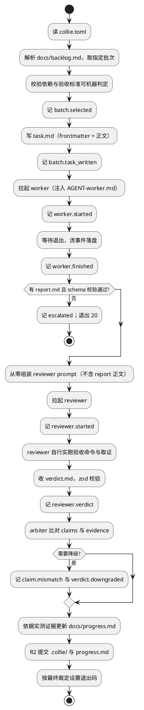

# Collie SPEC

> Agent 团队编排器。本文件是**唯一方案来源**（Single Source of Truth）。
> 唯一可修改者：R1 方案设计 Agent，且须用户批准。其他角色只读。
> 与本文件冲突时以本文件为准。

版本：v0.1
更新时间：2026-10-16
仓库：https://github.com/CIPFZ/Collie
配套文档：[ROADMAP.md](./ROADMAP.md)（版本路线）、[ROLES.md](./ROLES.md)（角色与权限）、[CONSTRAINTS.md](./CONSTRAINTS.md)（铁律）

---

## 1. 定位与范围

### 1.1 要解决的问题

用户有一个想法时，流程是：与好模型讨论可行性与技术方案，产出 SPEC、AGENT 手册、
图标、决策文档；再下发给工作 Agent 分阶段实现；完成后由审核 Agent 对照目标与现状
给出下一步。真正消耗用户时间的不是决策本身，而是**在多个 agent 窗口之间搬运上下文**
——每次搬运都要重新进入上下文。

Collie 的目标：把用户的输入位置收敛到一个入口，并让「不需要用户的轮次」根本不惊动用户。
用户只保留头（需求阐述与方案讨论）与尾（裁决）。

### 1.2 定位

**Collie 是 agent 与工程之间的胶水。**
不是 agent 编排平台，不是通用 workflow 引擎，不是 agent 框架。

它的全部工作是：取批次、拉起 Agent、看活性、比对证据、写轨迹、决定升级。

护城河在于粘合 agent 侧与工程侧的四个阻抗不匹配（自然语言对可验证事实、
易失会话对持久仓库、无身份对需权限、自觉完成对可判定完成）。
详见 ROADMAP 第 0 章「定位与护城河」，其中 0.3 给出了判断是否走偏的指标，
0.5 给出了泛化的硬边界。

### 1.3 范围

v0.1 的范围严格限定为：
- 单项目、单 task、串行执行
- 两个 Agent 角色的单批次闭环（R3 worker + R4 reviewer）
- R2 调度器本体

不在范围内（见 ROADMAP 各版本与永不做清单）：
多项目并发、并行 worker、失败恢复、多批次自动串行、可观测命令、
R1 自动拆批次、R5 体检、安全加固、成本配额。

### 1.4 验证目标

v0.1 只验证一件事：**审核 Agent 的独立取证能否拦住 worker 的虚假汇报。**
这是 Collie 的核心假设，不成立则整个系统价值为零。

## 2. 技术选型

### 2.1 语言与运行时

TypeScript，Node.js 22 LTS，ESM。

选型理由（按项目性质选择，非默认偏好）：
Collie 的核心全部是 Claude Agent SDK 已第一方提供的能力——hooks、`canUseTool`、
session fork、NDJSON 流解析。用 TS 可直接复用，用其他语言等于重造这些机制。
次优为 Python。Shell 不可行：信号阶梯与流解析无法测试。

### 2.2 依赖清单

| 依赖 | 用途 | 许可证 |
|---|---|---|
| `@anthropic-ai/claude-agent-sdk` | 拉起与控制 Agent | 供应商条款，ADR-004 豁免 |
| `commander` | CLI 参数解析 | MIT |
| `zod` | 尾部 JSON 块的 schema 校验 | MIT |
| `smol-toml` | 解析 `collie.toml` | BSD-3-Clause |
| `yaml` | 解析 task.md 的 frontmatter | ISC |
| `vitest` | 测试 | MIT |
| `tsx` | 开发期直接跑 TS | MIT |

开发依赖（devDependencies，批准见 ADR-002）：
`typescript`（锁 `~6.0.x`，Apache-2.0）、`@types/node`、`eslint`、`@eslint/js`、
`typescript-eslint`、`prettier`、`eslint-config-prettier`（均 MIT）。

许可证红线（ADR-003）：运行时依赖仅接受 MIT / Apache-2.0 / BSD / ISC / 0BSD；
开发依赖及其传递层不受白名单约束但禁止强 copyleft（GPL / AGPL / SSPL）。
新增任何依赖必须先写 ADR。
明确不引入：任何编排框架（LangGraph、Temporal 等）、任何可观测框架、任何 ORM。

### 2.3 工程约定

- 严格模式 TypeScript，`strict: true`，禁用 `any`（必要时用 `unknown` + 收窄）
- ESLint + Prettier 零错误
- 包前缀 `@collie/`，CLI 命令名 `collie`
- 所有阈值集中在 `collie.toml`，代码中禁止裸写数字；
  由 ESLint `no-magic-numbers` 在 `src/**` 强制执行（放行 0 / 1 / -1），见 ADR-002
- 结构不变量（如批次条目 1~3）属 schema 定义，以具名常量写在 `src/schema/`，不进 toml
- 测试放在 `test/`，不放进 `src/`（测试需断言 SPEC 默认值，不受 `no-magic-numbers` 约束）
- `.collie/collie.toml` 由 R1 放置并维护（阈值须与本文件 3.1 一致），worker 只读；
  `collie init` 实现后由其从模板生成
- 测试不访问网络、不调用真实模型（用 fake Agent runner）

## 3. 数据模型

所有跨边界结构集中定义在 `src/schema/`，用 zod 声明并导出类型。
`SCHEMA_VERSION = 1`。v0.1 期间以可选字段方式扩展，不升版本、不写迁移；
只有删除或改变已有字段语义时才 bump。

### 3.1 配置

```toml
# .collie/collie.toml
schema_version = 1

[project]
name = "collie"
repo = "https://github.com/CIPFZ/Collie"

[agent.worker]
model = "claude-opus-4-6"
allowed_tools = ["Read", "Write", "Edit", "Glob", "Grep", "Bash"]
max_turns = 120
permission_mode = "bypassPermissions"   # v0.1 裁定，见下

[agent.reviewer]
model = "claude-opus-4-6"
allowed_tools = ["Read", "Glob", "Grep", "Bash"]   # 无 Write/Edit：物理上无法改代码
max_turns = 60
permission_mode = "bypassPermissions"

[limits]
stall_secs = 90          # 事件流静默判定卡死（v0.2 生效）
progress_secs = 900      # 有事件但无产出判定空转（v0.2 生效）
wallclock_secs = 2700    # 单批次墙钟硬顶
resume_max = 2           # resume 上限（v0.2 生效）
fix_max = 2              # 同批次 FIX 上限（v0.3 生效）
dry_k = 2                # 连续 dry 轮数（v0.5 生效）
ci_wait_secs = 1800      # R2 取证前等待 head_sha 的 CI 出结论的上限；超时按 unknown 处理
ci_poll_secs = 30        # 等待期间查询 CI 的间隔

[verify]
# reviewer 必跑的全局命令，批次级命令在 task 中追加
commands = ["npm run lint", "npm run typecheck", "npm test"]

[ci]
provider = "github-actions"
expected_branch = "main"   # 用于核对 CI 实际监听分支，防止「假全绿」
```

`permission_mode` 取值 `default` / `acceptEdits` / `bypassPermissions`，省略时沿用 SDK 默认（逐次询问）。
**v0.1 裁定（v01-b05）：两个角色都用 `bypassPermissions`。** 无人值守下任何「询问」都等于卡死；
`acceptEdits` 也救不了，worker 必须跑 `npm test` 和 `git commit`。v0.1 的安全围栏不是审批，
而是：`allowed_tools` 白名单（reviewer 物理上无 Write/Edit）、reviewer 在只含 head_sha 的 worktree 里运行、
`max_turns` 与 `wallclock_secs` 硬顶、铁律 19 的受保护文件由 R2 事后取证（规则 2）。
细粒度门控（hook / 容器）是 v1.0 的议题，不在这里补。

### 3.2 批次（Batch）

来源：`docs/backlog.md`，由 R1 维护。Markdown 表格 + 每批次一个小节。

```ts
interface Batch {
  id: string;              // 如 "v01-b03"
  title: string;
  priority: number;        // 小者先，R1 一次排定
  depends_on: string[];    // 依赖的批次 id
  items: string[];         // 1~3 个条目，超过 3 个由 R1 拆分
  acceptance: Acceptance[];// 必须可机器判定
  forbidden: string[];     // 本批次额外禁止项
  status: 'pending' | 'running' | 'passed' | 'blocked';
}

interface Acceptance {
  desc: string;
  cmd: string;             // 可执行命令，禁止形容词式验收
  expect: 'exit_zero' | { stdout_matches: string };
}
```

`expect` 刻意不提供 `exit_nonzero`：负向检查必须写成正向命令
（如 `! grep -q pattern file`），期望仍为 `exit_zero`。
原因：统一为「命令成功即通过」，避免 verify.ts 与 reviewer 对退出码语义各自解释。

硬约束：`acceptance[].cmd` 必须是可执行命令。无法写成命令的验收标准，
R1 必须停下来与用户重新讨论，不得进入执行环节。

验收命令的能力边界（v01-b01 bootstrap 实测得出）：
命令只能证明「绿」，不能证明「测了该测的」。一个只写 `expect(true)` 的测试文件
也能让 `npm test -- xxx` 通过。因此 task 中的「测试内容要求」由 R4 读测试代码核验，
这是 AGENT-reviewer.md 第 4 节「该写的测试没写」盲区的既定处理方式。

验收命令的可移植性约定（v01-b01 后追加）：
- 测试过滤**写完整文件路径**（`npm test -- test/schema.test.ts`），不用子串；
  子串过滤在出现同名片段的文件后，证明的内容会悄悄变化
- `grep` 只用 POSIX ERE，禁用 `\s` `\d` 等 GNU 扩展（macOS 语义不同）；
  空白用 `[[:space:]]`
- 命令须在 Linux 与 macOS 上语义一致，R1 签发前自测

**验收命令的唯一执行形式（v01-b02 后追加）：以 `parseBacklog` 的输出为准。**
Markdown 表格中的 `\|` 是 GFM 转义，原样粘进 shell 时 grep 会把 `\|` 当普通字符，
导致本应拦截违规的命令放行（v01-b02 实测）。因此：
- `verify.ts` 与 R4 执行验收时必须读 `parseBacklog` 解析后的 `cmd`（`\|` 已还原）
- 人工执行时须先经 `collie show <batch>` 打印解析后命令，不得从 `.md` 源码复制
- `AGENT-reviewer.md` 第 2 节同步此要求

### 3.3 任务信封（task.md）

R2 写，R3 读。Markdown 正文 + YAML frontmatter。

```markdown
---
schema_version: 1
run_id: r-0007
batch_id: v01-b03
base_sha: a1b2c3d4e5f6a7b8c9d0e1f2a3b4c5d6e7f8a9b0
created_at: 2026-10-16T12:00:00Z
attempt: 1
interrupted_at: null        # v0.2：上一轮中断位置，仅 R2 知道
issued_by: collie           # collie run 签发时必填为 collie；人工签发写 human-placeholder-r2。AGENT-worker 第 6 节据此决定是否等计划确认
revised_at: null            # 可选：重签时间，未重签为 null 或省略
---

# 批次 v01-b03：事件日志写入

## 你的身份与边界
（由 AGENT-worker.md 承载，此处只做本批次提醒）

## 本批次条目（1~3 个）
1. ...

## 验收标准（可机器判定）
| 说明 | 命令 | 期望 |
|---|---|---|

## 本批次额外禁止
- ...

## 汇报要求
完成后写 `.collie/batches/v01-b03/report.md`，固定四段 + 尾部 JSON 块。
```

`base_sha` 约定：指向**签发本 task 前的最后一个提交**。task.md 自身的提交
（只触及 `.collie/batches/`）位于 `base_sha..head_sha` 之内，但不属于 worker 产出；
R4 取证与 arbiter 的受保护文件检查只针对 worker 的提交。
R1/R2 若在签发后又修改了 SPEC 等文档，必须重新签发 task 并更新 `base_sha`。

frontmatter 中的 sha 字段**必须加引号**：形如 `1234567e10` 的 sha 会被 YAML 解析为数字。
Collie 生成时自动加引号；人工签发时手动加。

`wallclock_secs` 的执行点（v01-b02 计划反馈后裁定）：由 **R2** 执行，不进 `RunOptions`。
理由：墙钟是编排层的预算闸，runner 只负责「拉起并返回」；放进 runner 接口会让
每个 runner 实现各自解释超时语义。R2 在 `runWorker` 外层以 `AbortSignal.timeout` 包裹，
超时即进入信号阶梯（v0.2），v0.1 先只记 `worker.crashed` 事件并以非零退出码返回。
`AgentRunner.run` 的 `RunOptions` 增加可选 `signal?: AbortSignal`，供 R2 传入。

### 3.4 汇报信封（report.md）

R3 写，R2 读，**R4 不读**。Markdown 四段正文 + 尾部围栏 JSON。

正文四段固定为：做了什么 / 测试结果 / 偏离或疑问 / 下一步建议。

尾部 JSON 块（R2 用 zod 校验）：

```json
{
  "schema_version": 1,
  "batch_id": "v01-b03",
  "head_sha": "e4f5a6b7c8d9e0f1a2b3c4d5e6f7a8b9c0d1e2f3",
  "claims": {
    "commits": ["e4f5a6b7c8d9e0f1a2b3c4d5e6f7a8b9c0d1e2f3"],
    "tests_passed": 47,
    "tests_failed": 0,
    "pushed": true,
    "ci_passed": true,
    "new_deps": [],
    "spec_touched": false
  },
  "open_questions": []
}
```

`claims` 下所有字段的语义是「worker 的声称」，**默认不可信**，须经 R4 取证核对。

字段说明（v01-b02 计划反馈后补充）：
- `head_sha`：**最后一个代码提交**的 sha，不含随后的 `report(collie):` 信封提交。
  R4 取证范围为 `base_sha..head_sha`，信封提交不在其中
- `ci_passed`（可选，缺失视为 `false`）：worker 声称 CI 已对 `head_sha` 实际触发且通过。
  此字段使场景 A 成为真正的「声称 vs 实测」比对（arbiter 规则 7 据此与 `ci_branch_matched` /
  `ci_conclusion` 对照），而非只检查 CI 本身是否通过
- sha 字段均须匹配 `/^[0-9a-f]{7,40}$/`

### 3.5 裁决信封（verdict.md）

R4 写，R2 读。Markdown 推理正文 + 尾部围栏 JSON。

```json
{
  "schema_version": 1,
  "batch_id": "v01-b03",
  "verdict": "PASS",
  "evidence": {
    "commits_actual": ["e4f5g6h"],
    "verify_results": [
      { "cmd": "npm test", "exit_code": 0, "summary": "47 passed, 0 failed" }
    ],
    "remote_has_head": true,
    "ci_conclusion": "success",
    "ci_run_url": "https://...",
    "ci_branch_matched": true,
    "deps_diff": [],
    "spec_diff_lines": 0
  },
  "claim_mismatches": [],
  "gaps": [],
  "reason": "三项验收标准均由实测命令确认"
}
```

关键规则：`verdict` 三值不用约束解码强制（结构约束会损害推理质量），
而是由 R2 解析尾部 JSON 并用 zod 校验；解析失败按 BLOCK 处理。

字段约定（v01-b03 后）：`ci_conclusion` 取 `success | failure | cancelled | unknown`，
`ci_branch_matched` 为 `boolean | null`（`null` = 未能取证），`ci_run_url` 可为空串；
`conditions?: string[]` 可选，非空表示 PASS 附条件。arbiter 把 `ci_branch_matched=null`
视为未取证：若 `claims.ci_passed=true` 则按规则 7 降 FIX。
reviewer 交付方式：无写工具，verdict 正文作为**最终回复文本**返回，
`RunResult.finalText` 承载，由 R2 写入 `verdict.md`。
reviewer 在检出于 `head_sha` 的独立 worktree 中工作，该 worktree 不含 `report.md`。

### 3.6 事件日志

`.collie/runs/<run_id>/events.ndjson`，append-only，每行一个事件。
这是 R2 的唯一状态源——R2 无状态可重启，崩溃恢复 = 重放此文件。

```ts
type JsonValue = string | number | boolean | null | JsonValue[] | { [k: string]: JsonValue };

interface Event {
  ts: string;              // ISO8601
  run_id: string;          // 用作路径段，须匹配 /^[A-Za-z0-9][A-Za-z0-9._-]*$/
  batch_id?: string;
  event: EventType;
  [key: string]: JsonValue | undefined;  // 扩展字段限 JSON 值，保证 replay(append(e)) 深相等
}

type EventType =
  | 'run.started' | 'run.finished'
  | 'batch.selected' | 'batch.task_written'
  | 'worker.started' | 'worker.finished' | 'worker.crashed'
  | 'reviewer.started' | 'reviewer.verdict'
  | 'claim.mismatch' | 'verdict.downgraded'
  | 'escalated'
  | 'ci.wait_timeout';   // 等 CI 超过 ci_wait_secs 仍无结论；字段 head_sha / waited_secs / last_state
// worker.finished 携带 exit_code 与 final_text（worker 最终回复，截断至 2000 字），
// 否则零产出退出的原因无从得知（v01-b05-smoke 教训）。
```

v0.1 只需支持上列事件；v0.2 起追加 `worker.stalled` / `worker.idling` /
`worker.signaled` / `worker.rescued` / `worker.resumed`。

## 4. 模块设计

```
src/
  cli.ts                  命令入口（commander）
  config.ts               读 collie.toml，校验，提供类型化配置
  schema/
    index.ts              SCHEMA_VERSION 与全部 zod schema
    envelope.ts           task / report / verdict 的读写与校验
  backlog.ts              解析 docs/backlog.md 为 Batch[]
  journal.ts              events.ndjson 的追加与重放
  git.ts                  git 命令封装（status/log/diff/ls-remote/commit）
  ci.ts                   CI 实际结论查询（gh CLI）
  runner/
    index.ts              Agent 拉起的统一接口（便于 fake 替换）
    claude.ts             基于 Claude Agent SDK 的真实实现
    fake.ts               测试用，按脚本返回预设结果
  roles/
    worker.ts             组装 task.md、拉起 worker、收 report
    reviewer.ts           组装审核 prompt、拉起 reviewer、收 verdict
  verify.ts               实跑验收命令并结构化输出
  arbiter.ts              claim 比对与 verdict 降级裁定
  progress.ts             依据实测证据写 docs/progress.md
```

### 4.1 `runner` 抽象的必要性

所有 Agent 调用必须经 `runner` 接口，禁止在 roles 中直接调 SDK。
两重理由，后者更本质：

1. **可测试性。** v0.1 的三个验证场景需要在不花钱、不联网的条件下可重复执行，
   `fake.ts` 按脚本返回「假 CI 全绿的 report」等预设结果。
2. **它是胶水与 agent 侧的解耦层。** Collie 的价值与「被粘的两端」解耦——
   今天是 Claude Code，明天可能是另一个 agent CLI。这个抽象做干净，
   Collie 就不绑定在任何一家的 CLI 上。详见 ROADMAP 0.4。

实现约束：任何 agent 侧的特有概念（session id、权限模式、模型名、流事件格式）
不得泄漏到 `roles/` 与 `arbiter.ts` 之外的模块。

```ts
interface AgentRunner {
  run(opts: {
    role: 'worker' | 'reviewer';
    prompt: string;
    systemPrompt: string;
    allowedTools: string[];
    cwd: string;
    maxTurns: number;
    onEvent?: (e: unknown) => void;   // NDJSON 逐行回调
  }): Promise<{ exitCode: number; sessionId?: string; usage?: Usage; finalText?: string }>;
}
```

### 4.2 reviewer 的干净上下文保证

reviewer 的 prompt 由 `roles/reviewer.ts` 从零组装，只允许包含：
- `AGENT-reviewer.md` 作为 system prompt
- 本批次 `task.md` 的验收标准与条目
- `SPEC.md` 的相关章节引用（给路径，让它自己读）
- diff 指针 `base_sha..head_sha`

**禁止**包含：`report.md` 正文、worker 的会话历史、worker 的 session id。
这条由代码保证（reviewer.ts 不接收 report 正文参数），不靠提示词约束。

### 4.3 arbiter 的强制降级

```
输入：report.claims + R2 自测的 evidence + verdict.verdict
规则（按顺序，命中即停）：
1. verdict 尾部 JSON 解析或校验失败            → BLOCK
2. evidence.spec_diff_lines > 0                → BLOCK
3. evidence.deps_diff 含未经 ADR 批准的运行时依赖，
   或任何树出现强 copyleft（ADR-003）         → BLOCK
4. claim_mismatches 非空                       → 若 verdict=PASS 则降为 FIX
5. claims.pushed=true 但 remote_has_head=false → FIX + 记 claim.mismatch
6. claims.tests_* 与 verify_results 不一致     → FIX + 记 claim.mismatch
7. claims.ci_passed=true 但 ci_conclusion≠success
   或 ci_branch_matched=false                  → FIX + 记 claim.mismatch
8. 否则采用 verdict 原值
```

规则 7 的来源是一次真实教训：某仓库 CI 配置监听 `main` 而实际用 `master`，
导致 M0 到 M6 全程「CI 全绿」其实从未触发过。此类失败在自动循环中会被放大，
因为中间再没有人亲自核验远端。
规则 7 是「声称 vs 实测」的比对而非仅检查 CI 状态：`claims.ci_passed` 为 worker 的声称，
`ci_conclusion` 与 `ci_branch_matched` 为实测值。

**证据来源（v01-b04 裁定）：arbiter 只依据 R2 自己用 `verify.ts` / `git.ts` / `ci.ts` 测出的 evidence，
不使用 reviewer 报上来的 evidence。** 理由：reviewer 也是 LLM，可能被 worker 的产物误导；
若仲裁采信它的 evidence，被骗的 reviewer 照抄 worker 说法即可让三个场景全部漏过（变异测试已证实）。
reviewer 的 evidence 原样保存在 `verdict.md` 供人对照，但不参与仲裁。
reviewer 的价值是「判断」（`verdict` 三值与 `gaps`），事实由 R2 自己测。

## 5. CLI 接口

v0.1 只提供三个命令。

```
collie init                      在当前仓库创建 .collie/ 与配置模板
collie run <batch_id>            跑一个批次的完整闭环（worker → reviewer → 裁定）
collie show <batch_id>           打印该批次的 task / report / verdict 与裁定过程
```

`collie run` 的退出码：
- `0`：PASS
- `10`：FIX
- `20`：BLOCK
- `1`：Collie 自身错误

## 6. 执行流程（v0.1）



## 7. 里程碑

v0.1 分三个批次，优先级已排定（见 `docs/backlog.md`）。

| 批次 | 内容 | 验收 |
|---|---|---|
| v01-b01 | 工程骨架 + schema + journal + config | lint/typecheck/test 零错误；schema round-trip 测试通过 |
| v01-b02 | backlog 解析 + task 生成 + fake runner + worker 角色 | 用 fake runner 跑通 task→report 并通过校验 |
| v01-b03 | reviewer 角色 + verify + ci + arbiter + CLI | 三个验证场景全部被拦住 |

## 8. v0.1 验收：三个必须被拦住的场景

这三个场景是 v0.1 的唯一通过标准，用 `fake.ts` 构造，必须自动化可重跑。

**场景 A 假 CI 全绿。** fake worker 产出 `claims.pushed=true` 且 `claims.ci_passed=true`，
但 `ci.ts` 查到的实际 run 监听分支与 `expected_branch` 不符（或根本无 run）。
期望：`claims.ci_passed=true` 与实测 `ci_branch_matched=false`（或 `ci_conclusion≠success`）不符
→ 裁定为 FIX，事件日志有 `claim.mismatch`。本场景验证的是声称与事实的比对，不只是 CI 状态。

**场景 B 假测试数。** fake worker 声称 `tests_passed=47, tests_failed=0`，
而 `verify.ts` 实跑结果为 3 个失败。
期望：claims 与 verify_results 不一致 → 裁定为 FIX，事件日志有 `claim.mismatch`。

**场景 C 偷改 SPEC。** fake worker 的 diff 中包含 `SPEC.md` 的修改。
期望：`spec_diff_lines > 0` → 直接 BLOCK，不理 verdict 原值。

补充要求：三个场景都必须验证 `collie run` 的退出码正确，
且 `collie show` 能完整还原裁定过程与证据链。

## 9. 明确不做

v0.1 不做下列内容，防止范围蔓延：

- 任何失败恢复、resume、信号阶梯（v0.2）
- 多批次自动串行、分级放行、返工闸（v0.3）
- `status` / `timeline` / `watch` / `why` 命令（v0.4）
- 完成判定与 dry 信号（v0.5）
- R5 体检（v0.6）、R1 自动拆批次（v0.7）
- 容器隔离、网络白名单、配额感知、成本账本、通知（v1.0）
- 永不做：并行写入、多项目共享、Agent 自判是否求助、自建框架、
  工具级审批交给人、可观测框架

## 10. 开放问题

| 编号 | 问题 | 现状 |
|---|---|---|
| Q1 | reviewer 实跑验收命令时，是否需要独立 worktree 以免污染 worker 的工作区？ | v0.1 串行执行，worker 已退出，暂不需要。若 v0.3 出现问题再议 |
| Q2 | `docs/backlog.md` 用 Markdown 表格是否足够？是否需要独立的结构化文件？ | 先用 Markdown（R1 与人都要读写）。若解析脆弱则改为 frontmatter 承载结构 |
| Q3 | `collie.toml` 放 `.collie/` 下还是仓库根？ | 暂定 `.collie/` 下，与运行时文件同域 |
| Q4 | 完成判定的四种判据，最终选哪个？ | 按用户要求保留全部，v0.5 起记录对比数据后再定 |
